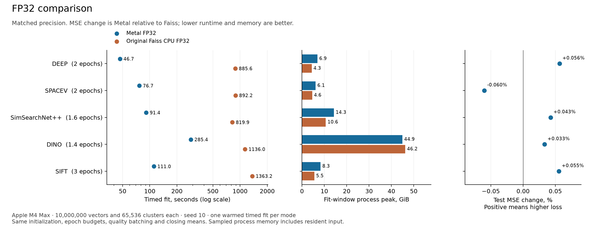
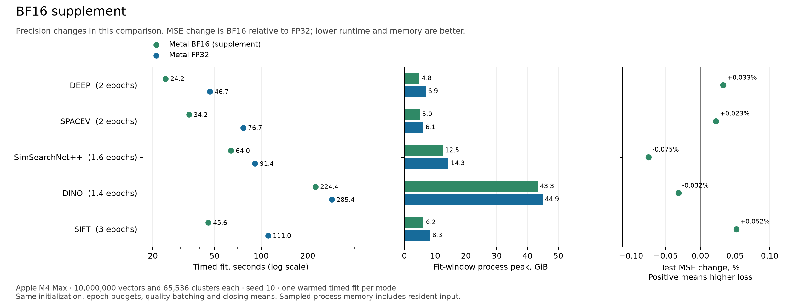

# E-means on five 10M datasets: Metal and original Faiss CPU

Validation: **complete**, 15/15 accepted records. Each dataset has 10,000,000 training vectors, 65,536 centroids, and seed 10. This is a single-seed comparison; there are no error bars or claims of statistical significance.

## FP32 comparison

Both primary implementations use FP32 input, centroid state and assignment operands. CPU/Metal is original Faiss NumpyEmeans time divided by Metal FP32 time. Lower MSE is better; positive MSE change means Metal has higher error.

| Dataset | d | Epochs | Metal FP32 (s) | Faiss FP32 (s) | CPU/Metal | Metal test MSE | Faiss test MSE | Change |
|---|---:|---:|---:|---:|---:|---:|---:|---:|
| DEEP | 96 | 2 | 46.732 | 885.553 | 18.95× | 0.34234220 | 0.34214898 | 0.056% |
| SPACEV | 100 | 2 | 76.705 | 892.162 | 11.63× | 6381.19034911 | 6385.02336835 | -0.060% |
| SimSearchNet++ | 256 | 1.6 | 91.350 | 819.943 | 8.98× | 109507.84171950 | 109461.20750538 | 0.043% |
| DINO10B prefix | 1024 | 1.4 | 285.428 | 1135.956 | 3.98× | 0.01122755 | 0.01122381 | 0.033% |
| SIFT | 128 | 3 | 111.043 | 1363.202 | 12.28× | 0.19292923 | 0.19282239 | 0.055% |

| Dataset | Metal footprint / RSS (GiB) | Faiss footprint / RSS (GiB) | Metal train-sample MSE | Faiss train-sample MSE |
|---|---:|---:|---:|---:|
| DEEP | 6.924 / 3.985 | 4.342 / 4.373 | 0.33063445 | 0.32993702 |
| SPACEV | 6.089 / 4.105 | 4.556 / 4.592 | 6282.25833348 | 6272.35104358 |
| SimSearchNet++ | 14.302 / 10.151 | 10.646 / 10.668 | 107553.82959856 | 107560.72110199 |
| DINO10B prefix | 44.907 / 9.956 | 46.197 / 46.224 | 0.01006349 | 0.01006091 |
| SIFT | 8.296 / 5.227 | 5.529 / 5.562 | 0.17447211 | 0.17410399 |

## BF16 supplement: changed precision

The supplemental Metal path rounds assignment operands and statistics inputs to BF16, with FP32 accumulation, norms, scores and centroid state. Its comparison below is against Metal FP32 only; it is not a matched-precision CPU speedup.

| Dataset | BF16 (s) | Metal FP32/BF16 | BF16 footprint / RSS (GiB) | MLX peak active (GiB) | BF16 test MSE | vs FP32 | BF16 train-sample MSE |
|---|---:|---:|---:|---:|---:|---:|---:|
| DEEP | 24.173 | 1.93× | 4.847 / 3.954 | 4.246 | 0.34245518 | 0.033% | 0.33038734 |
| SPACEV | 34.221 | 2.24× | 5.013 / 4.112 | 4.409 | 6382.62788785 | 0.023% | 6288.02782495 |
| SimSearchNet++ | 63.993 | 1.43× | 12.468 / 10.156 | 11.304 | 109425.90499637 | -0.075% | 107546.30631794 |
| DINO10B prefix | 224.356 | 1.27× | 43.273 / 8.692 | 41.103 | 0.01122398 | -0.032% | 0.01005616 |
| SIFT | 45.645 | 2.43× | 6.230 / 5.250 | 5.550 | 0.19302907 | 0.052% | 0.17423261 |

## Preparation and lifetime memory diagnostics

These process lifetime peaks include loading, preparation and warmup where applicable. They are not the matched fit-window measurements above, and do not include scoring after the fit. For DINO, two FP32 input copies alone require 76.3 GiB before host release, plus other allocations. Fit-window peaks alone do not describe the memory needed to prepare this workload.

| Dataset / mode | Lifetime peak through preparation (GiB) | Lifetime peak through timed fit (GiB) |
|---|---:|---:|
| DEEP / metal-fp32 | 7.603 | 8.912 |
| DEEP / faiss-fp32 | 3.770 | 4.398 |
| DEEP / metal-bf16 | 7.600 | 8.353 |
| SPACEV / metal-fp32 | 7.905 | 9.222 |
| SPACEV / faiss-fp32 | 3.923 | 4.585 |
| SPACEV / metal-bf16 | 7.904 | 8.654 |
| SimSearchNet++ / metal-fp32 | 19.645 | 19.645 |
| SimSearchNet++ / faiss-fp32 | 9.807 | 10.646 |
| SimSearchNet++ / metal-bf16 | 19.644 | 19.644 |
| DINO10B prefix / metal-fp32 | 77.356 | 77.356 |
| DINO10B prefix / faiss-fp32 | 39.455 | 46.197 |
| DINO10B prefix / metal-bf16 | 78.101 | 78.101 |
| SIFT / metal-fp32 | 10.023 | 10.023 |
| SIFT / faiss-fp32 | 4.990 | 5.949 |
| SIFT / metal-bf16 | 10.022 | 10.022 |

DINO's observed process lifetime footprint through preparation was metal-fp32: 77.356 GiB; metal-bf16: 78.101 GiB. These measurements include allocations beyond the two input copies.





## Protocol and limits

The explicit quality batch law matches pinned `paper_xb.py` for the 10M regime. DEEP and SPACEV use two epochs, SimSearchNet++ 1.6 and DINO 1.4: these are Table 4 aggregate crossing budgets applied as fixed local budgets, not recovered per-seed stopping points. SIFT uses an explicit local three-epoch budget; SIFT is absent from Table 4. No H100 timing or reproduction claim is made.

Each mode runs in a fresh process with one full untimed warmup and resident FP32 input. Preparation, validation, upload, cache clearing, host centroid export and scoring are outside the timer. A timed fit includes a new model, permutations, updates, revival, history, online int64 assignments, closing final-pass means and synchronization. Original CPU recipe/state setup remains inside its unmodified train call; Metal preparation (including its FP32 global-mean assignment origin) is outside, with signature checks inside. CPU and BF16 assignment do not require that mean. A first timed call below two seconds triggers three timed calls; otherwise there is one. Time is their median; quality comes from the first timed fit.

The original CPU implementation uses Faiss IndexFlat with eight OpenMP threads and unrestricted Accelerate. Metal FP32 assignment subtracts a global mean; original Faiss and Metal BF16 operate in original coordinates. Parallel reductions, equivalent EMA formulas, objective/count precision, and revival sampling arithmetic and random-number consumption differ. Identical initialization, recipe and seed do not imply bitwise-identical trajectories.

Test MSE and the 10,000-row evenly spaced training-sample MSE use the same FP32 Faiss nearest-center assignment followed by direct FP64 residual evaluation. The training statistic is not full-training MSE. Dataset verification covers all test rows and 1,000 evenly spaced training fingerprints, not a complete training-file hash. DINO and SIFT retain the pinned /4096 and /512 scaling. Published splits preserve known duplicate vectors shared between evaluation and training: combined validation-plus-test overlaps are DEEP 4 and SPACEV 45 at 10M. These counts are not test-only counts, and the holdouts are not claimed to be duplicate-disjoint.

Process physical footprint and RSS are sampled every 10 ms between the fit handshakes, including the resident-input baseline. Values shown are the maximum sampled peak over timed calls; short peaks can be missed and the measured maximum sample gap is retained in CSV/raw evidence. Baseline and peak increase are separately exported as maxima over calls and need not belong to the same call. MLX peak active allocation is a separate allocator statistic, not process memory. Metal releases its full NumPy input reference after preparation; CPU retains its contiguous input. Warmup and preparation transients are excluded; the raw post-preparation process snapshot includes lifetime diagnostics and is not a fit-window peak. DINO's resident FP32 input alone is 38.147 GiB.

## Evidence and reproduction

The [frozen protocol](../benchmarks/e_means/large_protocol.json) records dataset fingerprints, scaling, budgets and recipe constants. [Validation manifest](../benchmarks/e_means/results/large_comparison/validation.json) records raw SHA-256 values, coverage, source hashes and exclusions; [CSV](../benchmarks/e_means/results/large_comparison/summary.csv) retains numerical values and raw paths. Runtime snapshot: [Metal v3 archive](../benchmarks/e_means/reference/metal-v3-source.zip) (SHA-256 `c24dfaf84b3a75c1d741fb1708bb37addda013dc9301d9d6b3166d5f52077413`). The [shared source archive](../benchmarks/e_means/reference/large-comparison-source.zip) also preserves the exact benchmark driver, loader, memory sampler and protocol (SHA-256 `a61613a6c3dabb59690545d9a4b43796c6b104b8e817f502558ee1279287cf39`). Original Faiss revision: `ebab8f784c1d177129602269d5ad966c525fbdcb`.

The full-DINO [index-boundary probe](../benchmarks/e_means/results/large_validation/dino-index-boundaries.json) and [probe source](../benchmarks/e_means/large_index_probe.py) check exact FP32/BF16 gathers at rows 0, 4,194,303/4,194,304, 8,388,607/8,388,608 and 9,999,999, across 2³²-element offsets. This correctness probe is excluded from performance measurements.

The [preflight record](../benchmarks/e_means/results/large_validation/preflight.json) records the three-mode smoke test, imported runtime paths and source/environment checks before the campaign.

```sh
.venv/bin/python benchmarks/e_means/large_compare.py
.venv/bin/python benchmarks/e_means/large_report.py --require-complete
```

Recorded host and software:

```json
{
  "hardware": {
    "cpu": "Apple M4 Max",
    "machine": "arm64",
    "platform": "macOS-26.6.2-arm64-arm-64bit-Mach-O",
    "ram_bytes": 137438953472
  },
  "versions": {
    "faiss-cpu": "1.16.0",
    "h5py": "3.16.0",
    "mlx": "0.32.4",
    "numpy": "2.5.4",
    "python": "3.14.2",
    "scikit-learn": "1.9.1",
    "scipy": "1.18.1"
  }
}
```

| Dataset | Metal FP32 evidence | Faiss FP32 evidence | Metal BF16 evidence |
|---|---|---|---|
| DEEP | [raw JSON](../benchmarks/e_means/results/large_comparison/deep1b-10M-metal-fp32-s10-eca32295d2e3.json) | [raw JSON](../benchmarks/e_means/results/large_comparison/deep1b-10M-faiss-fp32-s10-75934d285698.json) | [raw JSON](../benchmarks/e_means/results/large_comparison/deep1b-10M-metal-bf16-s10-739038086240.json) |
| SPACEV | [raw JSON](../benchmarks/e_means/results/large_comparison/spacev-10M-metal-fp32-s10-7bc0aa5c530c.json) | [raw JSON](../benchmarks/e_means/results/large_comparison/spacev-10M-faiss-fp32-s10-bddcef488f27.json) | [raw JSON](../benchmarks/e_means/results/large_comparison/spacev-10M-metal-bf16-s10-affa76605e4b.json) |
| SimSearchNet++ | [raw JSON](../benchmarks/e_means/results/large_comparison/fb-ssnpp-10M-metal-fp32-s10-b6abca833aad.json) | [raw JSON](../benchmarks/e_means/results/large_comparison/fb-ssnpp-10M-faiss-fp32-s10-2aba9f1957b3.json) | [raw JSON](../benchmarks/e_means/results/large_comparison/fb-ssnpp-10M-metal-bf16-s10-c074e37a3710.json) |
| DINO10B prefix | [raw JSON](../benchmarks/e_means/results/large_comparison/dino10b-10M-div4096-metal-fp32-s10-c7c8c99cbae4.json) | [raw JSON](../benchmarks/e_means/results/large_comparison/dino10b-10M-div4096-faiss-fp32-s10-fcf9c6b8f1a9.json) | [raw JSON](../benchmarks/e_means/results/large_comparison/dino10b-10M-div4096-metal-bf16-s10-ef5a75daebe3.json) |
| SIFT | [raw JSON](../benchmarks/e_means/results/large_comparison/sift1b-10M-div512-metal-fp32-s10-b35c5d47e8ba.json) | [raw JSON](../benchmarks/e_means/results/large_comparison/sift1b-10M-div512-faiss-fp32-s10-07aab498d460.json) | [raw JSON](../benchmarks/e_means/results/large_comparison/sift1b-10M-div512-metal-bf16-s10-c8a34ba0ba17.json) |
