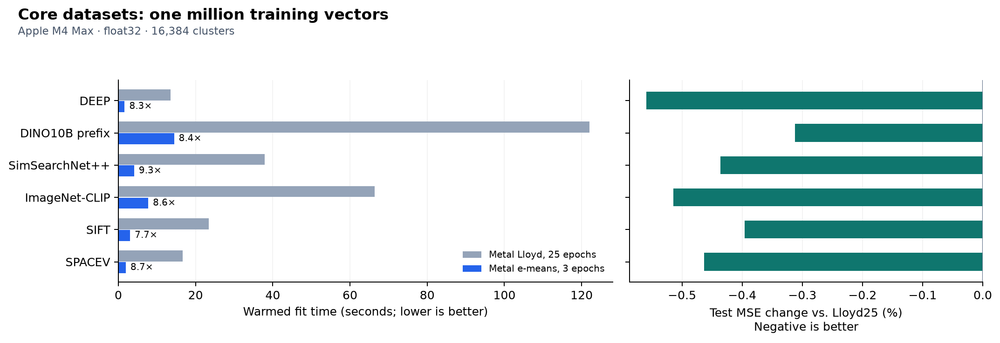
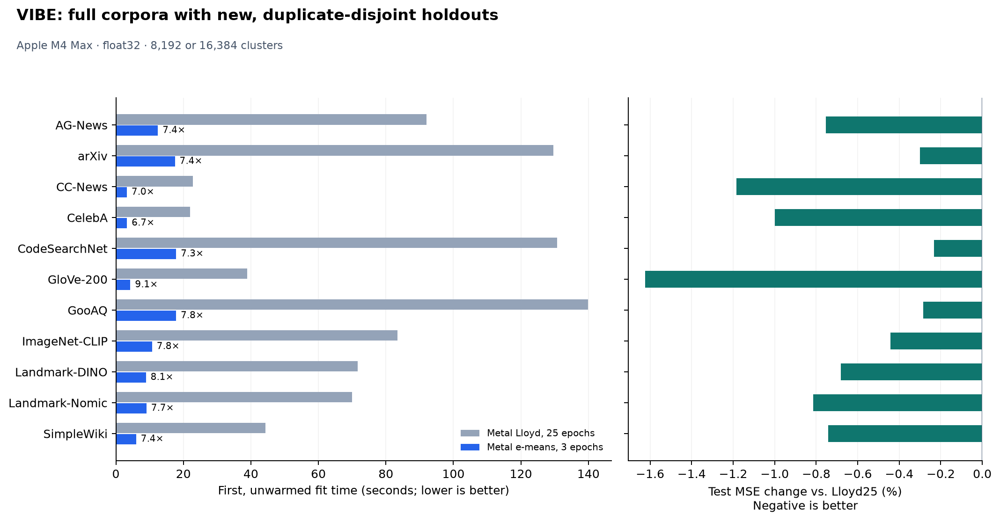
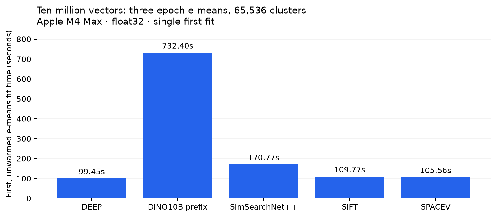

# e-means on Apple Silicon — benchmark evidence

Recorded campaign: 2026-11-14.

On the recorded Apple Silicon machine, **three-epoch e-means** ran **7.73–9.26× faster** than **25-epoch Metal Lloyd** in the paired core configurations. E-means had equal or lower test MSE in **6/6** configurations. These are measured fixed-budget comparisons; the tables state the budgets, seeds, and repetition counts. They are not H100 speedup estimates or an exhaustive search for the first equal-quality epoch.

Machine: **Apple M4 Max**, 128 GiB unified RAM; `macOS-26.6.2-arm64-arm-64bit-Mach-O`. GPU: `Apple M4 Max`.

Software: python 3.14.2, numpy 2.5.4, scipy 1.18.1, mlx 0.32.4, scikit-learn 1.9.1, faiss-cpu 1.16.0, h5py 3.16.0.

Recorded Metal assignment precision: **float32**. EMA state and accumulated statistics use float32. Reduced precision is never selected implicitly.

## One-million-row core datasets

These rows use the actual paper corpora at one million training vectors and 16,384 clusters, comparing **three-epoch e-means with 25-epoch Metal Lloyd**. Each timing is linked to raw JSON. SIFT1M follows the same prefix/split protocol but has no released 1M fingerprint; the other core splits are fingerprint-verified against Faiss.

Completed records use seeds 10; timed fits per configuration: 3. Each has one full untimed warm-up.

| Dataset | Rows × dimensions; k | E-means (s) | Lloyd25 (s) | Speedup | Test MSE change | Seeds; timed fits E/L |
|---|---:|---:|---:|---:|---:|---|
| DEEP | 1,000,000 × 96; 16,384 | [1.631](../benchmarks/e_means/results/core1m/deep1b-1M-metal-s10-a7b0fc0d453f.json) | [13.539](../benchmarks/e_means/results/core1m/deep1b-1M-metal-lloyd-s10-3b903c10184b.json) | 8.30× | -0.559% | 10; 3/3 |
| DINO10B prefix | 1,000,000 × 1024; 16,384 | [14.447](../benchmarks/e_means/results/core1m/dino10b-1M-div4096-metal-s10-5f330299a73d.json) | [121.993](../benchmarks/e_means/results/core1m/dino10b-1M-div4096-metal-lloyd-s10-30f6a41f48a6.json) | 8.44× | -0.312% | 10; 3/3 |
| SimSearchNet++ | 1,000,000 × 256; 16,384 | [4.090](../benchmarks/e_means/results/core1m/fb-ssnpp-1M-metal-s10-20cdf1813484.json) | [37.882](../benchmarks/e_means/results/core1m/fb-ssnpp-1M-metal-lloyd-s10-e7d06d669767.json) | 9.26× | -0.436% | 10; 3/3 |
| ImageNet-CLIP | 1,000,000 × 512; 16,384 | [7.745](../benchmarks/e_means/results/core1m/imagenet-clip-512-normalized-metal-s10-eb3694b96c2a.json) | [66.409](../benchmarks/e_means/results/core1m/imagenet-clip-512-normalized-metal-lloyd-s10-a6e7f96e2211.json) | 8.57× | -0.515% | 10; 3/3 |
| SIFT | 1,000,000 × 128; 16,384 | [3.035](../benchmarks/e_means/results/core1m/sift1b-1M-div512-metal-s10-20f29754087c.json) | [23.454](../benchmarks/e_means/results/core1m/sift1b-1M-div512-metal-lloyd-s10-5fd5ea1ac508.json) | 7.73× | -0.396% | 10; 3/3 |
| SPACEV | 1,000,000 × 100; 16,384 | [1.927](../benchmarks/e_means/results/core1m/spacev-1M-metal-s10-9cd1a53aae41.json) | [16.674](../benchmarks/e_means/results/core1m/spacev-1M-metal-lloyd-s10-1afba08bdbb7.json) | 8.65× | -0.464% | 10; 3/3 |

Negative MSE change is better. Timings are medians of synchronized fits; with multiple seeds, the table uses medians of per-seed medians and per-seed speedup ratios. Each linked timing opens its raw result (additional records are in the evidence index).

| Dataset | E-means test MSE | Lloyd25 test MSE |
|---|---:|---:|
| DEEP | 0.387906417 | 0.390088211 |
| DINO10B prefix | 0.0122454897 | 0.0122838139 |
| SimSearchNet++ | 113094.107 | 113589.523 |
| ImageNet-CLIP | 0.211883698 | 0.212979583 |
| SIFT | 0.193764601 | 0.194534497 |
| SPACEV | 7196.03944 | 7229.55305 |



## Seed stability and observed quality crossings

The independent seed campaign repeats three-epoch e-means at seeds 11 and 12. The table combines their completed results with seed 10 and reports the observed MSE range. These rows measure e-means stability. Additional paired speedups would require their own seed-matched Lloyd runs.

Completed records use seeds 11, 12; timed fits per configuration: 1. Each has one full untimed warm-up.

| Dataset | Seeds | Test MSE min | Median | Max | Range / median |
|---|---|---:|---:|---:|---:|
| DEEP | 10, 11, 12 | 0.387226334 | 0.387737733 | 0.387906417 | 0.175% |
| DINO10B prefix | 10, 11, 12 | 0.0122404239 | 0.0122454897 | 0.0122456662 | 0.043% |
| SimSearchNet++ | 10, 11, 12 | 113094.107 | 113116.751 | 113144.214 | 0.044% |
| ImageNet-CLIP | 10, 11, 12 | 0.211883698 | 0.211915714 | 0.21208016 | 0.093% |
| SIFT | 10, 11, 12 | 0.193547237 | 0.193764601 | 0.193784102 | 0.122% |
| SPACEV | 10, 11, 12 | 7190.03674 | 7196.03944 | 7196.07919 | 0.084% |

The convergence campaign uses separate fits at one and two epochs; the primary three-epoch fit supplies the third budget. Each fit has its own cosine schedule. The first successful tested budget is an observed upper bound on a quality crossing, not a search at the paper's 0.2-epoch resolution. Each point uses its recorded median; the different campaigns' sample counts are stated separately.

Completed records use seeds 10; timed fits per configuration: 1. Each has one full untimed warm-up.

| Dataset | Tested epoch budgets | First observed budget at or below local Lloyd25 MSE | Fit seconds | Matched speedup |
|---|---|---:|---:|---:|
| DEEP | 1, 2, 3 | 2 | [0.901](../benchmarks/e_means/results/convergence/deep1b-1M-metal-s10-1a3c1e2dadc1.json) | 15.02× |
| DINO10B prefix | 1, 2, 3 | 2 | [8.215](../benchmarks/e_means/results/convergence/dino10b-1M-div4096-metal-s10-6277974a7ee6.json) | 14.85× |
| SimSearchNet++ | 1, 2, 3 | 2 | [1.876](../benchmarks/e_means/results/convergence/fb-ssnpp-1M-metal-s10-212d859d38c6.json) | 20.19× |
| ImageNet-CLIP | 1, 2, 3 | 2 | [3.833](../benchmarks/e_means/results/convergence/imagenet-clip-512-normalized-metal-s10-a43d66d874b9.json) | 17.32× |
| SIFT | 1, 2, 3 | 2 | [1.190](../benchmarks/e_means/results/convergence/sift1b-1M-div512-metal-s10-799f55e58c69.json) | 19.70× |
| SPACEV | 1, 2, 3 | 3 | [1.927](../benchmarks/e_means/results/core1m/spacev-1M-metal-s10-9cd1a53aae41.json) | 8.65× |

## VIBE: separate evaluation splits

These are the eleven public corpora used in the paper's Appendix D.3. Their full source files were verified by SHA-256. The release does not provide those eleven holdout lists, so this campaign uses a seeded 20,000-row holdout, removes exact matching vectors from training, and scores its second 10,000-row half. The full remaining corpus is used; row counts are shown below. These are new reproducible evaluations, not exact Table 11 reproductions. Cluster count is the power of two nearest to 16√n. The standard paired comparison is **three-epoch e-means versus 25-epoch Metal Lloyd**; any e-means budget override is stated in its row label. Embeddings are used as stored and clustered by squared Euclidean distance.

**Timing scope:** Completed records use seeds 10; timed fits per configuration: 1. Each is a first fit in a fresh process, without a full warm-up; fit-time compilation may be included.

| Dataset | Rows × dimensions; k | E-means (s) | Lloyd25 (s) | Speedup | Test MSE change | Seeds; timed fits E/L |
|---|---:|---:|---:|---:|---:|---|
| AG-News | 749,088 × 1024; 16,384 | [12.444](../benchmarks/e_means/results/vibe/vibe-agnews-metal-s10-7384fa940f93.json) | [92.016](../benchmarks/e_means/results/vibe/vibe-agnews-metal-lloyd-s10-124b825b397b.json) | 7.39× | -0.754% | 10; 1/1 |
| arXiv | 1,324,643 × 768; 16,384 | [17.479](../benchmarks/e_means/results/vibe/vibe-arxiv-metal-s10-a9a4921c94ed.json) | [129.575](../benchmarks/e_means/results/vibe/vibe-arxiv-metal-lloyd-s10-c05a1d71a564.json) | 7.41× | -0.300% | 10; 1/1 |
| CC-News | 475,295 × 768; 8,192 | [3.240](../benchmarks/e_means/results/vibe/vibe-ccnews-metal-s10-246c089407d2.json) | [22.779](../benchmarks/e_means/results/vibe/vibe-ccnews-metal-lloyd-s10-09288d9adb09.json) | 7.03× | -1.183% | 10; 1/1 |
| CelebA | 181,573 × 2048; 8,192 | [3.288](../benchmarks/e_means/results/vibe/vibe-celeba-metal-s10-400ba2a3ee8f.json) | [22.011](../benchmarks/e_means/results/vibe/vibe-celeba-metal-lloyd-s10-621233a6bda7.json) | 6.69× | -0.999% | 10; 1/1 |
| CodeSearchNet | 1,354,065 × 768; 16,384 | [17.842](../benchmarks/e_means/results/vibe/vibe-codesearchnet-metal-s10-052a17704c2a.json) | [130.722](../benchmarks/e_means/results/vibe/vibe-codesearchnet-metal-lloyd-s10-0534517c47d2.json) | 7.33× | -0.233% | 10; 1/1 |
| GloVe-200 | 1,172,514 × 200; 16,384 | [4.277](../benchmarks/e_means/results/vibe/vibe-glove-metal-s10-968b21c7898d.json) | [38.950](../benchmarks/e_means/results/vibe/vibe-glove-metal-lloyd-s10-d1074f0adb14.json) | 9.11× | -1.624% | 10; 1/1 |
| GooAQ | 1,455,024 × 768; 16,384 | [17.833](../benchmarks/e_means/results/vibe/vibe-gooaq-metal-s10-febd4d14e5d3.json) | [139.853](../benchmarks/e_means/results/vibe/vibe-gooaq-metal-lloyd-s10-7f8069b9cf1b.json) | 7.84× | -0.285% | 10; 1/1 |
| ImageNet-CLIP | 1,260,979 × 512; 16,384 | [10.713](../benchmarks/e_means/results/vibe/vibe-imagenet-metal-s10-45619365eb3f.json) | [83.465](../benchmarks/e_means/results/vibe/vibe-imagenet-metal-lloyd-s10-92507a5b9240.json) | 7.79× | -0.442% | 10; 1/1 |
| Landmark-DINO | 740,740 × 768; 16,384 | [8.892](../benchmarks/e_means/results/vibe/vibe-landmark-dino-metal-s10-caf32e13bb2f.json) | [71.708](../benchmarks/e_means/results/vibe/vibe-landmark-dino-metal-lloyd-s10-f7d1f6638625.json) | 8.06× | -0.682% | 10; 1/1 |
| Landmark-Nomic | 740,729 × 768; 16,384 | [9.041](../benchmarks/e_means/results/vibe/vibe-landmark-nomic-metal-s10-588a23b611b0.json) | [70.018](../benchmarks/e_means/results/vibe/vibe-landmark-nomic-metal-lloyd-s10-f4d469039b91.json) | 7.74× | -0.815% | 10; 1/1 |
| SimpleWiki | 240,372 × 3072; 8,192 | [5.988](../benchmarks/e_means/results/vibe/vibe-simplewiki-metal-s10-1cdaab9f3f46.json) | [44.314](../benchmarks/e_means/results/vibe/vibe-simplewiki-metal-lloyd-s10-83d7b73163e6.json) | 7.40× | -0.743% | 10; 1/1 |

Negative MSE change is better. Timings are medians of synchronized fits; with multiple seeds, the table uses medians of per-seed medians and per-seed speedup ratios. Each linked timing opens its raw result (additional records are in the evidence index).

| Dataset | E-means test MSE | Lloyd25 test MSE |
|---|---:|---:|
| AG-News | 115.984436 | 116.866092 |
| arXiv | 0.219112115 | 0.219771234 |
| CC-News | 0.244257097 | 0.247182485 |
| CelebA | 40.9029541 | 41.3155665 |
| CodeSearchNet | 97.9499384 | 98.1787863 |
| GloVe-200 | 28.3338752 | 28.8016152 |
| GooAQ | 0.535240416 | 0.536771182 |
| ImageNet-CLIP | 0.210825465 | 0.211761119 |
| Landmark-DINO | 1995.76625 | 2009.46299 |
| Landmark-Nomic | 0.0815000174 | 0.0821696238 |
| SimpleWiki | 0.590742501 | 0.595164271 |



## Ten-million-row scaling

These runs use the released exact 10M splits and 65,536 clusters. Only e-means is timed here. Published Flash-KMeans25 MSE values are quality references on the same n, k, and evaluation split, but use different initialization RNG and assignment precision. **No Apple/H100 runtime ratio is calculated.**

**Timing scope:** Completed records use seeds 10; timed fits per configuration: 1. Each is a first fit in a fresh process, without a full warm-up; fit-time compilation may be included.

| Dataset | Rows × dimensions; k | Epochs | Fit seconds | Test MSE | Paper Flash25 median MSE | Difference | Seed; timed fits |
|---|---:|---:|---:|---:|---:|---:|---|
| DEEP | 10,000,000 × 96; 65,536 | 3 | [99.453](../benchmarks/e_means/results/core10m/deep1b-10M-metal-s10-78983eba903d.json) | 0.341131972 | 0.342309306 | -0.344% | 10; 1 |
| DINO10B prefix | 10,000,000 × 1024; 65,536 | 3 | [732.401](../benchmarks/e_means/results/core10m/dino10b-10M-div4096-metal-s10-8e20444338f5.json) | 0.0112092722 | 0.0112244459 | -0.135% | 10; 1 |
| SimSearchNet++ | 10,000,000 × 256; 65,536 | 3 | [170.772](../benchmarks/e_means/results/core10m/fb-ssnpp-10M-metal-s10-71265fc4e5d0.json) | 109211.712 | 109524.846 | -0.286% | 10; 1 |
| SIFT | 10,000,000 × 128; 65,536 | 3 | [109.768](../benchmarks/e_means/results/core10m/sift1b-10M-div512-metal-s10-9831808e04fe.json) | 0.193488396 | unavailable | — | 10; 1 |
| SPACEV | 10,000,000 × 100; 65,536 | 3 | [105.558](../benchmarks/e_means/results/core10m/spacev-10M-metal-s10-e1eddc28223d.json) | 6349.40251 | 6377.44632 | -0.440% | 10; 1 |



## Current upstream CPU reference

This separate comparison uses the current-Faiss recipe on both implementations, shared starting centroids, float32 assignment, and last-epoch means. The CPU arm runs the actual pinned `NumpyEmeans` source; its thread count is recorded in each raw configuration. The Metal arm uses `recipe='faiss'`. This is distinct from the primary published-recipe comparison. The GPU draws donor random variates at every revival check, including checks that split nothing, to avoid a host synchronization; the CPU skips those draws when no split is needed. Weighted sampling has the same distribution, but identical seeds therefore need not produce identical revival trajectories. Centered assignment and different float32 reduction orders also affect results. These differences were not separately ablated, so the observed MSE gap is not attributed to any one of them.

Completed records use seeds 10; timed fits per configuration: 1. Each has one full untimed warm-up.

| Dataset | Metal Faiss recipe (s) | Upstream CPU (s) | CPU / Metal | Metal / CPU test MSE |
|---|---:|---:|---:|---:|
| DEEP | [2.476](../benchmarks/e_means/results/cpu_reference/deep1b-1M-metal-s10-425f56d1d286.json) | [33.401](../benchmarks/e_means/results/cpu_reference/deep1b-1M-faiss-emeans-s10-0146fcf8f264.json) | 13.49× | 0.388199041 / 0.387601341 |
| SIFT | [1.892](../benchmarks/e_means/results/cpu_reference/sift1b-1M-div512-metal-s10-2782ce51d4d6.json) | [33.592](../benchmarks/e_means/results/cpu_reference/sift1b-1M-div512-faiss-emeans-s10-333e8b1145de.json) | 17.75× | 0.193967906 / 0.19360002 |

## Assignment tuning

Synthetic standard-normal vectors are used only for kernel tuning, not as substitutes for the paper datasets. 2 warmups then synchronized median; randomized configuration order. The tuning kernel hash matches the reported implementation. [Raw kernel measurements](../benchmarks/e_means/results/kernels.json).

| n × k × d | Best FP32 GEMM (ms) | Fused FP32 (ms) | GEMM advantage |
|---|---:|---:|---:|
| 16,384 × 16,384 × 96 | 6.917 | 9.401 | 1.36× |
| 16,384 × 16,384 × 128 | 8.038 | 11.606 | 1.44× |
| 16,384 × 16,384 × 256 | 13.544 | 22.381 | 1.65× |
| 16,384 × 16,384 × 512 | 24.225 | 46.548 | 1.92× |
| 16,384 × 16,384 × 1024 | 49.831 | 106.204 | 2.13× |

Choosing the fastest tested tile is a tuning result on this machine, not a guarantee of the fastest possible implementation on every Apple GPU. FP16 assignment changes are separately recorded as agreement fractions in the kernel JSON.

## Measurement protocol and interpretation

Each configuration runs in a fresh subprocess. Random initial centroids are shared byte for byte between paired methods via NumPy RandomState; these starts differ from the paper's CUDA RNG. A full untimed warm-up precedes the recorded fits unless the raw configuration explicitly says otherwise. Metal is synchronized on both timer boundaries. Fit time includes validation, NumPy-to-device transfer, shuffling, optimization, finalization and final centroid copies. Data loading, initial sampling, final label assignment and scoring are excluded. The timing scope is broader than the paper's resident-GPU timer.

Metal Lloyd uses the same assignment and statistics kernels, the same global-mean centering for assignment, and one centroid update per complete pass. It forces 25 iterations, retains empty centers, and never subsamples. This is a local full-batch control, not Flash-KMeans or Faiss-GPU. The e-means recipe and finalizer are recorded explicitly; the paper recipe is distinct from the current Faiss recipe.

All methods are scored with the same Faiss IndexFlatL2 float32 nearest-centroid search and direct float64 residual recomputation. Test MSE is per vector, summed over dimensions. SIFT values use coordinates divided by 512, and DINO coordinates by 4096; multiply MSE by the divisor squared to recover raw-coordinate units. Training MSE in the JSON is explicitly a deterministic sample (normally 10,000 rows), not a full training objective.

For a configuration with repeated timed fits, the reported runtime is the median of all timer samples, while **MSE and the final-centroid hash come from the last timed fit**. The runner retains only that fit's centroids; it does not report a median MSE across timing repetitions.

Repeated fits at the same seed measure timing variation, not independent clustering quality variation. No confidence intervals or universal performance claims follow from a one-seed campaign. A fixed-budget runtime advantage should be read together with the MSE change, especially for any row where e-means has higher error.

The released core fingerprint manifest records evaluation rows also present in training: `deep1b-10M`: 4; `deep1b-1M`: 4; `spacev-10M`: 45; `spacev-1M`: 6. The exact-split campaign preserves those published data definitions; it does not claim strict duplicate-disjointness for them. New VIBE splits remove exact train/evaluation duplicates.

## Validation

Recorded test total: **74 passed** (63 algorithm/benchmark tests and 11 report tests).

The validation source hashes match **67/67** completed benchmark records.

- **Command check**: passed. 63 passed in 0.50s. Command: `.venv/bin/python -m pytest tests/unit/test_e_means.py tests/unit/test_e_means_benchmark.py -q`. 56 algorithm/GPU cases including exact-count batch limit and 7 CPU benchmark provenance cases.
- **Command check**: passed. All checks passed!. Command: `.venv/bin/python -m ruff check src/mlxlearn/cluster src/mlxlearn/_kernels/e_means.py tests/unit/test_e_means.py tests/unit/test_e_means_benchmark.py benchmarks/e_means/run.py`.
- **Command check**: passed. branding PASS (1327); private-imports PASS (51); headers PASS (1335); licenses PASS (4); layout PASS (9). Command: `.venv/bin/python tools/compliance.py`.
- **Command check**: passed. Wheel and source distribution built successfully. Command: `.venv/bin/python -m build --no-isolation --outdir tmp/e_means/package-smoke`. [Evidence log](../tmp/e_means/package-smoke.log).
- **Archive membership and source integrity**: passed. Both wheel and sdist include all four new implementation files, byte-identical to final frozen checkout.
- **Extracted wheel smoke**: passed. Confirmed import from extracted wheel, sklearn clone, Metal fit and predict on 32x5 float32 data; finite inertia.
- **Command check**: passed. 11 passed in 0.02s. Command: `.venv/bin/python -m pytest benchmarks/e_means/test_report.py -q`. Pure-CPU checks for provenance-safe pairing, same-seed repetition handling, observed quality crossings, recorded medians, and cold-fit labels.
- **Command check**: passed. All checks passed!. Command: `.venv/bin/python -m ruff check benchmarks/e_means/report.py benchmarks/e_means/test_report.py`.
- **Command check**: passed. 74 passed in 0.48s. Command: `.venv/bin/python -m pytest tests/unit/test_e_means.py tests/unit/test_e_means_benchmark.py benchmarks/e_means/test_report.py -q`. Final combined check after figure-label and CPU-reference documentation changes; scoped Ruff and git diff --check also pass.
- **Command check**: passed. 11 passed in 0.02s; scoped Ruff passed. Command: `.venv/bin/python -m pytest benchmarks/e_means/test_report.py -q`. Final report-only host metadata deduplication; benchmark/runtime sources unchanged.

[Validation record](../benchmarks/e_means/results/validation.json).

## Coverage and limits

Implemented paths include scheduled EMA, published and current-Faiss recipes, dead-cluster revival, last-epoch means, primary EMA and slow-EMA finalization, spherical clustering, float32 assignment and explicitly approximate float16 assignment. Default paper-recipe timing does not benchmark every optional algorithm variant.

This report covers only completed JSON records below. Availability of a downloaded dataset does not imply its benchmark ran. The 100M, 1B and 10B scales and complete synthetic ablation grid are **not benchmarked here**. Distributed/sharded training, IVF approximate assignment, and the paper's BF16/FP8/INT8 CUDA quantization paths are **not implemented in this Metal port**. The full DINO10B corpus alone is approximately 10.28 TB; its 16,777,216 × 1,024 float32 centroid array is 64 GiB per state array. Exact single-GPU runs here do not establish the paper's distributed scalability.

## Reproduction and raw evidence

[Benchmark commands and dataset protocol](../benchmarks/e_means/README.md); [dataset inventory](../benchmarks/e_means/datasets.json); [pinned Python packages](../benchmarks/e_means/requirements.txt); [complete measurement CSV](../benchmarks/e_means/results/summary.csv).

Regenerate this report after measurements finish. Plotting uses Matplotlib; the isolated environment below leaves the measured Python environment unchanged:

```bash
uv run --isolated --no-project --with matplotlib --python .venv/bin/python \
  benchmarks/e_means/report.py --plots
```

Pairing requires identical source hashes, software versions, hardware, precision, dataset/train/test fingerprints and initialization. Workers snapshot provenance before measurement and reject source or environment changes during a fit. Resume keys include source, software and host identity.

| Dataset | Method | Seed | Raw record |
|---|---|---:|---|
| deep1b-1M | metal | 10 | [deep1b-1M-metal-s10-1a3c1e2dadc1.json](../benchmarks/e_means/results/convergence/deep1b-1M-metal-s10-1a3c1e2dadc1.json) |
| deep1b-1M | metal | 10 | [deep1b-1M-metal-s10-687195bed416.json](../benchmarks/e_means/results/convergence/deep1b-1M-metal-s10-687195bed416.json) |
| dino10b-1M-div4096 | metal | 10 | [dino10b-1M-div4096-metal-s10-44ef006109ed.json](../benchmarks/e_means/results/convergence/dino10b-1M-div4096-metal-s10-44ef006109ed.json) |
| dino10b-1M-div4096 | metal | 10 | [dino10b-1M-div4096-metal-s10-6277974a7ee6.json](../benchmarks/e_means/results/convergence/dino10b-1M-div4096-metal-s10-6277974a7ee6.json) |
| fb-ssnpp-1M | metal | 10 | [fb-ssnpp-1M-metal-s10-212d859d38c6.json](../benchmarks/e_means/results/convergence/fb-ssnpp-1M-metal-s10-212d859d38c6.json) |
| fb-ssnpp-1M | metal | 10 | [fb-ssnpp-1M-metal-s10-b95539cf9991.json](../benchmarks/e_means/results/convergence/fb-ssnpp-1M-metal-s10-b95539cf9991.json) |
| imagenet-clip-512-normalized | metal | 10 | [imagenet-clip-512-normalized-metal-s10-6e381ca564ee.json](../benchmarks/e_means/results/convergence/imagenet-clip-512-normalized-metal-s10-6e381ca564ee.json) |
| imagenet-clip-512-normalized | metal | 10 | [imagenet-clip-512-normalized-metal-s10-a43d66d874b9.json](../benchmarks/e_means/results/convergence/imagenet-clip-512-normalized-metal-s10-a43d66d874b9.json) |
| sift1b-1M-div512 | metal | 10 | [sift1b-1M-div512-metal-s10-13ead07296c9.json](../benchmarks/e_means/results/convergence/sift1b-1M-div512-metal-s10-13ead07296c9.json) |
| sift1b-1M-div512 | metal | 10 | [sift1b-1M-div512-metal-s10-799f55e58c69.json](../benchmarks/e_means/results/convergence/sift1b-1M-div512-metal-s10-799f55e58c69.json) |
| spacev-1M | metal | 10 | [spacev-1M-metal-s10-34bb27ac67f6.json](../benchmarks/e_means/results/convergence/spacev-1M-metal-s10-34bb27ac67f6.json) |
| spacev-1M | metal | 10 | [spacev-1M-metal-s10-425bbd19b321.json](../benchmarks/e_means/results/convergence/spacev-1M-metal-s10-425bbd19b321.json) |
| deep1b-10M | metal | 10 | [deep1b-10M-metal-s10-78983eba903d.json](../benchmarks/e_means/results/core10m/deep1b-10M-metal-s10-78983eba903d.json) |
| dino10b-10M-div4096 | metal | 10 | [dino10b-10M-div4096-metal-s10-8e20444338f5.json](../benchmarks/e_means/results/core10m/dino10b-10M-div4096-metal-s10-8e20444338f5.json) |
| fb-ssnpp-10M | metal | 10 | [fb-ssnpp-10M-metal-s10-71265fc4e5d0.json](../benchmarks/e_means/results/core10m/fb-ssnpp-10M-metal-s10-71265fc4e5d0.json) |
| sift1b-10M-div512 | metal | 10 | [sift1b-10M-div512-metal-s10-9831808e04fe.json](../benchmarks/e_means/results/core10m/sift1b-10M-div512-metal-s10-9831808e04fe.json) |
| spacev-10M | metal | 10 | [spacev-10M-metal-s10-e1eddc28223d.json](../benchmarks/e_means/results/core10m/spacev-10M-metal-s10-e1eddc28223d.json) |
| deep1b-1M | metal-lloyd | 10 | [deep1b-1M-metal-lloyd-s10-3b903c10184b.json](../benchmarks/e_means/results/core1m/deep1b-1M-metal-lloyd-s10-3b903c10184b.json) |
| deep1b-1M | metal | 10 | [deep1b-1M-metal-s10-a7b0fc0d453f.json](../benchmarks/e_means/results/core1m/deep1b-1M-metal-s10-a7b0fc0d453f.json) |
| dino10b-1M-div4096 | metal-lloyd | 10 | [dino10b-1M-div4096-metal-lloyd-s10-30f6a41f48a6.json](../benchmarks/e_means/results/core1m/dino10b-1M-div4096-metal-lloyd-s10-30f6a41f48a6.json) |
| dino10b-1M-div4096 | metal | 10 | [dino10b-1M-div4096-metal-s10-5f330299a73d.json](../benchmarks/e_means/results/core1m/dino10b-1M-div4096-metal-s10-5f330299a73d.json) |
| fb-ssnpp-1M | metal-lloyd | 10 | [fb-ssnpp-1M-metal-lloyd-s10-e7d06d669767.json](../benchmarks/e_means/results/core1m/fb-ssnpp-1M-metal-lloyd-s10-e7d06d669767.json) |
| fb-ssnpp-1M | metal | 10 | [fb-ssnpp-1M-metal-s10-20cdf1813484.json](../benchmarks/e_means/results/core1m/fb-ssnpp-1M-metal-s10-20cdf1813484.json) |
| imagenet-clip-512-normalized | metal-lloyd | 10 | [imagenet-clip-512-normalized-metal-lloyd-s10-a6e7f96e2211.json](../benchmarks/e_means/results/core1m/imagenet-clip-512-normalized-metal-lloyd-s10-a6e7f96e2211.json) |
| imagenet-clip-512-normalized | metal | 10 | [imagenet-clip-512-normalized-metal-s10-eb3694b96c2a.json](../benchmarks/e_means/results/core1m/imagenet-clip-512-normalized-metal-s10-eb3694b96c2a.json) |
| sift1b-1M-div512 | metal-lloyd | 10 | [sift1b-1M-div512-metal-lloyd-s10-5fd5ea1ac508.json](../benchmarks/e_means/results/core1m/sift1b-1M-div512-metal-lloyd-s10-5fd5ea1ac508.json) |
| sift1b-1M-div512 | metal | 10 | [sift1b-1M-div512-metal-s10-20f29754087c.json](../benchmarks/e_means/results/core1m/sift1b-1M-div512-metal-s10-20f29754087c.json) |
| spacev-1M | metal-lloyd | 10 | [spacev-1M-metal-lloyd-s10-1afba08bdbb7.json](../benchmarks/e_means/results/core1m/spacev-1M-metal-lloyd-s10-1afba08bdbb7.json) |
| spacev-1M | metal | 10 | [spacev-1M-metal-s10-9cd1a53aae41.json](../benchmarks/e_means/results/core1m/spacev-1M-metal-s10-9cd1a53aae41.json) |
| deep1b-1M | metal | 11 | [deep1b-1M-metal-s11-e9c4cc469dcd.json](../benchmarks/e_means/results/core1m_seeds/deep1b-1M-metal-s11-e9c4cc469dcd.json) |
| deep1b-1M | metal | 12 | [deep1b-1M-metal-s12-312ceae47c2f.json](../benchmarks/e_means/results/core1m_seeds/deep1b-1M-metal-s12-312ceae47c2f.json) |
| dino10b-1M-div4096 | metal | 11 | [dino10b-1M-div4096-metal-s11-4311409f69f6.json](../benchmarks/e_means/results/core1m_seeds/dino10b-1M-div4096-metal-s11-4311409f69f6.json) |
| dino10b-1M-div4096 | metal | 12 | [dino10b-1M-div4096-metal-s12-76e1c630e02c.json](../benchmarks/e_means/results/core1m_seeds/dino10b-1M-div4096-metal-s12-76e1c630e02c.json) |
| fb-ssnpp-1M | metal | 11 | [fb-ssnpp-1M-metal-s11-0a517bfe2d68.json](../benchmarks/e_means/results/core1m_seeds/fb-ssnpp-1M-metal-s11-0a517bfe2d68.json) |
| fb-ssnpp-1M | metal | 12 | [fb-ssnpp-1M-metal-s12-95e811131b12.json](../benchmarks/e_means/results/core1m_seeds/fb-ssnpp-1M-metal-s12-95e811131b12.json) |
| imagenet-clip-512-normalized | metal | 11 | [imagenet-clip-512-normalized-metal-s11-9ca071bf75f5.json](../benchmarks/e_means/results/core1m_seeds/imagenet-clip-512-normalized-metal-s11-9ca071bf75f5.json) |
| imagenet-clip-512-normalized | metal | 12 | [imagenet-clip-512-normalized-metal-s12-76e13ad3d13f.json](../benchmarks/e_means/results/core1m_seeds/imagenet-clip-512-normalized-metal-s12-76e13ad3d13f.json) |
| sift1b-1M-div512 | metal | 11 | [sift1b-1M-div512-metal-s11-158b4145e150.json](../benchmarks/e_means/results/core1m_seeds/sift1b-1M-div512-metal-s11-158b4145e150.json) |
| sift1b-1M-div512 | metal | 12 | [sift1b-1M-div512-metal-s12-d039c6e15b3f.json](../benchmarks/e_means/results/core1m_seeds/sift1b-1M-div512-metal-s12-d039c6e15b3f.json) |
| spacev-1M | metal | 11 | [spacev-1M-metal-s11-7d32afbd3fa8.json](../benchmarks/e_means/results/core1m_seeds/spacev-1M-metal-s11-7d32afbd3fa8.json) |
| spacev-1M | metal | 12 | [spacev-1M-metal-s12-fd70f2521ee8.json](../benchmarks/e_means/results/core1m_seeds/spacev-1M-metal-s12-fd70f2521ee8.json) |
| deep1b-1M | faiss-emeans | 10 | [deep1b-1M-faiss-emeans-s10-0146fcf8f264.json](../benchmarks/e_means/results/cpu_reference/deep1b-1M-faiss-emeans-s10-0146fcf8f264.json) |
| deep1b-1M | metal | 10 | [deep1b-1M-metal-s10-425f56d1d286.json](../benchmarks/e_means/results/cpu_reference/deep1b-1M-metal-s10-425f56d1d286.json) |
| sift1b-1M-div512 | faiss-emeans | 10 | [sift1b-1M-div512-faiss-emeans-s10-333e8b1145de.json](../benchmarks/e_means/results/cpu_reference/sift1b-1M-div512-faiss-emeans-s10-333e8b1145de.json) |
| sift1b-1M-div512 | metal | 10 | [sift1b-1M-div512-metal-s10-2782ce51d4d6.json](../benchmarks/e_means/results/cpu_reference/sift1b-1M-div512-metal-s10-2782ce51d4d6.json) |
| vibe-agnews | metal-lloyd | 10 | [vibe-agnews-metal-lloyd-s10-124b825b397b.json](../benchmarks/e_means/results/vibe/vibe-agnews-metal-lloyd-s10-124b825b397b.json) |
| vibe-agnews | metal | 10 | [vibe-agnews-metal-s10-7384fa940f93.json](../benchmarks/e_means/results/vibe/vibe-agnews-metal-s10-7384fa940f93.json) |
| vibe-arxiv | metal-lloyd | 10 | [vibe-arxiv-metal-lloyd-s10-c05a1d71a564.json](../benchmarks/e_means/results/vibe/vibe-arxiv-metal-lloyd-s10-c05a1d71a564.json) |
| vibe-arxiv | metal | 10 | [vibe-arxiv-metal-s10-a9a4921c94ed.json](../benchmarks/e_means/results/vibe/vibe-arxiv-metal-s10-a9a4921c94ed.json) |
| vibe-ccnews | metal-lloyd | 10 | [vibe-ccnews-metal-lloyd-s10-09288d9adb09.json](../benchmarks/e_means/results/vibe/vibe-ccnews-metal-lloyd-s10-09288d9adb09.json) |
| vibe-ccnews | metal | 10 | [vibe-ccnews-metal-s10-246c089407d2.json](../benchmarks/e_means/results/vibe/vibe-ccnews-metal-s10-246c089407d2.json) |
| vibe-celeba | metal-lloyd | 10 | [vibe-celeba-metal-lloyd-s10-621233a6bda7.json](../benchmarks/e_means/results/vibe/vibe-celeba-metal-lloyd-s10-621233a6bda7.json) |
| vibe-celeba | metal | 10 | [vibe-celeba-metal-s10-400ba2a3ee8f.json](../benchmarks/e_means/results/vibe/vibe-celeba-metal-s10-400ba2a3ee8f.json) |
| vibe-codesearchnet | metal-lloyd | 10 | [vibe-codesearchnet-metal-lloyd-s10-0534517c47d2.json](../benchmarks/e_means/results/vibe/vibe-codesearchnet-metal-lloyd-s10-0534517c47d2.json) |
| vibe-codesearchnet | metal | 10 | [vibe-codesearchnet-metal-s10-052a17704c2a.json](../benchmarks/e_means/results/vibe/vibe-codesearchnet-metal-s10-052a17704c2a.json) |
| vibe-glove | metal-lloyd | 10 | [vibe-glove-metal-lloyd-s10-d1074f0adb14.json](../benchmarks/e_means/results/vibe/vibe-glove-metal-lloyd-s10-d1074f0adb14.json) |
| vibe-glove | metal | 10 | [vibe-glove-metal-s10-968b21c7898d.json](../benchmarks/e_means/results/vibe/vibe-glove-metal-s10-968b21c7898d.json) |
| vibe-gooaq | metal-lloyd | 10 | [vibe-gooaq-metal-lloyd-s10-7f8069b9cf1b.json](../benchmarks/e_means/results/vibe/vibe-gooaq-metal-lloyd-s10-7f8069b9cf1b.json) |
| vibe-gooaq | metal | 10 | [vibe-gooaq-metal-s10-febd4d14e5d3.json](../benchmarks/e_means/results/vibe/vibe-gooaq-metal-s10-febd4d14e5d3.json) |
| vibe-imagenet | metal-lloyd | 10 | [vibe-imagenet-metal-lloyd-s10-92507a5b9240.json](../benchmarks/e_means/results/vibe/vibe-imagenet-metal-lloyd-s10-92507a5b9240.json) |
| vibe-imagenet | metal | 10 | [vibe-imagenet-metal-s10-45619365eb3f.json](../benchmarks/e_means/results/vibe/vibe-imagenet-metal-s10-45619365eb3f.json) |
| vibe-landmark-dino | metal-lloyd | 10 | [vibe-landmark-dino-metal-lloyd-s10-f7d1f6638625.json](../benchmarks/e_means/results/vibe/vibe-landmark-dino-metal-lloyd-s10-f7d1f6638625.json) |
| vibe-landmark-dino | metal | 10 | [vibe-landmark-dino-metal-s10-caf32e13bb2f.json](../benchmarks/e_means/results/vibe/vibe-landmark-dino-metal-s10-caf32e13bb2f.json) |
| vibe-landmark-nomic | metal-lloyd | 10 | [vibe-landmark-nomic-metal-lloyd-s10-f4d469039b91.json](../benchmarks/e_means/results/vibe/vibe-landmark-nomic-metal-lloyd-s10-f4d469039b91.json) |
| vibe-landmark-nomic | metal | 10 | [vibe-landmark-nomic-metal-s10-588a23b611b0.json](../benchmarks/e_means/results/vibe/vibe-landmark-nomic-metal-s10-588a23b611b0.json) |
| vibe-simplewiki | metal-lloyd | 10 | [vibe-simplewiki-metal-lloyd-s10-83d7b73163e6.json](../benchmarks/e_means/results/vibe/vibe-simplewiki-metal-lloyd-s10-83d7b73163e6.json) |
| vibe-simplewiki | metal | 10 | [vibe-simplewiki-metal-s10-1cdaab9f3f46.json](../benchmarks/e_means/results/vibe/vibe-simplewiki-metal-s10-1cdaab9f3f46.json) |

Sources: [paper](https://arxiv.org/abs/2611.09501), [pinned Faiss reproduction code](https://github.com/facebookresearch/faiss/tree/ebab8f784c1d177129602269d5ad966c525fbdcb/benchs/e_means), [VIBE data](https://huggingface.co/datasets/vector-index-bench/vibe).
