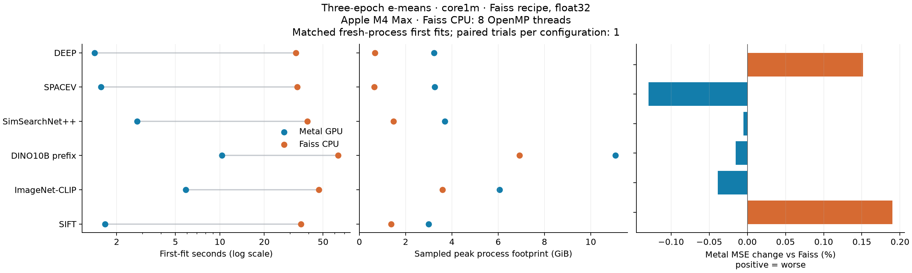
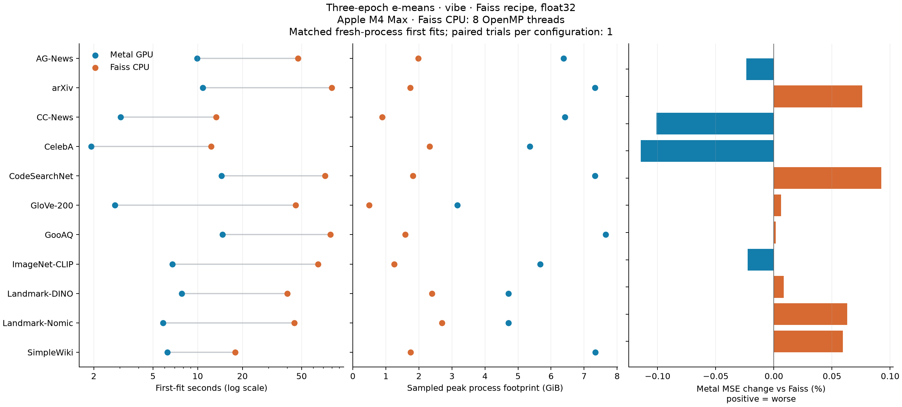

# Metal versus original Faiss e-means — 14 November 2026

This compares **three-epoch Metal GPU e-means with three-epoch unmodified upstream CPU `NumpyEmeans`**, using the same current Faiss recipe, float32 data, last-epoch finalization, and identical initial centroids. Each recorded measurement is one first fit in a fresh process, with no in-process warm-up.

**Primary coverage: 17/17 dataset configurations paired** (six core 1M configurations and eleven VIBE configurations). The five 10M configurations are deferred by the requested scope; their absence is not a failed benchmark.

Across completed primary configurations, the observed CPU/Metal runtime ratio ranges from **2.86× to 23.20×** (median 7.38×).
Metal test-MSE changes range from **-0.129% to +0.190%** (median +0.002%; positive means worse). These are measured differences, not an assertion of numerical identity.
Metal MSE is lower on **8**, equal on **0**, and higher on **9** completed configurations, using the unrounded paired percentage changes.
The observed Metal/Faiss peak-process-footprint ratio ranges from **1.60× to 7.25×** (median 4.04×; 17 configurations with complete memory sampling).

## Core 1M

Both implementations run three epochs. Every configuration below uses 1,000,000 training vectors and 16,384 clusters.

| Dataset | Rows × dimensions; k | Metal s | Faiss CPU s | CPU / Metal | Peak footprint GiB M / F | Test MSE M / F | MSE change | Paired trials; seeds |
|---|---:|---:|---:|---:|---:|---:|---:|---|
| DEEP | 1,000,000 × 96; 16,384 | [1.414](../benchmarks/e_means/results/faiss_comparison/deep1b-1M-metal-s10-t0-a8cdf52d0f07.json) | [32.798](../benchmarks/e_means/results/faiss_comparison/deep1b-1M-faiss-emeans-s10-t0-4eff04d355d0.json) | 23.20× | 3.220 / 0.674 | 0.38818828 / 0.38760134 | +0.151% | 1; 10 |
| SPACEV | 1,000,000 × 100; 16,384 | [1.570](../benchmarks/e_means/results/faiss_comparison/spacev-1M-metal-s10-t0-f40f6577008e.json) | [33.395](../benchmarks/e_means/results/faiss_comparison/spacev-1M-faiss-emeans-s10-t0-e3096bad1ce2.json) | 21.27× | 3.261 / 0.642 | 7190.2818 / 7199.5884 | -0.129% | 1; 10 |
| SimSearchNet++ | 1,000,000 × 256; 16,384 | [2.755](../benchmarks/e_means/results/faiss_comparison/fb-ssnpp-1M-metal-s10-t0-82f981742150.json) | [39.103](../benchmarks/e_means/results/faiss_comparison/fb-ssnpp-1M-faiss-emeans-s10-t0-77f6bcadd05e.json) | 14.20× | 3.701 / 1.482 | 113115.56 / 113121.1 | -0.005% | 1; 10 |
| DINO10B prefix | 1,000,000 × 1024; 16,384 | [10.315](../benchmarks/e_means/results/faiss_comparison/dino10b-1M-div4096-metal-s10-t0-0436f0d46c09.json) | [63.246](../benchmarks/e_means/results/faiss_comparison/dino10b-1M-div4096-faiss-emeans-s10-t0-bcc64a348f45.json) | 6.13× | 11.065 / 6.920 | 0.012242448 / 0.01224434 | -0.015% | 1; 10 |
| ImageNet-CLIP | 1,000,000 × 512; 16,384 | [5.871](../benchmarks/e_means/results/faiss_comparison/imagenet-clip-512-normalized-metal-s10-t0-b8b6b5983105.json) | [46.924](../benchmarks/e_means/results/faiss_comparison/imagenet-clip-512-normalized-faiss-emeans-s10-t0-7b794c65493d.json) | 7.99× | 6.053 / 3.590 | 0.21186397 / 0.21194581 | -0.039% | 1; 10 |
| SIFT | 1,000,000 × 128; 16,384 | [1.669](../benchmarks/e_means/results/faiss_comparison/sift1b-1M-div512-metal-s10-t0-7e3ed5ef4d94.json) | [35.482](../benchmarks/e_means/results/faiss_comparison/sift1b-1M-div512-faiss-emeans-s10-t0-0e15f1222b54.json) | 21.26× | 2.990 / 1.376 | 0.19396791 / 0.19360002 | +0.190% | 1; 10 |

M / F means Metal / Faiss CPU. Positive MSE change means Metal has higher (worse) loss. Peak footprint is the sampled fit-window process total, including its pre-fit baseline. Missing or incomplete memory samples appear as —; timing and quality remain separately usable.

## VIBE

Both implementations run three epochs on the full prepared training split. These use the same public VIBE source vectors but a new, recorded duplicate-disjoint split, because the paper's exact holdout indices were not released. They are not an exact reproduction of paper Table 11.

| Dataset | Rows × dimensions; k | Metal s | Faiss CPU s | CPU / Metal | Peak footprint GiB M / F | Test MSE M / F | MSE change | Paired trials; seeds |
|---|---:|---:|---:|---:|---:|---:|---:|---|
| AG-News | 749,088 × 1024; 16,384 | [9.926](../benchmarks/e_means/results/faiss_comparison/vibe-agnews-metal-s10-t0-91ce6aa61d61.json) | [47.373](../benchmarks/e_means/results/faiss_comparison/vibe-agnews-faiss-emeans-s10-t0-c80f2c0ff4ff.json) | 4.77× | 6.377 / 1.977 | 116.0257 / 116.0533 | -0.024% | 1; 10 |
| arXiv | 1,324,643 × 768; 16,384 | [10.839](../benchmarks/e_means/results/faiss_comparison/vibe-arxiv-metal-s10-t0-93d125f3541d.json) | [79.946](../benchmarks/e_means/results/faiss_comparison/vibe-arxiv-faiss-emeans-s10-t0-60eed1a5bdcc.json) | 7.38× | 7.328 / 1.734 | 0.21913023 / 0.21896372 | +0.076% | 1; 10 |
| CC-News | 475,295 × 768; 8,192 | [3.036](../benchmarks/e_means/results/faiss_comparison/vibe-ccnews-metal-s10-t0-a0d084cbee1f.json) | [13.340](../benchmarks/e_means/results/faiss_comparison/vibe-ccnews-faiss-emeans-s10-t0-1802547461c1.json) | 4.39× | 6.415 / 0.885 | 0.24406073 / 0.24430731 | -0.101% | 1; 10 |
| CelebA | 181,573 × 2048; 8,192 | [1.921](../benchmarks/e_means/results/faiss_comparison/vibe-celeba-metal-s10-t0-34cea276ef5b.json) | [12.336](../benchmarks/e_means/results/faiss_comparison/vibe-celeba-faiss-emeans-s10-t0-69de9d80ed80.json) | 6.42× | 5.360 / 2.319 | 40.864185 / 40.91101 | -0.114% | 1; 10 |
| CodeSearchNet | 1,354,065 × 768; 16,384 | [14.466](../benchmarks/e_means/results/faiss_comparison/vibe-codesearchnet-metal-s10-t0-a5bbb2f939b0.json) | [72.124](../benchmarks/e_means/results/faiss_comparison/vibe-codesearchnet-faiss-emeans-s10-t0-078edf8306e8.json) | 4.99× | 7.327 / 1.815 | 98.040322 / 97.949715 | +0.093% | 1; 10 |
| GloVe-200 | 1,172,514 × 200; 16,384 | [2.772](../benchmarks/e_means/results/faiss_comparison/vibe-glove-metal-s10-t0-ec15cbca10b3.json) | [45.715](../benchmarks/e_means/results/faiss_comparison/vibe-glove-faiss-emeans-s10-t0-ef2d3260b746.json) | 16.49× | 3.165 / 0.492 | 28.329095 / 28.327351 | +0.006% | 1; 10 |
| GooAQ | 1,455,024 × 768; 16,384 | [14.660](../benchmarks/e_means/results/faiss_comparison/vibe-gooaq-metal-s10-t0-5d848c195dbc.json) | [78.002](../benchmarks/e_means/results/faiss_comparison/vibe-gooaq-faiss-emeans-s10-t0-76c3689e0dc7.json) | 5.32× | 7.655 / 1.584 | 0.53520967 / 0.53520141 | +0.002% | 1; 10 |
| ImageNet-CLIP | 1,260,979 × 512; 16,384 | [6.762](../benchmarks/e_means/results/faiss_comparison/vibe-imagenet-metal-s10-t0-d7dcda74183f.json) | [64.441](../benchmarks/e_means/results/faiss_comparison/vibe-imagenet-faiss-emeans-s10-t0-ef7b9437708b.json) | 9.53× | 5.666 / 1.254 | 0.2110345 / 0.21108209 | -0.023% | 1; 10 |
| Landmark-DINO | 740,740 × 768; 16,384 | [7.821](../benchmarks/e_means/results/faiss_comparison/vibe-landmark-dino-metal-s10-t0-2bdad5a89909.json) | [40.086](../benchmarks/e_means/results/faiss_comparison/vibe-landmark-dino-faiss-emeans-s10-t0-63f89f45561c.json) | 5.13× | 4.713 / 2.395 | 1995.3855 / 1995.2152 | +0.009% | 1; 10 |
| Landmark-Nomic | 740,729 × 768; 16,384 | [5.840](../benchmarks/e_means/results/faiss_comparison/vibe-landmark-nomic-metal-s10-t0-0b9522425774.json) | [44.731](../benchmarks/e_means/results/faiss_comparison/vibe-landmark-nomic-faiss-emeans-s10-t0-a9fd99f2caa3.json) | 7.66× | 4.710 / 2.699 | 0.081594827 / 0.081543274 | +0.063% | 1; 10 |
| SimpleWiki | 240,372 × 3072; 8,192 | [6.237](../benchmarks/e_means/results/faiss_comparison/vibe-simplewiki-metal-s10-t0-2d4fddfdc4eb.json) | [17.854](../benchmarks/e_means/results/faiss_comparison/vibe-simplewiki-faiss-emeans-s10-t0-36dd61542c13.json) | 2.86× | 7.335 / 1.748 | 0.59153246 / 0.591182 | +0.059% | 1; 10 |

M / F means Metal / Faiss CPU. Positive MSE change means Metal has higher (worse) loss. Peak footprint is the sampled fit-window process total, including its pre-fit baseline. Missing or incomplete memory samples appear as —; timing and quality remain separately usable.

## Figures





## Measurement and interpretation

A fresh worker loads data and constructs the shared NumPy initial centroids before signaling `FIT_READY`. The parent starts external process-memory sampling, then permits the fit. `FIT_DONE` ends that window before quality scoring. The fit timer includes validation, Metal upload where applicable, shuffling, centroid updates/finalization, synchronization, and a host centroid copy. Loading, initial-centroid sampling, and scoring are excluded. Any compilation that occurs inside the fit is included. Cold here means no in-process algorithm warm-up; operating-system file and shader caches are not flushed, so this is not a cold-machine measurement.

Time, MSE, and memory columns are medians over paired fresh-process trials when more than one exists. The speedup column is the median of paired CPU/Metal ratios; MSE change is the median of paired percentage changes. Every MSE comes from its own timed fit. Repeated trials with the same seed are timing replications, not independent initialization seeds; the table reports both counts. A single cold fit does not establish timing variance or steady-state throughput. Headline ranges and medians give each completed configuration one weight and do not pool losses across datasets.

The main memory metric is the maximum sampled **process physical footprint during the fit window**, including the baseline after data loading/imports and any retained MLX cache. It is an observed first-fit peak, not a deterministic minimum workspace. Retained allocator cache and process footprint can vary between fresh processes even when the active-allocation peak is unchanged. RSS is separately reported; it is not interchangeable with physical footprint, particularly for file-backed VIBE inputs. Baseline-to-peak increase is a phase increase, not total dataset storage or exclusive GPU memory. MLX's active-allocation peak describes its allocator only. **Do not add footprint, RSS, or MLX allocation:** their accounting overlaps. The kernel lifetime peak includes loading and is retained only as a raw diagnostic, never used for the fit-window peak. Polling can miss brief transients; each raw record includes the requested interval, observed maximum gap, sample count, and errors. Incomplete memory collection is withheld from the memory comparison.

Quality uses one shared evaluator: Faiss CPU `IndexFlatL2` float32 nearest-centroid assignment followed by direct float64 squared residuals averaged per vector (sum over dimensions). Identical initial centroids and matched recipe constants do not guarantee identical floating-point assignments or revival choices in these iterative algorithms. The table reports the resulting quality differences directly. Faiss draws donor random variates only on revival checks requiring a split; Metal draws on every five-batch check, including empty checks, to avoid CPU synchronization. After an empty check, the same seed therefore follows a different donor-random-number trajectory. Reduction order, centered assignment, and donor-key precision also differ. Their separate contributions to the observed MSE differences were not ablated. See the [usage guide and numerical-differences discussion](e-means.md).

Core data and released split fingerprints follow the pinned upstream loader. The released DEEP 1M evaluation contains four vectors also found in training; SPACEV 1M contains six. These published overlaps are retained, so the core evaluations are not all strictly disjoint. SIFT 1M uses the same corpus and first-million/next-10K split but has no released 1M fingerprint. SIFT is divided by 512 and DINO by 4096, as in upstream; multiply MSE by the divisor squared to recover raw-vector units. VIBE uses source vectors as stored and Euclidean clustering.

## Hardware, software, and pairing checks

Host: **Apple M4 Max**, 128 GiB unified memory; `macOS-26.6.2-arm64-arm-64bit-Mach-O`. CPU OpenMP threads: **8**. `VECLIB_MAXIMUM_THREADS=unset` (Accelerate may choose its own worker count). Metal uses the same host's Apple GPU.

Versions: python `3.14.2`; numpy `2.5.4`; scipy `1.18.1`; mlx `0.32.4`; scikit-learn `1.9.1`; faiss-cpu `1.16.0`; h5py `3.16.0`.

Faiss compile options: `OPTIMIZE DD ARM_NEON MAC_METAL`.

CPU selection used [bounded thread calibration](../benchmarks/e_means/results/faiss_comparison_calibration/summary.json) (17 trials). Full DEEP 1M three-epoch observations: 8 threads: 32.971 s, 12 threads: 33.300 s, 16 threads: 34.428 s. The chosen setting was 8 OpenMP threads with unrestricted Accelerate. One timing per calibration configuration does not establish a globally optimal thread count.

Original source: [Faiss contrib/e_means at `ebab8f784c1d`](https://github.com/facebookresearch/faiss/tree/ebab8f784c1d177129602269d5ad966c525fbdcb/contrib/e_means). The reference is upstream `NumpyEmeans` with CPU Faiss assignment; this is not a CUDA/H100 runtime comparison.

Pairing requires identical full-data metadata and fingerprints, dimensions, cluster count, initialization hash, seed/trial, source hashes, versions, host, thread settings, timing/scoring/memory scopes, and requested protocol. It also checks resolved batch law/size, learning rate, epoch rows/steps, total steps, alpha floor, initial usage mass, split epsilon, unused-cluster threshold/check cadence, tail policy, and seed. Numeric recipe comparisons permit only 1e-12 relative / 1e-15 absolute rounding tolerance. Missing provenance, ambiguous duplicates, or mismatches are excluded with reasons below.

## Fit-window memory details

| Dataset | Method; seed/trial | Baseline footprint GiB | Peak footprint GiB | Increase GiB | Peak RSS GiB | MLX active peak GiB | MLX cache after fit GiB | Samples; max gap ms |
|---|---|---:|---:|---:|---:|---:|---:|---|
| [DEEP](../benchmarks/e_means/results/faiss_comparison/deep1b-1M-metal-s10-t0-a8cdf52d0f07.json) | metal; 10/0 | 0.474 | 3.220 | 2.746 | 0.942 | 1.482 | 2.527 | 143; 12.48 |
| [DEEP](../benchmarks/e_means/results/faiss_comparison/deep1b-1M-faiss-emeans-s10-t0-4eff04d355d0.json) | faiss; 10/0 | 0.415 | 0.674 | 0.259 | 0.700 | — | — | 3,281; 12.64 |
| [DINO10B prefix](../benchmarks/e_means/results/faiss_comparison/dino10b-1M-div4096-metal-s10-t0-0436f0d46c09.json) | metal; 10/0 | 4.497 | 11.065 | 6.568 | 8.701 | 6.072 | 6.178 | 1,033; 13.28 |
| [DINO10B prefix](../benchmarks/e_means/results/faiss_comparison/dino10b-1M-div4096-faiss-emeans-s10-t0-bcc64a348f45.json) | faiss; 10/0 | 4.436 | 6.920 | 2.484 | 6.943 | — | — | 6,326; 12.66 |
| [SimSearchNet++](../benchmarks/e_means/results/faiss_comparison/fb-ssnpp-1M-metal-s10-t0-82f981742150.json) | metal; 10/0 | 1.125 | 3.701 | 2.577 | 2.236 | 2.273 | 2.329 | 277; 12.59 |
| [SimSearchNet++](../benchmarks/e_means/results/faiss_comparison/fb-ssnpp-1M-faiss-emeans-s10-t0-77f6bcadd05e.json) | faiss; 10/0 | 1.064 | 1.482 | 0.418 | 1.508 | — | — | 3,912; 12.66 |
| [ImageNet-CLIP](../benchmarks/e_means/results/faiss_comparison/imagenet-clip-512-normalized-metal-s10-t0-b8b6b5983105.json) | metal; 10/0 | 2.149 | 6.053 | 3.905 | 4.288 | 3.540 | 3.612 | 588; 12.43 |
| [ImageNet-CLIP](../benchmarks/e_means/results/faiss_comparison/imagenet-clip-512-normalized-faiss-emeans-s10-t0-7b794c65493d.json) | faiss; 10/0 | 2.086 | 3.590 | 1.504 | 3.615 | — | — | 4,694; 12.50 |
| [SIFT](../benchmarks/e_means/results/faiss_comparison/sift1b-1M-div512-metal-s10-t0-7e3ed5ef4d94.json) | metal; 10/0 | 1.082 | 2.990 | 1.908 | 1.666 | 1.640 | 1.688 | 168; 12.66 |
| [SIFT](../benchmarks/e_means/results/faiss_comparison/sift1b-1M-div512-faiss-emeans-s10-t0-0e15f1222b54.json) | faiss; 10/0 | 1.022 | 1.376 | 0.354 | 1.402 | — | — | 3,549; 12.49 |
| [SPACEV](../benchmarks/e_means/results/faiss_comparison/spacev-1M-metal-s10-t0-f40f6577008e.json) | metal; 10/0 | 0.497 | 3.261 | 2.764 | 0.978 | 1.502 | 2.547 | 158; 12.39 |
| [SPACEV](../benchmarks/e_means/results/faiss_comparison/spacev-1M-faiss-emeans-s10-t0-e3096bad1ce2.json) | faiss; 10/0 | 0.435 | 0.642 | 0.208 | 0.669 | — | — | 3,341; 12.65 |
| [AG-News](../benchmarks/e_means/results/faiss_comparison/vibe-agnews-metal-s10-t0-91ce6aa61d61.json) | metal; 10/0 | 0.377 | 6.377 | 6.000 | 6.482 | 4.738 | 5.614 | 994; 12.65 |
| [AG-News](../benchmarks/e_means/results/faiss_comparison/vibe-agnews-faiss-emeans-s10-t0-c80f2c0ff4ff.json) | faiss; 10/0 | 0.317 | 1.977 | 1.660 | 4.864 | — | — | 4,739; 12.50 |
| [arXiv](../benchmarks/e_means/results/faiss_comparison/vibe-arxiv-metal-s10-t0-93d125f3541d.json) | metal; 10/0 | 0.315 | 7.328 | 7.013 | 8.214 | 5.736 | 6.670 | 1,085; 12.48 |
| [arXiv](../benchmarks/e_means/results/faiss_comparison/vibe-arxiv-faiss-emeans-s10-t0-60eed1a5bdcc.json) | faiss; 10/0 | 0.253 | 1.734 | 1.480 | 5.559 | — | — | 7,996; 12.65 |
| [CC-News](../benchmarks/e_means/results/faiss_comparison/vibe-ccnews-metal-s10-t0-a0d084cbee1f.json) | metal; 10/0 | 0.190 | 6.415 | 6.226 | 3.133 | 5.278 | 5.926 | 305; 12.47 |
| [CC-News](../benchmarks/e_means/results/faiss_comparison/vibe-ccnews-faiss-emeans-s10-t0-1802547461c1.json) | faiss; 10/0 | 0.129 | 0.885 | 0.756 | 2.275 | — | — | 1,335; 12.48 |
| [CelebA](../benchmarks/e_means/results/faiss_comparison/vibe-celeba-metal-s10-t0-34cea276ef5b.json) | metal; 10/0 | 0.330 | 5.360 | 5.030 | 3.554 | 4.262 | 4.575 | 193; 12.67 |
| [CelebA](../benchmarks/e_means/results/faiss_comparison/vibe-celeba-faiss-emeans-s10-t0-69de9d80ed80.json) | faiss; 10/0 | 0.269 | 2.319 | 2.050 | 3.734 | — | — | 1,235; 12.46 |
| [CodeSearchNet](../benchmarks/e_means/results/faiss_comparison/vibe-codesearchnet-metal-s10-t0-a5bbb2f939b0.json) | metal; 10/0 | 0.314 | 7.327 | 7.013 | 8.332 | 5.820 | 6.672 | 1,448; 12.52 |
| [CodeSearchNet](../benchmarks/e_means/results/faiss_comparison/vibe-codesearchnet-faiss-emeans-s10-t0-078edf8306e8.json) | faiss; 10/0 | 0.254 | 1.815 | 1.562 | 5.726 | — | — | 7,214; 14.98 |
| [GloVe-200](../benchmarks/e_means/results/faiss_comparison/vibe-glove-metal-s10-t0-ec15cbca10b3.json) | metal; 10/0 | 0.159 | 3.165 | 3.005 | 2.052 | 2.126 | 2.769 | 278; 15.18 |
| [GloVe-200](../benchmarks/e_means/results/faiss_comparison/vibe-glove-faiss-emeans-s10-t0-ef2d3260b746.json) | faiss; 10/0 | 0.099 | 0.492 | 0.393 | 1.398 | — | — | 4,573; 14.97 |
| [GooAQ](../benchmarks/e_means/results/faiss_comparison/vibe-gooaq-metal-s10-t0-5d848c195dbc.json) | metal; 10/0 | 0.316 | 7.655 | 7.339 | 8.959 | 6.109 | 6.998 | 1,467; 14.97 |
| [GooAQ](../benchmarks/e_means/results/faiss_comparison/vibe-gooaq-faiss-emeans-s10-t0-76c3689e0dc7.json) | faiss; 10/0 | 0.254 | 1.584 | 1.330 | 5.781 | — | — | 7,802; 14.98 |
| [ImageNet-CLIP](../benchmarks/e_means/results/faiss_comparison/vibe-imagenet-metal-s10-t0-d7dcda74183f.json) | metal; 10/0 | 0.243 | 5.666 | 5.423 | 5.293 | 4.038 | 5.130 | 678; 13.43 |
| [ImageNet-CLIP](../benchmarks/e_means/results/faiss_comparison/vibe-imagenet-faiss-emeans-s10-t0-ef7b9437708b.json) | faiss; 10/0 | 0.185 | 1.254 | 1.069 | 3.696 | — | — | 6,445; 12.49 |
| [Landmark-DINO](../benchmarks/e_means/results/faiss_comparison/vibe-landmark-dino-metal-s10-t0-2bdad5a89909.json) | metal; 10/0 | 0.309 | 4.713 | 4.404 | 4.863 | 3.781 | 4.062 | 783; 12.49 |
| [Landmark-DINO](../benchmarks/e_means/results/faiss_comparison/vibe-landmark-dino-faiss-emeans-s10-t0-63f89f45561c.json) | faiss; 10/0 | 0.248 | 2.395 | 2.147 | 4.547 | — | — | 4,010; 12.49 |
| [Landmark-Nomic](../benchmarks/e_means/results/faiss_comparison/vibe-landmark-nomic-metal-s10-t0-0b9522425774.json) | metal; 10/0 | 0.309 | 4.710 | 4.401 | 4.860 | 3.781 | 4.061 | 585; 12.55 |
| [Landmark-Nomic](../benchmarks/e_means/results/faiss_comparison/vibe-landmark-nomic-faiss-emeans-s10-t0-a9fd99f2caa3.json) | faiss; 10/0 | 0.249 | 2.699 | 2.451 | 4.848 | — | — | 4,474; 12.65 |
| [SimpleWiki](../benchmarks/e_means/results/faiss_comparison/vibe-simplewiki-metal-s10-t0-2d4fddfdc4eb.json) | metal; 10/0 | 0.446 | 7.335 | 6.889 | 6.588 | 5.441 | 6.311 | 625; 12.49 |
| [SimpleWiki](../benchmarks/e_means/results/faiss_comparison/vibe-simplewiki-faiss-emeans-s10-t0-36dd61542c13.json) | faiss; 10/0 | 0.386 | 1.748 | 1.362 | 4.528 | — | — | 1,787; 12.65 |

## Coverage and exclusions

| Configuration | Scope | Result |
|---|---|---|
| `deep1b-1M` | primary | paired |
| `spacev-1M` | primary | paired |
| `fb-ssnpp-1M` | primary | paired |
| `dino10b-1M-div4096` | primary | paired |
| `imagenet-clip-512-normalized` | primary | paired |
| `sift1b-1M-div512` | primary | paired |
| `vibe-agnews` | primary | paired |
| `vibe-arxiv` | primary | paired |
| `vibe-ccnews` | primary | paired |
| `vibe-celeba` | primary | paired |
| `vibe-codesearchnet` | primary | paired |
| `vibe-glove` | primary | paired |
| `vibe-gooaq` | primary | paired |
| `vibe-imagenet` | primary | paired |
| `vibe-landmark-dino` | primary | paired |
| `vibe-landmark-nomic` | primary | paired |
| `vibe-simplewiki` | primary | paired |
| `deep1b-10M` | 10M deferred | deferred by requested scope; not run |
| `spacev-10M` | 10M deferred | deferred by requested scope; not run |
| `fb-ssnpp-10M` | 10M deferred | deferred by requested scope; not run |
| `dino10b-10M-div4096` | 10M deferred | deferred by requested scope; not run |
| `sift1b-10M-div512` | 10M deferred | deferred by requested scope; not run |


## Additional DEEP 1M memory trials

This appendix contains **3 additional measured Metal-only first fits** on full DEEP 1M, with the same seed, initial centroids, resolved recipe, source, environment, and protocol as the primary DEEP Metal record. These trials are **excluded from all primary paired tables, figures, coverage counts, and headline statistics**. The primary record is repeated here only for context. Observed differences illustrate process/cache variability; this small sample does not establish a memory confidence interval.

| Record | Seed; trial | Fit seconds | Peak process footprint GiB | MLX active peak GiB | Retained MLX cache after fit GiB |
|---|---|---:|---:|---:|---:|
| [Primary reference](../benchmarks/e_means/results/faiss_comparison/deep1b-1M-metal-s10-t0-a8cdf52d0f07.json) | 10; 0 | 1.414 | 3.220 | 1.482 | 2.527 |
| [Additional trial](../benchmarks/e_means/results/faiss_comparison_memory_variability/deep1b-1M-metal-s10-t0-a8cdf52d0f07.json) | 10; 0 | 1.416 | 2.223 | 1.482 | 1.527 |
| [Additional trial](../benchmarks/e_means/results/faiss_comparison_memory_variability/deep1b-1M-metal-s10-t1-b3f61d71bbb6.json) | 10; 1 | 1.427 | 2.221 | 1.482 | 1.527 |
| [Additional trial](../benchmarks/e_means/results/faiss_comparison_memory_variability/deep1b-1M-metal-s10-t2-13c6f6d1cfe0.json) | 10; 2 | 1.414 | 2.222 | 1.482 | 1.527 |

Process footprint includes baseline and retained cache. MLX active and cached allocation diagnostics are not additive to process footprint, and active peak and end-of-fit cache are observed at different instants.


## Reproducibility and raw evidence

[Summary CSV](../benchmarks/e_means/results/faiss_comparison/comparison_summary.csv) · [Evidence manifest with all raw record hashes](../benchmarks/e_means/results/faiss_comparison/comparison_report_manifest.json) · [fresh-process comparison driver](../benchmarks/e_means/compare.py) · [external memory sampler](../benchmarks/e_means/memory.py) · [report generator](../benchmarks/e_means/comparison_report.py).

Validation evidence: [controller tests and CPU dispatch audit](../benchmarks/e_means/results/faiss_comparison_validation/validation.json) · [external memory-sampler validation](../benchmarks/e_means/results/faiss_comparison_validation/memory.json) · [report calculations and exclusion tests](../benchmarks/e_means/results/faiss_comparison_validation/report.json).

The [earlier paper-recipe/Lloyd report](e-means-benchmarks-2026-11-14.md) and its original measurements are preserved. They are not pooled with these new cold-fit/memory measurements. The five 10M comparisons remain deferred; 100M/1B/10B, distributed runs, IVF downstream experiments, and FP8 comparisons are outside the measured scope.

```bash
.venv/bin/python benchmarks/e_means/compare.py --suite core1m --repeats 1
.venv/bin/python benchmarks/e_means/compare.py --suite vibe --repeats 1
.venv/bin/python benchmarks/e_means/comparison_report.py --plots
```
