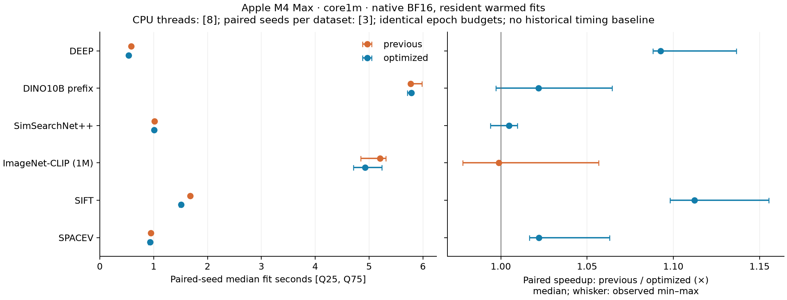
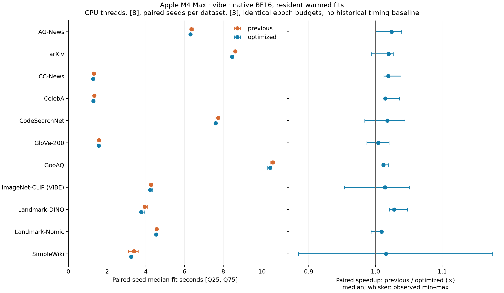

# Fresh Metal e-means optimization and H100 gap investigation

**Complete planned coverage: 17/17 datasets and 51/51 planned seed pairs are measured.** Planned seed IDs: 10, 11, 12; 51 valid pairs are available in total. The previous and optimized implementations both use native BF16 assignment, the same fixed epoch budget, input, initial centroids, warm-up and timing controller. Only explicitly recorded runtime sources may differ. Historical campaign timings are investigation context, not the speedup baseline below.

The previous implementation comes from [the frozen second-version source archive](../benchmarks/e_means/reference/metal-v2-source.zip). Each result proves which runtime modules were actually loaded. Shared harness, protocol, hardware, software, resolved recipe and initialization must match within each seed pair. Conflicting or ambiguous evidence is excluded.

## Why the H100 gap remains

**The evidence points primarily to matrix-throughput differences, with smaller implementation overheads.** On two wide test shapes (d=1024 and 3072), this M4 Max's fused assignment reaches about 14.1 useful TFLOP/s; plain MLX BF16-output matrix multiplication reaches 14.7–14.8 TFLOP/s. Assignment is within about 4–5% of that simpler operation's time. The plain product omits nearest-centroid reduction and has different output precision, so it is an empirical arithmetic reference, not a valid replacement or a proven hardware ceiling. [Measured matrix-throughput evidence](../benchmarks/e_means/results/gap_investigation/roofline.json).

Using the recorded local assignment work with the paper's rounded H100 times gives a **conditional** 246–595 TFLOP/s. This is plausible against H100 SXM's 989.4 dense BF16 TFLOP/s specification with FP32 accumulation; the roughly doubled structured-sparse figure is inapplicable. The nominal memory-bandwidth ratio is only about 6.1× (3350 versus 546 GB/s). Neither this ratio nor a peak/measurement ratio precisely partitions the performance gap. The exact Table 11 H100 SKU and per-seed work remain unverified. [Hardware sources, FLOP accounting and limitations](../benchmarks/e_means/results/gap_investigation/workload_analysis.md).

Fresh serialized stage profiles attribute roughly 84–92% of instrumented time to assignment on DEEP, GloVe and AG-News; the earlier DINO profile attributes about 96%. Shuffling, casting, statistics, updates and dispatch remain candidates for incremental improvement, but the profiles do not support them as the dominant wide-dimension cost. These stage percentages come from synchronized instrumentation, not GPU hardware-counter traces or an exact decomposition of normal asynchronous wall time. [Stage attribution](../benchmarks/e_means/results/gap_investigation/stages-before.json).

## Implemented changes

The optimized runtime fuses shuffled FP32 row gathering and BF16 conversion using four-value vector loads. The recorded gather microbenchmark preserves every BF16 output bit and improves its standalone operation by 1.24–2.25× on the tested shapes. It also stores partial scores and merges them with contiguous row accesses for dimensions 96 and 128 when k ≥ 1024 and the batch has at least 32 rows. That assignment change measured about 1.11–1.13× on its tested low-dimension shapes. Higher-dimension assignment kernels are unchanged; their implemented change is the gather/conversion step. These microbenchmarks do not establish whole-fit gains; only the fresh paired table below measures those.

[Vector-gather evidence](../benchmarks/e_means/results/gap_investigation/gather-vector4.json) · [Assignment correctness and timing evidence](../benchmarks/e_means/results/gap_investigation/production-validation.json).

## Fresh matched results

| Dataset | Epochs | Previous s | Optimized s | Paired speedup | MSE change median [min, max] % | Footprint GiB P / O | Seed pairs |
|---|---:|---:|---:|---:|---:|---:|---:|
| DEEP | 2 | 0.583 | 0.533 | 1.093× | +0 [+0, +0] | 2.131 / 2.016 | 3 |
| DINO10B prefix | 2 | 5.771 | 5.787 | 1.022× | +0 [+0, +0] | 10.337 / 10.055 | 3 |
| SimSearchNet++ | 1.4 | 1.012 | 1.007 | 1.005× | +0 [+0, +0] | 3.964 / 3.842 | 3 |
| ImageNet-CLIP (1M) | 3 | 5.202 | 4.923 | 0.999× | +0 [+0, +0] | 5.874 / 5.654 | 3 |
| SIFT | 3 | 1.680 | 1.510 | 1.112× | +0 [+0, +0] | 2.913 / 3.404 | 3 |
| SPACEV | 2.4 | 0.950 | 0.935 | 1.022× | +0 [+0, +0] | 2.167 / 2.701 | 3 |
| AG-News | 2.2 | 6.355 | 6.297 | 1.024× | +0 [+0, +0] | 5.422 / 5.087 | 3 |
| arXiv | 2.4 | 8.612 | 8.445 | 1.020× | +0 [+0, +0] | 6.534 / 6.080 | 3 |
| CC-News | 2 | 1.309 | 1.275 | 1.019× | +0 [+0, +0] | 2.856 / 2.875 | 3 |
| CelebA | 1.8 | 1.335 | 1.289 | 1.015× | +0 [+0, +0] | 3.661 / 3.801 | 3 |
| CodeSearchNet | 2.2 | 7.739 | 7.603 | 1.018× | +0 [+0, +8.8818e-14] | 6.821 / 6.276 | 3 |
| GloVe-200 | 1.6 | 1.574 | 1.567 | 1.004× | +0 [+0, +0] | 2.897 / 2.640 | 3 |
| GooAQ | 2.6 | 10.551 | 10.427 | 1.012× | +0 [-9.992e-14, +0] | 7.004 / 6.508 | 3 |
| ImageNet-CLIP (VIBE) | 1.8 | 4.265 | 4.223 | 1.014× | +0 [+0, +0] | 4.625 / 4.311 | 3 |
| Landmark-DINO | 1.8 | 3.939 | 3.759 | 1.028× | +0 [+0, +0] | 4.208 / 4.027 | 3 |
| Landmark-Nomic | 2.2 | 4.556 | 4.532 | 1.009× | +0 [+0, +0] | 4.296 / 4.074 | 3 |
| SimpleWiki | 2.2 | 3.386 | 3.245 | 1.016× | +0 [+0, +0] | 5.866 / 5.299 | 3 |

Speedup is the median of per-seed previous/optimized time ratios; mode times are medians over those same pairs. Positive MSE change means worse optimized quality. Each seed's quality uses its first timed fit; time is one synchronized fit or the median of three when its first fit took less than two seconds. Repeated calls are not independent seeds.

Across 51 defined seed-level comparisons, observed MSE changes range from -9.99201e-14% to +8.88178e-14%. These extrema describe individual seed pairs, not dataset medians or confidence intervals.

In the figures, runtime whiskers show the interquartile range of per-seed fit times; speedup whiskers show the observed minimum and maximum of paired ratios. Neither is a confidence interval. Clustering-quality changes are retained numerically in the table and CSV.





## Variation and published H100 context

The H100 seconds below are rounded Table 11 values, not fresh runs. Its per-seed stopping budgets, exact VIBE splits and seed IDs are unavailable, and the epoch row's GPU association is unverified. Apple/H100 is descriptive context, not an equal-work or equal-quality hardware speedup. The six core cases have no published absolute H100 e-means time. Local table-level budgets remain fixed across seeds; no crossing search was performed.

| Dataset | Previous s [Q25, Q75]; SD | Optimized s [Q25, Q75]; SD | Seed IDs | H100 s | Approx. Apple/H100 |
|---|---:|---:|---|---:|---:|
| DEEP | [0.583, 0.587]; 0.005 | [0.526, 0.534]; 0.009 | 10, 11, 12 | — | — |
| DINO10B prefix | [5.767, 5.980]; 0.244 | [5.714, 5.801]; 0.093 | 10, 11, 12 | — | — |
| SimSearchNet++ | [1.006, 1.017]; 0.011 | [1.007, 1.010]; 0.003 | 10, 11, 12 | — | — |
| ImageNet-CLIP (1M) | [4.843, 5.315]; 0.493 | [4.706, 5.236]; 0.533 | 10, 11, 12 | — | — |
| SIFT | [1.673, 1.683]; 0.010 | [1.476, 1.523]; 0.048 | 10, 11, 12 | — | — |
| SPACEV | [0.934, 0.962]; 0.028 | [0.899, 0.944]; 0.047 | 10, 11, 12 | — | — |
| AG-News | [6.335, 6.449]; 0.122 | [6.251, 6.307]; 0.060 | 10, 11, 12 | 0.10 | 63 |
| arXiv | [8.585, 8.624]; 0.039 | [8.429, 8.528]; 0.107 | 10, 11, 12 | 0.14 | 60 |
| CC-News | [1.304, 1.313]; 0.009 | [1.272, 1.284]; 0.012 | 10, 11, 12 | 0.04 | 32 |
| CelebA | [1.321, 1.335]; 0.017 | [1.289, 1.304]; 0.017 | 10, 11, 12 | 0.03 | 43 |
| CodeSearchNet | [7.610, 7.768]; 0.168 | [7.536, 7.603]; 0.077 | 10, 11, 12 | 0.13 | 58 |
| GloVe-200 | [1.573, 1.582]; 0.010 | [1.563, 1.580]; 0.018 | 10, 11, 12 | 0.05 | 31 |
| GooAQ | [10.447, 10.556]; 0.124 | [10.287, 10.433]; 0.166 | 10, 11, 12 | 0.16 | 65 |
| ImageNet-CLIP (VIBE) | [4.230, 4.351]; 0.124 | [4.179, 4.348]; 0.176 | 10, 11, 12 | 0.07 | 60 |
| Landmark-DINO | [3.856, 4.072]; 0.218 | [3.715, 3.939]; 0.237 | 10, 11, 12 | 0.06 | 63 |
| Landmark-Nomic | [4.555, 4.565]; 0.011 | [4.516, 4.558]; 0.043 | 10, 11, 12 | 0.08 | 57 |
| SimpleWiki | [3.091, 3.600]; 0.511 | [3.203, 3.289]; 0.086 | 10, 11, 12 | 0.06 | 54 |

Quartiles interpolate between per-seed fit medians; SD is sample standard deviation and is unavailable for one seed. The raw CSV preserves each fit's repetitions and the observed quality range. Unpaired records do not enter any aggregate above.

## Memory metrics

All memory comparisons below use the same paired seeds. A seed's peak is the maximum across its timed calls; table cells are medians of those peaks. Incomplete metric groups are withheld rather than using different seed sets. Process physical footprint and RSS include resident input, runtime and retained cache. MLX active allocation is a separate allocator metric. These values are not exclusive workspace and must not be added together. Sampling can miss short transients; raw evidence preserves sample gaps and baseline/increase diagnostics.

| Dataset | RSS GiB P / O | MLX active peak GiB P / O | Complete process seeds P / O | Complete allocator seeds P / O |
|---|---:|---:|---:|---:|
| DEEP | 0.935 / 0.935 | 1.353 / 1.244 | 3 / 3 | 3 / 3 |
| DINO10B prefix | 8.449 / 8.449 | 5.212 / 5.138 | 3 / 3 | 3 / 3 |
| SimSearchNet++ | 2.184 / 2.188 | 2.470 / 2.355 | 3 / 3 | 3 / 3 |
| ImageNet-CLIP (1M) | 4.166 / 4.166 | 3.113 / 3.012 | 3 / 3 | 3 / 3 |
| SIFT | 1.652 / 1.650 | 1.524 / 2.029 | 3 / 3 | 3 / 3 |
| SPACEV | 0.964 / 0.965 | 1.387 / 1.897 | 3 / 3 | 3 / 3 |
| AG-News | 6.233 / 6.233 | 4.240 / 4.179 | 3 / 3 | 3 / 3 |
| arXiv | 8.023 / 8.024 | 5.364 / 5.142 | 3 / 3 | 3 / 3 |
| CC-News | 3.032 / 3.033 | 2.415 / 2.410 | 3 / 3 | 3 / 3 |
| CelebA | 3.308 / 3.307 | 2.888 / 3.053 | 3 / 3 | 3 / 3 |
| CodeSearchNet | 8.193 / 8.194 | 5.448 / 5.226 | 3 / 3 | 3 / 3 |
| GloVe-200 | 2.012 / 2.017 | 2.322 / 2.096 | 3 / 3 | 3 / 3 |
| GooAQ | 8.772 / 8.773 | 5.738 / 5.516 | 3 / 3 | 3 / 3 |
| ImageNet-CLIP (VIBE) | 5.174 / 5.174 | 3.612 / 3.512 | 3 / 3 | 3 / 3 |
| Landmark-DINO | 4.674 / 4.676 | 3.341 / 3.300 | 3 / 3 | 3 / 3 |
| Landmark-Nomic | 4.674 / 4.674 | 3.341 / 3.260 | 3 / 3 | 3 / 3 |
| SimpleWiki | 6.125 / 6.125 | 4.456 / 4.246 | 3 / 3 | 3 / 3 |

**Not all memory metrics improve.** Optimized median per-seed MLX active peaks increase on SIFT (+33.16%); SPACEV (+36.77%); CelebA (+5.69%). These observed allocator changes do not establish a cause and are separate from process-footprint changes.


## Measurement and queue controls

The external memory sampler was toggled in fresh-process runs of the frozen runtime, with balanced condition order and three seeds per dataset. All other fit conditions were retained. The ratios below are medians of paired sampled/unsampled times, not ratios of the two displayed time medians.

| Dataset | Sampling enabled s | Sampling disabled s | Paired enabled / disabled |
|---|---:|---:|---:|
| AG-News | 5.960 | 5.814 | 1.013× |
| GloVe-200 | 1.539 | 1.575 | 0.976× |

These small, mixed-direction differences do not establish a precise sampler cost and do not support sampling as the explanation for the much larger earlier timing shift. [Control samples, commands and evidence hashes](../benchmarks/e_means/results/sampler_control/summary.json).

A separate interleaved experiment drained queued GPU work every two, four or eight batches. For SPACEV, draining every two batches reduced active peak allocation from 1.897 to 0.760 GiB, with a 2.7% higher median time; individual timing directions varied. The four-batch policy was consistently slower on SPACEV. AG-News timing effects were inconclusive. Centroid and timing-free history hashes matched across all variants. This establishes a queue-depth contribution to memory usage, without proving it is the sole cause of the earlier memory regression. No reliable runtime win was established, so production scheduling remains unchanged. [Queue ablation and tradeoffs](../benchmarks/e_means/results/gap_investigation/queue-summary.md).

A rootless telemetry trace observed variable active-residency-weighted GPU frequencies while thermal state remained Normal. It does not establish thermal throttling as the cause of earlier timing differences. The monitor consumed measurable CPU time, so all four dataset/seed pairs whose timed windows overlapped collection were rerun with the monitor off. The table uses those clean replacements; every original record is preserved. [Telemetry semantics](../benchmarks/e_means/results/gap_investigation/TELEMETRY.md) · [Original and replacement evidence](../benchmarks/e_means/results/gap_telemetry_overlap/replacement_manifest.json).


## Investigation evidence and limits

[Workload and hardware audit](../benchmarks/e_means/results/gap_investigation/workload_analysis.md) · [Inspectable FLOP calculations](../benchmarks/e_means/results/gap_investigation/workload_analysis.json) · [Stage profiles, scheduling experiments and arithmetic proxies](../benchmarks/e_means/results/gap_investigation).

The prior campaign's 33–68× H100 context gap was not a proven hardware limit. Fresh unchanged-code diagnostics were faster under different measurement conditions, so the table above compares newly measured runtimes under one controller. H100 dense BF16 throughput makes the published times plausible; its sparse peak is inapplicable. Hardware specifications and isolated matrix products do not assign a causal fraction of the gap to hardware or code.

Both local variants use resident FP32 input, BF16-rounded assignment/statistics operands, FP32 state, last-epoch closing means and online final-pass int64 labels. Upload, full preparation validation, initialization sampling, warm-up, cache clearing, host export and shared FP32-ranking/FP64-residual scoring are outside fit timing. New model creation, signature checks, permutations, updates, objective/history and synchronization are timed. Online history reductions remain FP32 on Metal versus FP64 upstream, and NumPy/CUDA random streams differ. Core overlap counts and VIBE's newly prepared holdouts are preserved; ten-million and larger cases are excluded.

Hardware: Apple M4 Max, 128 GiB; CPU threads: 8. Software: python 3.14.2, numpy 2.5.4, scipy 1.18.1, mlx 0.32.4, scikit-learn 1.9.1, faiss-cpu 1.16.0, h5py 3.16.0.

[Dataset summary CSV](../benchmarks/e_means/results/gap_protocol/summary.csv) · [Paired seed metrics and raw evidence paths](../benchmarks/e_means/results/gap_protocol/pairs.csv) · [Source and evidence hashes](../benchmarks/e_means/results/gap_protocol/report_manifest.json) · [Audited protocol](../benchmarks/e_means/H100_PROTOCOL.md).

[Final coverage, runtime-source and telemetry-window audit](../benchmarks/e_means/results/gap_protocol/validation.json).

Recorded previous-runtime archive: [metal-v2-source.zip](../benchmarks/e_means/reference/metal-v2-source.zip); SHA-256 `2ac3e346f7a59186631fac850aa1e9831f34288dcb4e93bbc74ebb432b9383e0`.

```bash
.venv/bin/python benchmarks/e_means/gap_report.py
# Add --plots only after timed fits finish.
```
