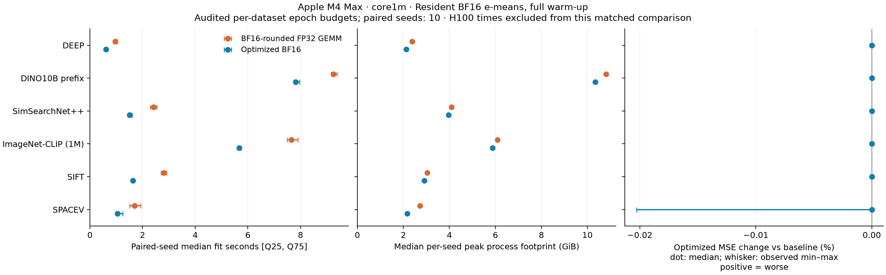
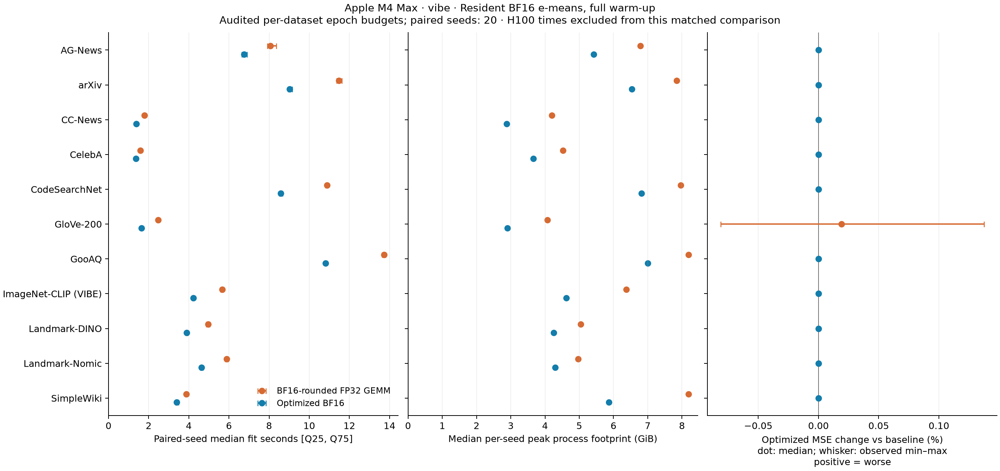

# Resident BF16 Metal e-means and published H100 context

**17/17 configurations; 560 mode/seed records and 280 matched seed pairs.** This rerun uses resident FP32 input, BF16-rounded assignment and statistics values, FP32 centroid state, last-epoch means, captured moving labels, and an identical full warm-up. Epoch budgets follow the audited manifest: four published aggregate core H100 crossing budgets, eleven backend-unverified Table 11 budgets, and two supplemental three-epoch core configurations.

**Each table-level epoch budget is held fixed across all local seeds.** The reference core experiment instead searched each seed independently against its own Flash-KMeans@25 quality target and reported the upper median crossing budget. Its individual crossing budgets are not released. This is a fixed-budget rerun using the published summaries, not a reproduction of per-seed H100 stopping epochs. Table 11 likewise supplies no per-seed budget sequence and does not specify the epoch row's aggregation rule.

## Implementation and profiling

The original FP32 profile attributed about 94–96% of fit time to assignment on DEEP and DINO. The optimized implementation uses native BF16 matrix fragments, contiguous vector tile loads, and a register-level nearest-centroid reduction. It writes one FP32 score and uint32 index per 64-centroid tile, rather than a full batch-by-centroid score matrix: 32× less score/index storage at equal row counts, before small merge outputs. Row tile sizes and other buffers differ; measured process-memory ratios are reported below. Fused centroid norms and residual kernels consume BF16 values directly while accumulating in FP32. The resident fit API separates preparation and host export from training without removing shuffling, casting, history, or final-pass labels from the fit timer.

Raw stage profiles and kernel tuning sweeps are preserved in [optimization evidence](../benchmarks/e_means/results/optimization). Stage instrumentation serializes GPU work, so its stage sums are diagnostic rather than an asynchronous hardware trace. The optimization speedups below compare matched BF16 runs. Earlier cold FP32 results used a different protocol and are not a causal measure of this kernel optimization. Their original implementation remains archived in [the pre-optimization source snapshot](../benchmarks/e_means/reference/metal-v1-source.zip).

## Matched Metal optimization comparison

Baseline and optimized measurements below use the same data, initial centroids, seed, resolved recipe, source, hardware, and timing scope. Baseline uses BF16-rounded operands widened to FP32 for MLX GEMM; optimized uses the selected native-BF16 assignment path. Only seeds measured in both modes enter this table. Extra optimized seeds are reported separately.

| Dataset | Epochs | Baseline s | Optimized s | Speedup | Optimized MSE change | Peak footprint GiB B / O | Paired seeds |
|---|---:|---:|---:|---:|---:|---:|---|
| DEEP | 2 | 0.964 | 0.611 | 1.56× | 0.000% | 2.386 / 2.131 | 10 |
| DINO10B prefix | 2 | 9.250 | 7.817 | 1.19× | 0.000% | 10.811 / 10.338 | 10 |
| SimSearchNet++ | 1.4 | 2.424 | 1.509 | 1.59× | 0.000% | 4.096 / 3.965 | 10 |
| ImageNet-CLIP (1M) | 3 | 7.658 | 5.668 | 1.35× | 0.000% | 6.095 / 5.874 | 10 |
| SIFT | 3 | 2.800 | 1.629 | 1.69× | 0.000% | 3.040 / 2.912 | 10 |
| SPACEV | 2.4 | 1.693 | 1.048 | 1.55× | 0.000% | 2.722 / 2.169 | 10 |
| AG-News | 2.2 | 8.066 | 6.763 | 1.19× | 0.000% | 6.781 / 5.423 | 20 |
| arXiv | 2.4 | 11.474 | 9.023 | 1.27× | 0.000% | 7.850 / 6.534 | 20 |
| CC-News | 2 | 1.794 | 1.385 | 1.30× | 0.000% | 4.200 / 2.879 | 20 |
| CelebA | 1.8 | 1.589 | 1.362 | 1.17× | 0.000% | 4.527 / 3.660 | 20 |
| CodeSearchNet | 2.2 | 10.882 | 8.572 | 1.27× | 0.000% | 7.965 / 6.821 | 20 |
| GloVe-200 | 1.6 | 2.468 | 1.645 | 1.49× | 0.019% | 4.067 / 2.897 | 20 |
| GooAQ | 2.6 | 13.726 | 10.820 | 1.27× | 0.000% | 8.189 / 7.003 | 20 |
| ImageNet-CLIP (VIBE) | 1.8 | 5.670 | 4.220 | 1.35× | 0.000% | 6.375 / 4.624 | 20 |
| Landmark-DINO | 1.8 | 4.959 | 3.900 | 1.26× | 0.000% | 5.044 / 4.253 | 20 |
| Landmark-Nomic | 2.2 | 5.885 | 4.638 | 1.27× | 0.000% | 4.972 / 4.295 | 20 |
| SimpleWiki | 2.2 | 3.877 | 3.399 | 1.15× | 0.000% | 8.194 / 5.865 | 20 |

Speedup is the median of paired per-seed time ratios; quality change is the median paired percentage change (positive means optimized has worse MSE). Mode times are medians over those same paired seeds. Peak footprint is the median per-seed maximum sampled process footprint over that seed's timed calls, including the resident-input baseline.

Across 280 paired dataset/seed comparisons with defined percentage changes, the observed per-seed MSE change ranges from -0.0811144% to +0.137481%. This range describes individual seed pairs; the table reports per-dataset medians. In the quality figures, dots show those medians and whiskers show the observed per-dataset minimum and maximum, not confidence intervals.

**Memory metrics do not all improve.** The following comparisons use matching seeds with complete MLX allocator records in both modes. MLX active peak is the allocator-reported active allocation peak, separate from sampled process physical footprint and RSS. Each mode's value is the median of per-seed maxima over timed fits; the percentage compares those two medians.

- SimSearchNet++: optimized MLX active peak 2.470 GiB versus baseline 2.265 GiB (+9.0%; 10 paired seeds). On the same seeds, median sampled process footprint is 3.965 GiB versus baseline 4.096 GiB (-3.2%).
- GloVe-200: optimized MLX active peak 2.322 GiB versus baseline 2.120 GiB (+9.5%; 20 paired seeds). On the same seeds, median sampled process footprint is 2.897 GiB versus baseline 4.067 GiB (-28.8%).





## All optimized seeds and H100 context

The H100 column transcribes Table 11's rounded times; **Apple/H100 is descriptive context, not a matched hardware speedup**. VIBE epoch-to-GPU association is unverified, exact paper splits and seed IDs are unavailable, and no H100 run was performed here. No absolute H100 e-means time is supplied for the six core1M configurations; Flash-KMeans times are not substituted.

| Dataset | Rows × dimensions; k | Epochs | Optimized s median [Q25, Q75] | Time SD s | Test MSE median [min, max] | Seeds observed / expected | H100 s | Approx. Apple / H100 |
|---|---:|---:|---:|---:|---:|---:|---:|---:|
| DEEP | 1,000,000 × 96; 16,384 | 2 | 0.611 [0.588, 0.667] | 0.044 | 0.38871813 [0.38809012, 0.38936679] | 10 / 10 | — | — |
| DINO10B prefix | 1,000,000 × 1024; 16,384 | 2 | 7.817 [7.768, 7.960] | 0.549 | 0.012269432 [0.012266178, 0.012276755] | 10 / 10 | — | — |
| SimSearchNet++ | 1,000,000 × 256; 16,384 | 1.4 | 1.509 [1.447, 1.606] | 0.195 | 113454.94 [113421.78, 113475.2] | 10 / 10 | — | — |
| ImageNet-CLIP (1M) | 1,000,000 × 512; 16,384 | 3 | 5.668 [5.605, 5.736] | 0.326 | 0.21202152 [0.21177237, 0.21220981] | 10 / 10 | — | — |
| SIFT | 1,000,000 × 128; 16,384 | 3 | 1.629 [1.611, 1.659] | 0.237 | 0.19361186 [0.19336587, 0.19406577] | 10 / 10 | — | — |
| SPACEV | 1,000,000 × 100; 16,384 | 2.4 | 1.048 [0.996, 1.249] | 0.189 | 7226.0405 [7222.2777, 7231.9252] | 10 / 10 | — | — |
| AG-News | 749,088 × 1024; 16,384 | 2.2 | 6.763 [6.652, 6.910] | 0.489 | 116.43949 [116.22406, 116.61562] | 20 / 20 | 0.10 | 68× |
| arXiv | 1,324,643 × 768; 16,384 | 2.4 | 9.023 [8.946, 9.149] | 0.296 | 0.21992963 [0.21961592, 0.22016654] | 20 / 20 | 0.14 | 64× |
| CC-News | 475,295 × 768; 8,192 | 2 | 1.385 [1.371, 1.407] | 0.047 | 0.24588047 [0.24527476, 0.24649065] | 20 / 20 | 0.04 | 35× |
| CelebA | 181,573 × 2048; 8,192 | 1.8 | 1.362 [1.341, 1.389] | 0.034 | 41.013297 [40.975635, 41.109436] | 20 / 20 | 0.03 | 45× |
| CodeSearchNet | 1,354,065 × 768; 16,384 | 2.2 | 8.572 [8.507, 8.670] | 0.136 | 98.233438 [98.104309, 98.380335] | 20 / 20 | 0.13 | 66× |
| GloVe-200 | 1,172,514 × 200; 16,384 | 1.6 | 1.645 [1.629, 1.661] | 0.047 | 28.504253 [28.483772, 28.524899] | 20 / 20 | 0.05 | 33× |
| GooAQ | 1,455,024 × 768; 16,384 | 2.6 | 10.820 [10.797, 10.850] | 0.094 | 0.53533468 [0.53436529, 0.53628873] | 20 / 20 | 0.16 | 68× |
| ImageNet-CLIP (VIBE) | 1,260,979 × 512; 16,384 | 1.8 | 4.220 [4.172, 4.243] | 0.131 | 0.21192422 [0.21165987, 0.21217259] | 20 / 20 | 0.07 | 60× |
| Landmark-DINO | 740,740 × 768; 16,384 | 1.8 | 3.900 [3.861, 3.946] | 0.103 | 2005.1385 [2001.9346, 2007.597] | 20 / 20 | 0.06 | 65× |
| Landmark-Nomic | 740,729 × 768; 16,384 | 2.2 | 4.638 [4.585, 4.698] | 0.075 | 0.081795785 [0.081632547, 0.081908034] | 20 / 20 | 0.08 | 58× |
| SimpleWiki | 240,372 × 3072; 8,192 | 2.2 | 3.399 [3.334, 3.488] | 0.185 | 0.59404104 [0.59331524, 0.5952613] | 20 / 20 | 0.06 | 57× |

Time quartiles use linear interpolation over per-seed median fit times; SD is sample standard deviation across those seed medians (unavailable for one seed). Quality ranges describe measured seed outcomes, not confidence intervals. The CSV also preserves minimum and maximum time. Core seed IDs are 10–19; VIBE IDs 10–29 are an explicit local choice matching the paper's count of twenty, not verified paper IDs. Each seed's quality comes from its first timed fit; its runtime is one synchronized fit, or the median of three when its first fit was under two seconds.

## Timing, precision, and memory

The fit timer includes a new model, signature/state checks, epoch shuffling, per-batch BF16 casts, assignment, FP32 statistics/updates, revival, online objective/history, moving last-pass int64 label capture, closing means and synchronization. Input upload, full input finite/range validation, initial-center sampling, full warm-up, cache clearing before each call, host centroid copy and quality scoring are outside timing. Moving full validation to preparation differs from upstream's lighter checks. Epoch history accumulation is FP32 on Metal versus FP64 upstream; per-epoch host reads remain inside the fit.

Assignment norms use BF16-rounded centroid values widened to FP32; statistics use BF16-rounded rows widened to FP32. Explicit initial state and output centroids remain FP32, with no coordinate centering. CUDA and NumPy random streams, reduction orders and hardware differ. The shared evaluator uses Faiss FP32 nearest-centroid assignment and direct FP64 residuals.

Process physical footprint and RSS are externally sampled only across each timed fit. They include resident input/runtime baseline and retained cache, are not exclusive workspace, and must not be added to each other or to MLX allocator metrics. Sampling can miss transients shorter than its observed gaps. Missing/incomplete memory is suppressed. Raw files retain every fit's sample count, gap, baseline, peak, increase and MLX allocation diagnostics.

The memory appendix uses **all available valid seeds for each mode**, including unpaired mode/seed records. Each cell is the median of per-seed peaks, where each seed's peak is the maximum over its timed fits. Counts distinguish available seeds from complete process-memory and allocator records. Incomplete records do not contribute to the corresponding memory median. These aggregates may use more seeds than the paired comparison above.

| Dataset | Mode | Median peak footprint GiB | Median peak RSS GiB | Median MLX active peak GiB | Seeds available; process / allocator complete |
|---|---|---:|---:|---:|---:|
| DEEP | baseline | 2.386 | 0.933 | 1.481 | 10; 10 / 10 |
| DEEP | optimized | 2.131 | 0.935 | 1.353 | 10; 10 / 10 |
| DINO10B prefix | baseline | 10.811 | 8.448 | 5.902 | 10; 10 / 10 |
| DINO10B prefix | optimized | 10.338 | 8.448 | 5.214 | 10; 10 / 10 |
| SimSearchNet++ | baseline | 4.096 | 2.173 | 2.265 | 10; 10 / 10 |
| SimSearchNet++ | optimized | 3.965 | 2.186 | 2.470 | 10; 10 / 10 |
| ImageNet-CLIP (1M) | baseline | 6.095 | 4.165 | 3.645 | 10; 10 / 10 |
| ImageNet-CLIP (1M) | optimized | 5.874 | 4.166 | 3.113 | 10; 10 / 10 |
| SIFT | baseline | 3.040 | 1.639 | 1.669 | 10; 10 / 10 |
| SIFT | optimized | 2.912 | 1.652 | 1.524 | 10; 10 / 10 |
| SPACEV | baseline | 2.722 | 0.965 | 1.525 | 10; 10 / 10 |
| SPACEV | optimized | 2.169 | 0.965 | 1.387 | 10; 10 / 10 |
| AG-News | baseline | 6.781 | 6.232 | 4.943 | 20; 20 / 20 |
| AG-News | optimized | 5.423 | 6.234 | 4.255 | 20; 20 / 20 |
| arXiv | baseline | 7.850 | 8.023 | 5.892 | 20; 20 / 20 |
| arXiv | optimized | 6.534 | 8.023 | 5.364 | 20; 20 / 20 |
| CC-News | baseline | 4.200 | 3.030 | 3.673 | 20; 20 / 20 |
| CC-News | optimized | 2.879 | 3.032 | 2.439 | 20; 20 / 20 |
| CelebA | baseline | 4.527 | 3.308 | 3.387 | 20; 20 / 20 |
| CelebA | optimized | 3.660 | 3.307 | 2.888 | 20; 20 / 20 |
| CodeSearchNet | baseline | 7.965 | 8.191 | 5.977 | 20; 20 / 20 |
| CodeSearchNet | optimized | 6.821 | 8.192 | 5.448 | 20; 20 / 20 |
| GloVe-200 | baseline | 4.067 | 2.006 | 2.120 | 20; 20 / 20 |
| GloVe-200 | optimized | 2.897 | 2.012 | 2.322 | 20; 20 / 20 |
| GooAQ | baseline | 8.189 | 8.770 | 6.266 | 20; 20 / 20 |
| GooAQ | optimized | 7.003 | 8.771 | 5.738 | 20; 20 / 20 |
| ImageNet-CLIP (VIBE) | baseline | 6.375 | 5.172 | 4.144 | 20; 20 / 20 |
| ImageNet-CLIP (VIBE) | optimized | 4.624 | 5.173 | 3.612 | 20; 20 / 20 |
| Landmark-DINO | baseline | 5.044 | 4.672 | 4.030 | 20; 20 / 20 |
| Landmark-DINO | optimized | 4.253 | 4.673 | 3.356 | 20; 20 / 20 |
| Landmark-Nomic | baseline | 4.972 | 4.673 | 4.030 | 20; 20 / 20 |
| Landmark-Nomic | optimized | 4.295 | 4.674 | 3.341 | 20; 20 / 20 |
| SimpleWiki | baseline | 8.194 | 6.124 | 5.347 | 20; 20 / 20 |
| SimpleWiki | optimized | 5.865 | 6.124 | 4.456 | 20; 20 / 20 |

[Memory aggregate CSV with raw evidence paths](../benchmarks/e_means/results/h100_protocol/memory_summary.csv).


## Evidence and limits

Hardware: Apple M4 Max, 128 GiB. Versions: python 3.14.2, numpy 2.5.4, scipy 1.18.1, mlx 0.32.4, scikit-learn 1.9.1, faiss-cpu 1.16.0, h5py 3.16.0.

[Audited protocol and unresolved differences](../benchmarks/e_means/H100_PROTOCOL.md) · [Machine-readable workload manifest](../benchmarks/e_means/h100_protocol.json) · [Frozen-manifest interpretation notes](../benchmarks/e_means/h100_protocol_addendum.json) · [Summary CSV](../benchmarks/e_means/results/h100_protocol/summary.csv) · [Raw evidence hashes](../benchmarks/e_means/results/h100_protocol/report_manifest.json).

Core published split overlaps are retained: DEEP1M has four overlapping evaluation vectors and SPACEV1M six; SIFT1M has no released 1M fingerprint. VIBE uses newly prepared duplicate-disjoint holdouts rather than unpublished paper indices. The two supplemental core T3 results have no matched published H100 budget/time. Ten-million and larger runs are excluded.

```bash
.venv/bin/python benchmarks/e_means/h100.py --seeds 10
.venv/bin/python benchmarks/e_means/h100.py  # all manifest seeds, both modes; resumes pilot
.venv/bin/python benchmarks/e_means/h100_report.py
uv run --isolated --no-project --with matplotlib --python .venv/bin/python benchmarks/e_means/h100_report.py --plots
```

[Saved coverage/source audit with raw-file hashes](../benchmarks/e_means/results/h100_protocol/validation.json).
