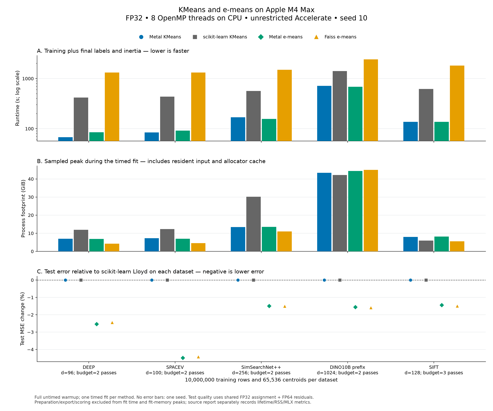

# KMeans and e-means on five 10M datasets

**Complete: 20/20 accepted measurements.** Each configuration uses 10,000,000 rows, 65,536 centers, FP32 input and seed 10. These are single-seed measurements, with no error bars or statistical-significance claim.

All four methods start from identical explicit centers and use the same integer pass budget. The timed result includes final nearest-center labels and training inertia. Lower test MSE is better.

Across the five datasets, Metal KMeans ran at 1.96–6.19× the speed of scikit-learn KMeans. The Metal KMeans/Metal e-means runtime ratio ranged from 0.801–1.08×; values above one favor e-means. Observed test-MSE changes for Metal KMeans versus scikit-learn ranged from -0.0029682% to +0.00049007%. Observed test-MSE changes for Metal e-means versus Metal KMeans ranged from -4.4812% to -1.4339%.

| Dataset | Method | Budget / actual passes | Time (s) | Fit footprint (GiB) | Test MSE |
|---|---|---:|---:|---:|---:|
| DEEP | Metal KMeans | 2 / 2 | 67.739 | 6.998 | 0.35072240 |
| DEEP | scikit-learn KMeans | 2 / 2 | 419.024 | 11.888 | 0.35072068 |
| DEEP | Metal e-means | 2 / 2 | 84.525 | 6.814 | 0.34182333 |
| DEEP | Faiss e-means | 2 / 2 | 1316.119 | 4.270 | 0.34214898 |
| SPACEV | Metal KMeans | 2 / 2 | 83.792 | 7.289 | 6680.55657579 |
| SPACEV | scikit-learn KMeans | 2 / 2 | 436.886 | 12.350 | 6680.54742107 |
| SPACEV | Metal e-means | 2 / 2 | 91.534 | 6.916 | 6381.19034911 |
| SPACEV | Faiss e-means | 2 / 2 | 1317.260 | 4.512 | 6385.02336835 |
| SimSearchNet++ | Metal KMeans | 2 / 2 | 169.059 | 13.454 | 110979.52534360 |
| SimSearchNet++ | scikit-learn KMeans | 2 / 2 | 566.796 | 30.199 | 110980.14467498 |
| SimSearchNet++ | Metal e-means | 2 / 2 | 156.089 | 13.498 | 109326.02122924 |
| SimSearchNet++ | Faiss e-means | 2 / 2 | 1493.677 | 10.963 | 109305.72659845 |
| DINO10B prefix | Metal KMeans | 2 / 2 | 717.691 | 43.428 | 0.01139336 |
| DINO10B prefix | scikit-learn KMeans | 2 / 2 | 1409.493 | 42.194 | 0.01139337 |
| DINO10B prefix | Metal e-means | 2 / 2 | 683.099 | 44.344 | 0.01121605 |
| DINO10B prefix | Faiss e-means | 2 / 2 | 2414.187 | 44.992 | 0.01121236 |
| SIFT | Metal KMeans | 3 / 3 | 137.247 | 8.020 | 0.19573591 |
| SIFT | scikit-learn KMeans | 3 / 3 | 620.928 | 5.943 | 0.19574172 |
| SIFT | Metal e-means | 3 / 3 | 137.319 | 8.186 | 0.19292923 |
| SIFT | Faiss e-means | 3 / 3 | 1816.697 | 5.509 | 0.19282239 |

| Dataset | sklearn / Metal KMeans | Metal KMeans / Metal e-means | Faiss / Metal e-means | Metal KMeans MSE vs sklearn | Metal e-means MSE vs Metal KMeans | Metal e-means MSE vs Faiss |
|---|---:|---:|---:|---:|---:|---:|
| DEEP | 6.186× | 0.801× | 15.571× | +0.00049007% | -2.5374% | -0.09518% |
| SPACEV | 5.214× | 0.915× | 14.391× | +0.00013704% | -4.4812% | -0.060031% |
| SimSearchNet++ | 3.353× | 1.083× | 9.569× | -0.00055806% | -1.4899% | +0.018567% |
| DINO10B prefix | 1.964× | 1.051× | 3.534× | -8.1966e-05% | -1.5563% | +0.032873% |
| SIFT | 4.524× | 0.999× | 13.230× | -0.0029682% | -1.4339% | +0.055408% |

Ratios above one mean the denominator is faster. Positive MSE change means the named numerator has higher error. The Lloyd/e-means ratio compares different algorithms at a shared pass budget, not matched clustering quality.



[Download the comparison figure as PDF](../benchmarks/e_means/kmeans_figures/comparison.pdf)

## Memory and training-quality diagnostics

| Dataset / method | Fit RSS (GiB) | MLX peak active (GiB) | Lifetime through preparation / timed fit (GiB) | Train-sample MSE | Native labels |
|---|---:|---:|---:|---:|---|
| DEEP / Metal KMeans | 3.811 | 5.843 | 7.613 / 9.605 | 0.34356582 | int64 |
| DEEP / scikit-learn KMeans | 11.930 | — | 3.836 / 11.888 | 0.34356599 | int32 |
| DEEP / Metal e-means | 3.968 | 5.756 | 7.613 / 8.921 | 0.33007351 | int32 |
| DEEP / Faiss e-means | 4.320 | — | 3.835 / 4.364 | 0.32993702 | int32 |
| SPACEV / Metal KMeans | 4.091 | 5.972 | 7.918 / 10.918 | 6601.49896970 | int64 |
| SPACEV / scikit-learn KMeans | 12.390 | — | 3.990 / 12.350 | 6601.52853061 | int32 |
| SPACEV / Metal e-means | 4.174 | 5.066 | 7.918 / 10.236 | 6282.25833348 | int32 |
| SPACEV / Faiss e-means | 4.560 | — | 3.988 / 4.552 | 6272.35104358 | int32 |
| SimSearchNet++ / Metal KMeans | 10.012 | 12.017 | 19.656 / 19.656 | 109417.78294057 | int64 |
| SimSearchNet++ / scikit-learn KMeans | 30.225 | — | 9.873 / 30.237 | 109418.34198362 | int32 |
| SimSearchNet++ / Metal e-means | 10.170 | 12.014 | 19.656 / 19.656 | 107188.29906854 | int32 |
| SimSearchNet++ / Faiss e-means | 11.015 | — | 9.873 / 11.629 | 107230.75053265 | int32 |
| DINO10B prefix / Metal KMeans | 1.403 | 41.046 | 78.153 / 78.153 | 0.01038793 | int64 |
| DINO10B prefix / scikit-learn KMeans | 42.215 | — | 39.520 / 42.194 | 0.01038799 | int32 |
| DINO10B prefix / Metal e-means | 12.364 | 41.688 | 77.379 / 77.379 | 0.00998590 | int32 |
| DINO10B prefix / Faiss e-means | 45.015 | — | 39.520 / 46.535 | 0.00999139 | int32 |
| SIFT / Metal KMeans | 5.159 | 6.136 | 10.035 / 10.035 | 0.17941954 | int64 |
| SIFT / scikit-learn KMeans | 5.982 | — | 5.055 / 5.943 | 0.17942077 | int32 |
| SIFT / Metal e-means | 5.243 | 6.995 | 10.035 / 10.035 | 0.17447211 | int32 |
| SIFT / Faiss e-means | 5.557 | — | 5.055 / 5.930 | 0.17410399 | int32 |

Process footprint and RSS are sampled every 10 ms during fit handshakes, including resident input and retained allocator cache. Short peaks may be missed. MLX allocation is separate and is never added to process memory. Lifetime peaks include earlier preparation and warmup; they are not fit-window peaks. CSV retains baseline, peak increase, maximum sample gaps and allocator cache values. Across repeated calls, each memory column is a maximum and need not describe the same call.

## Protocol and limits

DEEP, SPACEV, SimSearchNet++ and DINO use two full passes; SIFT uses three. Lloyd can stop earlier on unchanged labels or zero center shift even with tol=0, so actual iterations are reported. E-means uses the pinned Faiss quality batch law and last-epoch moving-assignment means. It is then reassigned once against its final centers. Earlier fractional-budget or online-label-only measurements are historical and are not reused.

Each method runs in a fresh process, with one identical full untimed warmup. Data loading, explicit initialization, Metal validation/upload/preparation, cache clearing, host export and shared quality scoring are excluded. Timed work includes a fresh model, training, final labels/inertia and GPU synchronization where applicable. CPU validation and sklearn's centering/sample-weight allocation remain inside their public fit calls. A first timed fit under two seconds triggers two more; reported time is the median, while quality is from the first fit. OS file and shader caches are not flushed.

scikit-learn uses unmodified Lloyd KMeans, n_init=1, tol=0 and copy_x=False. It subtracts and restores the input mean in place; exact cached data is reloaded and checked outside timing before each timed call. Its empty-cluster relocation can allocate full n×d temporary matrices. DINO's FP32 input alone occupies 38.147 GiB, so preparation and any relocation transients matter beyond fit-only memory summaries. Metal releases its complete NumPy input reference after device preparation. Neither method is an out-of-core implementation.

Eight OpenMP threads are requested before imports; sklearn's observed thread count and loaded thread pools are recorded. Accelerate threading is unrestricted. scikit-learn's BLAS-limit wrapper does not establish a measured single-thread Accelerate configuration when threadpoolctl cannot control that library.

The four implementations differ in reduction order, empty-cluster treatment, centroid-update arithmetic and label dtype. Lloyd holds centers fixed for each pass; e-means moves them between mini-batches. Identical initialization does not imply identical centers or bitwise trajectories. Native full-training inertia reductions also differ; quality comparisons use shared FP32 Faiss assignment followed by direct FP64 residuals on the test set and a fixed 10,000-row training sample. The training-sample metric is not full-training MSE. Label agreement and selected-label residual diagnostics are preserved in CSV/raw records.

Dataset identity covers complete official test arrays and 1,000 evenly spaced training fingerprints, not a full training-file digest. DINO and SIFT retain the pinned /4096 and /512 scaling. Published combined validation/test duplicate overlap with training is four vectors for DEEP and 45 for SPACEV; these are not test-only counts and the holdouts are not claimed to be duplicate-disjoint. This campaign does not reproduce H100 timing or per-seed crossing budgets.

## Evidence

[Frozen protocol](../benchmarks/e_means/kmeans_protocol.json); [validation and raw hashes](../benchmarks/e_means/results/kmeans_comparison/validation.json); [per-method CSV](../benchmarks/e_means/results/kmeans_comparison/summary.csv); [paired-comparison CSV](../benchmarks/e_means/results/kmeans_comparison/comparisons.csv); [KMeans API documentation](k-means.md).

[Frozen source archive](../benchmarks/e_means/reference/kmeans-comparison-source.zip) SHA-256: `a0c98fea2653c920eea9290a44885cbdc546fdefbd12f10e0f129506be4e1ea4`.

Recorded machine and software:

```json
{
  "hardware": {
    "cpu": "Apple M4 Max",
    "machine": "arm64",
    "platform": "macOS-26.6.2-arm64-arm-64bit-Mach-O",
    "ram_bytes": 137438953472
  },
  "thread_environment": {
    "OMP_NUM_THREADS": "8",
    "VECLIB_MAXIMUM_THREADS": null
  },
  "versions": {
    "faiss-cpu": "1.16.0",
    "h5py": "3.16.0",
    "mlx": "0.32.4",
    "numpy": "2.5.4",
    "python": "3.14.2",
    "scikit-learn": "1.9.1",
    "scipy": "1.18.1"
  }
}
```

| Dataset / method | Raw evidence |
|---|---|
| DEEP / Metal KMeans | [JSON](../benchmarks/e_means/results/kmeans_comparison/deep1b-10M-metal-kmeans-s10-592e0a950692.json) |
| DEEP / scikit-learn KMeans | [JSON](../benchmarks/e_means/results/kmeans_comparison/deep1b-10M-sklearn-kmeans-s10-af58e876d0a5.json) |
| DEEP / Metal e-means | [JSON](../benchmarks/e_means/results/kmeans_comparison/deep1b-10M-metal-emeans-s10-f8136fe8093f.json) |
| DEEP / Faiss e-means | [JSON](../benchmarks/e_means/results/kmeans_comparison/deep1b-10M-faiss-emeans-s10-9135c4286f1c.json) |
| SPACEV / Metal KMeans | [JSON](../benchmarks/e_means/results/kmeans_comparison/spacev-10M-metal-kmeans-s10-ba793b268f60.json) |
| SPACEV / scikit-learn KMeans | [JSON](../benchmarks/e_means/results/kmeans_comparison/spacev-10M-sklearn-kmeans-s10-179c986130d0.json) |
| SPACEV / Metal e-means | [JSON](../benchmarks/e_means/results/kmeans_comparison/spacev-10M-metal-emeans-s10-e33735c80c04.json) |
| SPACEV / Faiss e-means | [JSON](../benchmarks/e_means/results/kmeans_comparison/spacev-10M-faiss-emeans-s10-4b6930a65866.json) |
| SimSearchNet++ / Metal KMeans | [JSON](../benchmarks/e_means/results/kmeans_comparison/fb-ssnpp-10M-metal-kmeans-s10-39d174e4bf4e.json) |
| SimSearchNet++ / scikit-learn KMeans | [JSON](../benchmarks/e_means/results/kmeans_comparison/fb-ssnpp-10M-sklearn-kmeans-s10-35e05e5ee663.json) |
| SimSearchNet++ / Metal e-means | [JSON](../benchmarks/e_means/results/kmeans_comparison/fb-ssnpp-10M-metal-emeans-s10-bbd9c5d8e796.json) |
| SimSearchNet++ / Faiss e-means | [JSON](../benchmarks/e_means/results/kmeans_comparison/fb-ssnpp-10M-faiss-emeans-s10-9a2ce0e31135.json) |
| DINO10B prefix / Metal KMeans | [JSON](../benchmarks/e_means/results/kmeans_comparison/dino10b-10M-div4096-metal-kmeans-s10-93d60e0caf4f.json) |
| DINO10B prefix / scikit-learn KMeans | [JSON](../benchmarks/e_means/results/kmeans_comparison/dino10b-10M-div4096-sklearn-kmeans-s10-7966b44fb14b.json) |
| DINO10B prefix / Metal e-means | [JSON](../benchmarks/e_means/results/kmeans_comparison/dino10b-10M-div4096-metal-emeans-s10-db738ffabcc7.json) |
| DINO10B prefix / Faiss e-means | [JSON](../benchmarks/e_means/results/kmeans_comparison/dino10b-10M-div4096-faiss-emeans-s10-4cf8fb739bb3.json) |
| SIFT / Metal KMeans | [JSON](../benchmarks/e_means/results/kmeans_comparison/sift1b-10M-div512-metal-kmeans-s10-083caec8f56a.json) |
| SIFT / scikit-learn KMeans | [JSON](../benchmarks/e_means/results/kmeans_comparison/sift1b-10M-div512-sklearn-kmeans-s10-3d9680920f67.json) |
| SIFT / Metal e-means | [JSON](../benchmarks/e_means/results/kmeans_comparison/sift1b-10M-div512-metal-emeans-s10-3c6fea1ba26a.json) |
| SIFT / Faiss e-means | [JSON](../benchmarks/e_means/results/kmeans_comparison/sift1b-10M-div512-faiss-emeans-s10-940e5a886624.json) |
