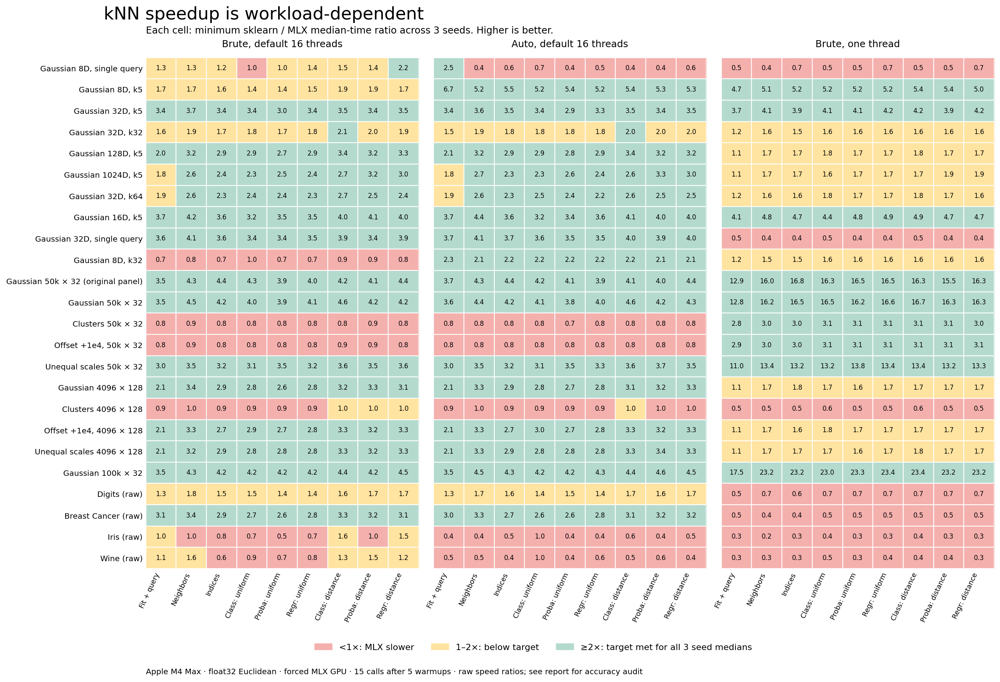

# Broad kNN benchmark against sklearn — October 30, 2026

**No: the new MLX GPU version is not consistently 2× faster than sklearn across varied workloads.** The earlier 2× result applied to the 50,000-row, 32-feature Gaussian workload. This broader run covers 72 dataset instances in 24 families, three seeds each, and nine search/inference operations. Large Gaussian and unequal-scale batches retain substantial gains; clustered, offset, small-real-data and single-query workloads expose limits. Production source was unchanged.

| sklearn baseline | Dataset-operation medians ≥2× | Individual paired calls ≥2× | Consistently ≥2×? |
| --- | --- | --- | --- |
| Brute, default 16 threads | 402/648 (62.0%) | 6,208/9,720 (63.9%) | No |
| Auto, default 16 threads | 452/648 (69.8%) | 6,672/9,720 (68.6%) | No |
| Brute, one thread | 245/648 (37.8%) | 4,053/9,720 (41.7%) | No |

If sklearn is allowed the fastest median of these three measured configurations for each dataset and operation, only **168/648 (25.9%)** comparisons reach 2×. This is a best-of-measured-configurations comparison, not a claim that one fixed sklearn configuration achieves every best result. The percentages describe this equally weighted benchmark panel, not the frequency of workloads in real applications.

All **14,472 current-version audits pass** (72 first-query, 3,600 warmup, 10,800 retained, including fit-only). Source, loaded-worker, fixture and harness hashes match before and after the run. Sklearn has some numerical and canonical-tie audit differences detailed below; all its timings remain in the speed tables.



## What holds up

- Gaussian 50k × 32 queries: **4.29–4.90×** versus default brute; fresh fit + query: **3.48–4.42×**. Both independent seed sets pass every retained paired call for all nine operations against all three sklearn configurations.
- Gaussian 100k × 32 queries: **4.30–4.97×**; fresh: **3.48–3.70×** versus default brute.
- Unequal-scale 50k × 32 queries: **3.46–3.73×**; fresh: **3.05–3.15×** versus default brute.
- Established Gaussian 128-feature queries: **3.22–4.16×** versus default brute, but only **1.69–1.78×** versus single-thread brute.
- Offset +1e4 at 50k × 32: **0.86–0.88×** query and **0.82–0.90×** fresh versus default brute.
- Clusters at 4096 × 128: **0.96–1.02×** query and **0.88–0.93×** fresh versus default brute.
- Iris and Wine queries: **0.35–0.56×** and **0.51–0.68×** versus sklearn auto, which selects KD-tree. Single-thread brute is faster still on these small datasets.

Only **6/24 families** pass all 27 seed-operation medians against all three baselines: Gaussian batches at 16D and 32D, both 50k Gaussian seed sets, 50k unequal scales, and 100k Gaussian. Five also pass every retained pair; the 8192 × 32 Gaussian family misses one default-brute pair. This is a workload-specific acceleration, not a universal sklearn replacement speed guarantee.

## Protocol and scope

Apple M4 Max, 128 GiB unified memory, macOS 26.6.2; Python 3.13.3, MLX 0.32.2, NumPy 2.5.2, sklearn 1.9.0. Four persistent isolated workers run serially. Current explicitly uses the MLX GPU backend with brute search; sklearn uses brute/default 16 OpenMP threads, brute/one thread, or auto/default threads. Auto's actual fitted algorithm is retained per call. This measures the forced GPU path, not mlxlearn's automatic CPU/GPU dispatch.

Each dataset-operation-variant gets five warmups and 15 retained calls. Variant order rotates by case and operation and reverses each round. Timing surrounds the public NumPy-input/output call with synchronization; validation, conversion and GPU transfers are included, worker IPC and oracle checks are excluded. Fresh fit + query constructs a new estimator each time and includes deferred preparation. Repeated query/prediction uses a fitted estimator; no result cache is used. Fit-only is separate. The recorded 'cold' call is first fit/query per fixture in a persistent worker, not a fresh-process compiler startup measurement. Default and auto workers that both choose brute can differ through ordinary timing variation; that difference is not an algorithmic auto benefit.

Speedup means sklearn median milliseconds / current median milliseconds, so below 1× means MLX is slower. Each family range spans its three seed-specific ratios; it is not a ratio of independently selected range endpoints. Individual paired-call gates use corresponding retained rounds. No confidence intervals or universal statistical claim are inferred from these descriptive timings.

The panel includes the previous eleven Gaussian shapes (1–256 queries, 8–1024 features, k=5/32/64); Gaussian, 16-cluster, +1e4-offset and unequal-scale distributions at 50k × 32 and 4096 × 128; a 100k × 32 Gaussian workload; and bundled Digits, Breast Cancer, Iris and Wine. Unequal feature multipliers span 1e-2 to 1e2. Synthetic batched fixtures include two copied training rows as queries to check zero distances. Real data use raw float32 features and deterministic stratified holdouts, with no scaling or jitter. Real classification labels are also used numerically for the regression timing exercise; those regression timings are not evidence of regression-model quality. Large real datasets, sparse input, other metrics, float64 and other hardware are outside this run. Exact seeds and fixture hashes are in the raw JSON.

## All query workloads

Ranges below span three seeds. The final column counts all nine operation medians reaching 2× out of 27, in the order default brute / auto / single-thread brute. Query includes distances and indices.

| Family | Train × features; queries; k | Current query ms | vs default brute | vs auto | vs one thread | Medians ≥2× /27 |
| --- | --- | --- | --- | --- | --- | --- |
| Gaussian 8D, single query | 8,192 × 8; 1; 5 | 0.571–0.589 | 1.29–1.44× | 0.36–0.37× | 0.43–0.44× | 7 / 3 / 0 |
| Gaussian 8D, k5 | 8,192 × 8; 256; 5 | 0.743–0.801 | 1.73–1.88× | 5.22–6.06× | 5.13–5.50× | 4 / 27 / 27 |
| Gaussian 32D, k5 | 8,192 × 32; 256; 5 | 0.991–1.072 | 3.72–4.52× | 3.60–4.37× | 4.08–4.37× | 27 / 27 / 27 |
| Gaussian 32D, k32 | 8,192 × 32; 128; 32 | 1.622–1.938 | 1.88–2.37× | 1.89–2.39× | 1.55–1.86× | 13 / 15 / 0 |
| Gaussian 128D, k5 | 4,096 × 128; 128; 5 | 0.951–1.005 | 3.22–4.16× | 3.17–4.17× | 1.69–1.78× | 27 / 27 / 0 |
| Gaussian 1024D, k5 | 2,048 × 1024; 32; 5 | 1.313–1.363 | 2.61–2.99× | 2.69–3.42× | 1.66–1.80× | 24 / 25 / 0 |
| Gaussian 32D, k64 | 4,096 × 32; 128; 64 | 1.474–1.554 | 2.58–3.03× | 2.63–2.99× | 1.65–1.74× | 25 / 26 / 0 |
| Gaussian 16D, k5 | 8,192 × 16; 256; 5 | 0.810–0.854 | 4.22–4.55× | 4.36–4.55× | 4.84–5.09× | 27 / 27 / 27 |
| Gaussian 32D, single query | 8,192 × 32; 1; 5 | 0.486–0.663 | 4.10–6.08× | 4.12–6.08× | 0.40–0.60× | 27 / 27 / 0 |
| Gaussian 8D, k32 | 8,192 × 8; 128; 32 | 1.875–1.915 | 0.82–1.11× | 2.13–2.22× | 1.49–1.53× | 0 / 27 / 0 |
| Gaussian 50k × 32 (original panel) | 50,000 × 32; 256; 5 | 1.510–1.558 | 4.29–4.52× | 4.27–4.53× | 16.04–16.56× | 27 / 27 / 27 |
| Gaussian 50k × 32 | 50,000 × 32; 256; 5 | 1.417–1.540 | 4.47–4.90× | 4.41–4.88× | 16.20–17.61× | 27 / 27 / 27 |
| Clusters 50k × 32 | 50,000 × 32; 256; 5 | 5.015–8.296 | 0.86–1.33× | 0.81–1.38× | 3.01–4.98× | 0 / 0 / 27 |
| Offset +1e4, 50k × 32 | 50,000 × 32; 256; 5 | 8.166–8.315 | 0.86–0.88× | 0.78–0.92× | 3.00–3.05× | 0 / 0 / 27 |
| Unequal scales 50k × 32 | 50,000 × 32; 256; 5 | 1.861–1.871 | 3.46–3.73× | 3.48–3.63× | 13.38–13.44× | 27 / 27 / 27 |
| Gaussian 4096 × 128 | 4,096 × 128; 128; 5 | 0.925–0.981 | 3.35–3.53× | 3.31–3.56× | 1.72–1.84× | 27 / 27 / 0 |
| Clusters 4096 × 128 | 4,096 × 128; 128; 5 | 3.146–3.254 | 0.96–1.02× | 1.00–1.06× | 0.52–0.55× | 0 / 0 / 0 |
| Offset +1e4, 4096 × 128 | 4,096 × 128; 128; 5 | 0.914–1.009 | 3.32–3.56× | 3.25–3.59× | 1.70–1.85× | 27 / 27 / 2 |
| Unequal scales 4096 × 128 | 4,096 × 128; 128; 5 | 0.958–1.010 | 3.17–3.38× | 3.25–3.43× | 1.69–1.77× | 27 / 27 / 0 |
| Gaussian 100k × 32 | 100,000 × 32; 256; 5 | 1.946–2.137 | 4.30–4.97× | 4.54–4.89× | 23.22–25.53× | 27 / 27 / 27 |
| Digits (raw) | 1,541 × 64; 256; 5 | 1.362–1.702 | 1.78–2.19× | 1.70–2.13× | 0.65–0.82× | 5 / 5 / 0 |
| Breast Cancer (raw) | 455 × 30; 114; 5 | 0.626–0.634 | 3.37–3.42× | 3.34–3.49× | 0.43–0.45× | 27 / 27 / 0 |
| Iris (raw) | 120 × 4; 30; 5 | 0.352–0.607 | 0.99–1.65× | 0.35–0.56× | 0.24–0.37× | 0 / 0 / 0 |
| Wine (raw) | 142 × 13; 36; 5 | 0.321–0.399 | 1.59–1.87× | 0.51–0.68× | 0.35–0.46× | 0 / 0 / 0 |

## Fresh fit + query

| Family | Current fresh ms | vs default brute | vs auto | vs one thread |
| --- | --- | --- | --- | --- |
| Gaussian 8D, single query | 0.474–0.675 | 1.33–1.82× | 2.46–3.49× | 0.51–0.75× |
| Gaussian 8D, k5 | 0.828–0.878 | 1.72–2.18× | 6.70–6.96× | 4.75–5.08× |
| Gaussian 32D, k5 | 1.097–1.185 | 3.42–4.04× | 3.38–4.09× | 3.75–4.06× |
| Gaussian 32D, k32 | 2.369–2.581 | 1.55–1.96× | 1.53–2.13× | 1.22–1.32× |
| Gaussian 128D, k5 | 1.550–1.636 | 2.02–2.47× | 2.06–2.52× | 1.10–1.18× |
| Gaussian 1024D, k5 | 2.233–2.280 | 1.75–1.99× | 1.78–2.02× | 1.13–1.17× |
| Gaussian 32D, k64 | 2.021–2.200 | 1.91–2.46× | 1.91–2.37× | 1.22–1.32× |
| Gaussian 16D, k5 | 0.977–1.022 | 3.69–3.90× | 3.71–3.92× | 4.14–4.33× |
| Gaussian 32D, single query | 0.760–0.806 | 3.65–3.83× | 3.66–3.94× | 0.48–0.49× |
| Gaussian 8D, k32 | 2.300–2.468 | 0.69–0.71× | 2.33–2.43× | 1.19–1.29× |
| Gaussian 50k × 32 (original panel) | 1.806–1.966 | 3.55–4.01× | 3.66–3.94× | 12.86–14.01× |
| Gaussian 50k × 32 | 1.570–1.978 | 3.48–4.42× | 3.61–4.34× | 12.79–16.12× |
| Clusters 50k × 32 | 5.269–9.004 | 0.79–1.34× | 0.80–1.37× | 2.81–4.77× |
| Offset +1e4, 50k × 32 | 8.032–8.556 | 0.82–0.90× | 0.82–0.90× | 2.95–3.14× |
| Unequal scales 50k × 32 | 2.232–2.292 | 3.05–3.15× | 2.98–3.15× | 11.04–11.36× |
| Gaussian 4096 × 128 | 1.487–1.635 | 2.14–2.30× | 2.09–2.25× | 1.14–1.24× |
| Clusters 4096 × 128 | 3.696–3.838 | 0.88–0.93× | 0.89–0.94× | 0.48–0.50× |
| Offset +1e4, 4096 × 128 | 1.385–1.648 | 2.10–2.47× | 2.09–2.44× | 1.13–1.32× |
| Unequal scales 4096 × 128 | 1.578–1.609 | 2.11–2.22× | 2.09–2.20× | 1.14–1.17× |
| Gaussian 100k × 32 | 2.804–2.857 | 3.48–3.70× | 3.48–3.57× | 17.54–17.87× |
| Digits (raw) | 1.782–2.317 | 1.31–1.74× | 1.34–1.61× | 0.53–0.68× |
| Breast Cancer (raw) | 0.706–0.729 | 3.11–3.18× | 3.01–3.21× | 0.49–0.51× |
| Iris (raw) | 0.485–0.689 | 1.00–1.35× | 0.44–0.60× | 0.30–0.43× |
| Wine (raw) | 0.449–0.648 | 1.05–1.51× | 0.48–0.73× | 0.33–0.48× |

## Every operation and retained pair

Each entry is median cells ≥2× /72; individual paired calls ≥2× /1,080. Uniform and distance refer to neighbor weighting. Fit-only excludes first-query preparation and is not a substitute for fresh fit + query.

| Operation | Brute, default 16 threads | Auto, default 16 threads | Brute, one thread |
| --- | --- | --- | --- |
| `fit` (excluded from headline) | 0/72; 0/1,080 | 9/72; 135/1,080 | 0/72; 0/1,080 |
| `fit_query` | 38/72; 592/1,080 | 49/72; 687/1,080 | 27/72; 409/1,080 |
| `kneighbors` | 45/72; 724/1,080 | 51/72; 762/1,080 | 27/72; 466/1,080 |
| `indices` | 45/72; 677/1,080 | 50/72; 724/1,080 | 27/72; 456/1,080 |
| `predict_uniform` | 44/72; 674/1,080 | 50/72; 743/1,080 | 27/72; 448/1,080 |
| `proba_uniform` | 43/72; 658/1,080 | 50/72; 729/1,080 | 28/72; 458/1,080 |
| `regress_uniform` | 43/72; 669/1,080 | 49/72; 736/1,080 | 28/72; 453/1,080 |
| `predict_distance` | 49/72; 746/1,080 | 52/72; 772/1,080 | 27/72; 447/1,080 |
| `proba_distance` | 47/72; 736/1,080 | 50/72; 761/1,080 | 27/72; 457/1,080 |
| `regress_distance` | 48/72; 732/1,080 | 51/72; 758/1,080 | 27/72; 459/1,080 |

Family-level individual-call counts below include nine operations × three seeds × 15 retained pairs; no median or mean hides a slower call.

| Family | Brute, default 16 threads | Auto, default 16 threads | Brute, one thread |
| --- | --- | --- | --- |
| Gaussian 8D, single query | 109/405 | 43/405 | 0/405 |
| Gaussian 8D, k5 | 156/405 | 405/405 | 405/405 |
| Gaussian 32D, k5 | 404/405 | 405/405 | 405/405 |
| Gaussian 32D, k32 | 208/405 | 204/405 | 10/405 |
| Gaussian 128D, k5 | 394/405 | 398/405 | 65/405 |
| Gaussian 1024D, k5 | 359/405 | 361/405 | 88/405 |
| Gaussian 32D, k64 | 366/405 | 366/405 | 27/405 |
| Gaussian 16D, k5 | 405/405 | 405/405 | 405/405 |
| Gaussian 32D, single query | 405/405 | 405/405 | 0/405 |
| Gaussian 8D, k32 | 1/405 | 371/405 | 0/405 |
| Gaussian 50k × 32 (original panel) | 405/405 | 405/405 | 405/405 |
| Gaussian 50k × 32 | 405/405 | 405/405 | 405/405 |
| Clusters 50k × 32 | 8/405 | 5/405 | 405/405 |
| Offset +1e4, 50k × 32 | 8/405 | 8/405 | 405/405 |
| Unequal scales 50k × 32 | 405/405 | 405/405 | 405/405 |
| Gaussian 4096 × 128 | 398/405 | 394/405 | 63/405 |
| Clusters 4096 × 128 | 5/405 | 6/405 | 0/405 |
| Offset +1e4, 4096 × 128 | 390/405 | 393/405 | 89/405 |
| Unequal scales 4096 × 128 | 394/405 | 391/405 | 66/405 |
| Gaussian 100k × 32 | 405/405 | 405/405 | 405/405 |
| Digits (raw) | 91/405 | 87/405 | 0/405 |
| Breast Cancer (raw) | 404/405 | 405/405 | 0/405 |
| Iris (raw) | 25/405 | 0/405 | 0/405 |
| Wine (raw) | 58/405 | 0/405 | 0/405 |

## Precision and tie audit

The independent oracle exhaustively computes direct float64 squared differences on the actual stored float32 coordinates, then orders by distance and training index. Neighbor indices must match exactly; distance atol/rtol are 1e-6. Class predictions must match exactly; probabilities and regression use atol 2e-6 and rtol 2e-5. Current passes every audit. Its maximum absolute distance error is 2.296e-5 at larger distances, within the combined absolute/relative tolerance; maximum probability/regression absolute error is 3.903e-8.

| Variant | Strict passes | Valid alternative tie choices | Distance tolerance misses | Prediction misses away from boundary ties | Prediction misses on boundary ties |
| --- | --- | --- | --- | --- | --- |
| current | 14,472/14,472 | 0 | 0 | 0 | 0 |
| sklearn_default | 13,114/14,472 | 405 | 793 | 160 | 0 |
| sklearn_1 | 13,034/14,472 | 405 | 793 | 160 | 80 |
| sklearn_auto | 13,114/14,472 | 405 | 793 | 160 | 0 |

Counts are repeated audit calls across cold, warmup and retained phases, including fit-only's untimed verification query, not counts of distinct defective datasets. There are **no incorrect neighbor-membership or distance-order failures** in any variant. Sklearn's 405 canonical tie differences per variant are exact-distance-valid alternatives on Digits/Iris and are not correctness bugs. The 80 additional single-thread prediction differences occur on true boundary ties in Digits seed 251; they are flagged as ambiguous, not automatically certified equivalent. Sklearn distance tolerance misses occur on 13 dataset instances, including copied-row residuals in high-dimensional/offset data; maximum absolute error is 0.007307925. Non-boundary prediction misses occur on five dataset instances. The summary retains every case/operation and raw JSON pointer, with separate phase counts. Baseline strict-quality flags remain false, and speed tables are raw timing comparisons rather than equal-accuracy certifications for those cells.

## Reproduction and artifacts

- [Raw results, all calls and audits](../benchmarks/evidence/knn-evidence-2026-10-31.md#artifact-d99a529dcd35c0a5f03d)
- [Compact derived summary and evidence pointers](../benchmarks/evidence/knn-evidence-2026-10-31.md#artifact-398a3af0bf650fc23f36)
- [Execution record](../benchmarks/results/knn-broad-execution-2026-10-30.json) and [run log](../benchmarks/results/knn-broad-2026-10-30.log)
- [Frozen production source](../benchmarks/reference/knn-128-final-2026-10-30.zip) and [manifest](../benchmarks/reference/knn-128-final-2026-10-30.manifest.json)
- [Frozen six-file benchmark harness](../benchmarks/reference/knn-broad-harnesses-2026-10-30.zip) and [manifest](../benchmarks/reference/knn-broad-harnesses-2026-10-30.manifest.json)
- [Summary script](../benchmarks/knn_broad_summary.py), [report/plot generator](../benchmarks/knn_broad_report.py), [SVG figure](assets/knn-broad-2026-10-30.svg)
- [Previous v3 comparison and 128-feature fix](knn-128-feature-fix-2026-10-30.md)

This task added benchmark and reporting code only. The prior 652-test production validation is documented in the preceding report; it was not rerun or counted as new validation here. New benchmark validation includes an audited smoke run, full-run audits, summary completeness/counter checks, Ruff and source-integrity checks. The execution record reports a 319.7-second full run with exit code 0. The final source archive SHA-256 is `920753a01375683bcfe776e6bbb79765f6f237471913ce8155a6bdc2806cf7ca`.

```sh
python3 -m benchmarks.knn_broad --repeats 15 --warmup 5 \
  --output benchmarks/results/knn-broad-2026-10-30.json
python3 -m benchmarks.knn_broad_summary \
  --input benchmarks/results/knn-broad-2026-10-30.json \
  --output benchmarks/results/knn-broad-summary-2026-10-30.json
python3 -m benchmarks.knn_broad_report
```
