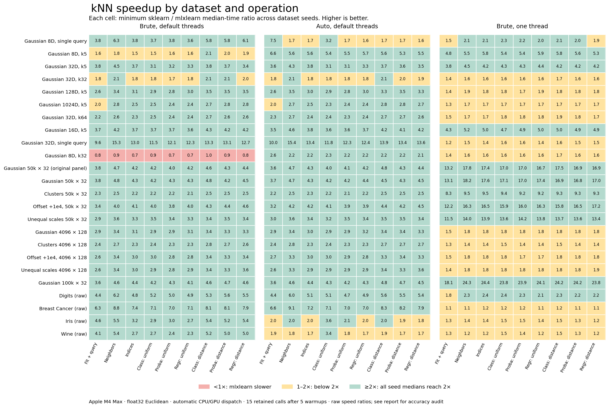

# KNN latency fixes against three sklearn configurations

Completed `2026-10-30T21:51:00.583911+00:00`. This run covers **72 dataset instances in 24 families**, 9 search/inference operations, and **15 retained calls after 5 warmups** per dataset-operation-variant. Fit-only is recorded separately and excluded from the headline 2× counts. Production source and fixture identities are recorded in the raw results.

| sklearn baseline | Medians ≥2× | Individual paired calls ≥2× | All medians ≥2×? | Every pair ≥2×? |
| --- | --- | --- | --- | --- |
| Brute, default threads | 594/648 (91.7%) | 8,857/9,720 (91.1%) | False | False |
| Auto, default threads | 583/648 (90.0%) | 8,736/9,720 (89.9%) | False | False |
| Brute, one thread | 300/648 (46.3%) | 4,875/9,720 (50.2%) | False | False |

Against the fastest median among the three measured sklearn configurations in each dataset-operation cell, **264/648 (40.7%)** reach 2×. This is a best-of-measured-configurations comparison, not one fixed sklearn setting. The panel weights each dataset-operation cell equally; percentages do not estimate real-world workload frequencies. Raw timing counts retain every baseline accuracy failure.

**8/24 families** reach 2× in every seed-operation median against all three baselines; **7/24** also reach 2× in every retained paired call. A family passes only when all its constituent cases and operations pass, without averaging away misses.

## Controlled automatic dispatch and GPU comparison

5 serial workers compare current automatic dispatch, an identical automatic A/A worker, current forced GPU and the preceding frozen small-workload GPU implementation. A fifth worker uses the preceding automatic source and its exact archived native binary. The unchanged control covers 48 fixtures and 222 case-operations, with 31 paired rounds after 0.25 seconds of continuous warmup per worker/operation. Default continuous warmup is 0.25 seconds (the preceding small control used 1 second); this is configurable and absolute timings must not be compared across those runs. Each worker/operation warms continuously for at least the requested duration. Its one post-warmup probe is audited and retained separately, excluded from paired ratios. All warmup audits and probe samples remain in the report.

Ratios are comparator/automatic time. The ratio of per-worker medians and median paired ratio are shown separately. A/A exposes process/timing variation; these are descriptive comparisons, not confidence intervals. Each worker retains its actual routing metadata.

Control accuracy and integrity acceptance: **True**. Strict quality: `{"current": true, "current_b": true, "current_gpu": true, "previous_auto": true, "previous_gpu": true}`.

| Family | Operation | Seeds | Auto ms | Current GPU/auto medians | Current GPU/auto paired | Previous GPU/auto medians | Previous GPU/auto paired | Auto A/A paired |
| --- | --- | --- | --- | --- | --- | --- | --- | --- |
| Gaussian 8D, single query | fit_query | 41, 42, 43 | 0.165–0.179 | 2.076–2.182× | 2.092–2.500× | 1.799–2.780× | 1.753–2.571× | 0.947–1.027× |
| Gaussian 8D, single query | kneighbors | 41, 42, 43 | 0.092–0.120 | 2.143–2.485× | 2.135–2.531× | 2.274–2.652× | 2.260–2.623× | 0.984–1.048× |
| Gaussian 8D, single query | indices | 41, 42, 43 | 0.084–0.093 | 2.627–4.484× | 2.837–4.803× | 2.601–2.994× | 2.672–3.049× | 0.975–1.182× |
| Gaussian 8D, single query | predict_uniform | 41, 42, 43 | 0.091–0.101 | 2.221–3.288× | 2.276–3.454× | 2.111–4.688× | 2.131–3.717× | 1.000–1.018× |
| Gaussian 8D, single query | proba_uniform | 41, 42, 43 | 0.096–0.109 | 1.939–2.964× | 1.979–3.407× | 2.263–2.843× | 2.221–3.022× | 0.993–1.084× |
| Gaussian 8D, single query | regress_uniform | 41, 42, 43 | 0.098–0.111 | 2.585–2.958× | 2.516–3.043× | 2.462–2.735× | 2.416–2.876× | 0.980–1.028× |
| Gaussian 8D, single query | predict_distance | 41, 42, 43 | 0.100–0.132 | 2.101–3.016× | 2.129–3.223× | 2.101–3.037× | 2.149–3.091× | 0.985–1.131× |
| Gaussian 8D, single query | proba_distance | 41, 42, 43 | 0.102–0.112 | 2.624–3.126× | 2.743–3.314× | 2.613–3.284× | 2.757–3.284× | 1.020–1.074× |
| Gaussian 8D, single query | regress_distance | 41, 42, 43 | 0.105–0.112 | 2.028–2.850× | 2.052–2.827× | 2.003–4.594× | 2.094–4.625× | 0.978–1.021× |
| Gaussian 32D, single query | fit_query | 49, 50, 51 | 0.236–0.251 | 1.448–1.932× | 1.455–2.031× | 1.421–1.831× | 1.431–1.869× | 0.979–1.034× |
| Gaussian 32D, single query | kneighbors | 49, 50, 51 | 0.137–0.152 | 2.093–2.272× | 2.296–2.304× | 2.200–2.277× | 2.240–2.293× | 0.926–1.050× |
| Gaussian 32D, single query | indices | 49, 50, 51 | 0.139–0.147 | 1.422–2.274× | 1.454–2.300× | 1.521–2.440× | 1.585–2.360× | 0.980–1.028× |
| Gaussian 32D, single query | predict_uniform | 49, 50, 51 | 0.144–0.147 | 1.558–2.544× | 1.576–2.596× | 1.638–2.549× | 1.651–2.600× | 0.989–1.011× |
| Gaussian 32D, single query | proba_uniform | 49, 50, 51 | 0.150–0.153 | 2.046–2.491× | 2.026–2.424× | 1.989–2.335× | 1.994–2.412× | 0.967–1.013× |
| Gaussian 32D, single query | regress_uniform | 49, 50, 51 | 0.143–0.152 | 1.659–2.263× | 1.720–2.297× | 1.460–2.322× | 1.538–2.353× | 0.993–1.084× |
| Gaussian 32D, single query | predict_distance | 49, 50, 51 | 0.151–0.155 | 2.260–2.340× | 2.354–2.545× | 2.184–2.463× | 2.140–2.514× | 0.982–1.043× |
| Gaussian 32D, single query | proba_distance | 49, 50, 51 | 0.154–0.165 | 1.502–2.230× | 1.509–2.317× | 1.640–2.234× | 1.614–2.179× | 0.976–1.008× |
| Gaussian 32D, single query | regress_distance | 49, 50, 51 | 0.154–0.156 | 1.528–2.234× | 1.610–2.261× | 1.787–2.164× | 1.772–2.236× | 1.016–1.023× |
| Digits (raw) | fit_query | 151, 251, 252 | 0.561–0.618 | 1.887–1.997× | 1.952–2.049× | 1.917–2.054× | 1.932–2.104× | 0.896–1.040× |
| Digits (raw) | kneighbors | 151, 251, 252 | 0.405–0.537 | 2.112–2.290× | 2.146–2.386× | 2.333–2.666× | 2.472–2.609× | 0.866–0.985× |
| Digits (raw) | indices | 151, 251, 252 | 0.409–0.446 | 1.042–2.242× | 1.142–2.286× | 1.147–2.318× | 1.297–2.271× | 0.853–0.985× |
| Digits (raw) | predict_uniform | 151, 251, 252 | 0.393–0.442 | 1.115–2.060× | 1.230–1.996× | 1.049–2.544× | 1.080–2.316× | 0.985–1.135× |
| Digits (raw) | proba_uniform | 151, 251, 252 | 0.438–0.449 | 1.962–2.151× | 1.782–2.116× | 0.956–2.205× | 0.964–2.374× | 0.829–1.044× |
| Digits (raw) | regress_uniform | 151, 251, 252 | 0.365–0.481 | 0.931–2.578× | 0.930–2.505× | 1.600–2.499× | 1.536–2.427× | 0.836–1.159× |
| Digits (raw) | predict_distance | 151, 251, 252 | 0.448–0.467 | 0.990–2.011× | 1.066–1.937× | 1.737–2.127× | 1.666–2.205× | 0.864–0.992× |
| Digits (raw) | proba_distance | 151, 251, 252 | 0.436–0.480 | 0.943–2.122× | 1.004–2.133× | 0.857–1.991× | 0.882–1.989× | 0.949–0.983× |
| Digits (raw) | regress_distance | 151, 251, 252 | 0.386–0.478 | 2.081–2.602× | 2.055–2.601× | 0.969–2.524× | 1.001–2.499× | 0.977–1.183× |
| Breast Cancer (raw) | fit_query | 151, 251, 252 | 0.263–0.298 | 1.278–1.415× | 1.293–1.424× | 1.148–1.384× | 1.193–1.336× | 1.033–1.136× |
| Breast Cancer (raw) | kneighbors | 151, 251, 252 | 0.178–0.200 | 1.297–1.470× | 1.280–1.438× | 1.194–2.681× | 1.124–2.483× | 1.057–1.140× |
| Breast Cancer (raw) | indices | 151, 251, 252 | 0.167–0.188 | 1.139–1.433× | 1.163–1.421× | 1.133–1.493× | 1.133–1.484× | 1.015–1.127× |
| Breast Cancer (raw) | predict_uniform | 151, 251, 252 | 0.180–0.197 | 1.221–1.510× | 1.218–1.554× | 1.316–2.742× | 1.287–2.613× | 0.965–1.018× |
| Breast Cancer (raw) | proba_uniform | 151, 251, 252 | 0.193–0.199 | 1.128–1.534× | 1.158–1.492× | 1.220–1.427× | 1.181–1.427× | 1.041–1.043× |
| Breast Cancer (raw) | regress_uniform | 151, 251, 252 | 0.185–0.195 | 1.223–1.478× | 1.215–1.543× | 1.141–1.393× | 1.142–1.404× | 1.044–1.098× |
| Breast Cancer (raw) | predict_distance | 151, 251, 252 | 0.192–0.214 | 1.113–1.441× | 1.094–1.457× | 0.984–2.393× | 0.955–2.312× | 1.000–1.153× |
| Breast Cancer (raw) | proba_distance | 151, 251, 252 | 0.201–0.236 | 1.229–1.369× | 1.195–1.399× | 1.225–2.166× | 1.246–2.135× | 1.014–1.124× |
| Breast Cancer (raw) | regress_distance | 151, 251, 252 | 0.197–0.219 | 1.131–1.548× | 1.132–1.701× | 1.156–1.468× | 1.152–1.487× | 1.012–1.069× |
| Iris (raw) | fit_query | 151, 251, 252 | 0.123–0.146 | 2.749–2.972× | 2.779–3.434× | 2.971–3.464× | 2.916–3.706× | 0.873–1.115× |
| Iris (raw) | kneighbors | 151, 251, 252 | 0.068–0.077 | 2.786–3.668× | 2.698–4.148× | 2.931–3.654× | 2.808–4.001× | 0.984–1.072× |
| Iris (raw) | indices | 151, 251, 252 | 0.064–0.075 | 3.059–4.502× | 3.057–4.529× | 2.690–4.395× | 2.709–4.461× | 1.015–1.151× |
| Iris (raw) | predict_uniform | 151, 251, 252 | 0.075–0.084 | 2.828–4.087× | 2.829–4.283× | 2.536–4.135× | 2.557–4.318× | 0.982–1.172× |
| Iris (raw) | proba_uniform | 151, 251, 252 | 0.077–0.083 | 2.920–3.878× | 3.087–4.494× | 3.377–4.313× | 3.358–4.171× | 0.922–1.107× |
| Iris (raw) | regress_uniform | 151, 251, 252 | 0.079–0.083 | 2.456–3.812× | 2.541–3.822× | 2.563–6.383× | 2.650–5.114× | 0.985–1.018× |
| Iris (raw) | predict_distance | 151, 251, 252 | 0.092–0.096 | 2.358–3.144× | 2.305–3.350× | 2.348–3.453× | 2.259–3.509× | 0.923–1.026× |
| Iris (raw) | proba_distance | 151, 251, 252 | 0.075–0.105 | 2.491–4.377× | 2.478–4.551× | 2.207–4.122× | 2.263–4.093× | 0.982–1.170× |
| Iris (raw) | regress_distance | 151, 251, 252 | 0.085–0.093 | 2.866–3.685× | 3.053–4.215× | 2.788–3.715× | 2.836–4.214× | 0.979–1.127× |
| Wine (raw) | fit_query | 151, 251, 252 | 0.127–0.135 | 2.387–2.657× | 2.458–2.730× | 2.196–4.302× | 2.197–3.649× | 0.975–1.075× |
| Wine (raw) | kneighbors | 151, 251, 252 | 0.081–0.093 | 2.157–3.045× | 2.188–3.417× | 2.278–4.261× | 2.292–3.477× | 0.966–1.139× |
| Wine (raw) | indices | 151, 251, 252 | 0.078–0.104 | 2.195–3.265× | 2.324–3.427× | 2.173–3.020× | 2.357–3.020× | 0.956–1.031× |
| Wine (raw) | predict_uniform | 151, 251, 252 | 0.093–0.110 | 2.285–2.582× | 2.267–2.737× | 2.214–2.759× | 2.169–2.828× | 0.970–1.026× |
| Wine (raw) | proba_uniform | 151, 251, 252 | 0.082–0.096 | 2.644–3.442× | 2.560–3.719× | 2.489–3.048× | 2.450–3.033× | 0.998–1.222× |
| Wine (raw) | regress_uniform | 151, 251, 252 | 0.084–0.095 | 2.127–4.954× | 2.146–4.269× | 1.983–3.380× | 1.925–3.160× | 0.996–1.129× |
| Wine (raw) | predict_distance | 151, 251, 252 | 0.095–0.099 | 2.162–4.704× | 2.130–4.206× | 2.370–5.263× | 2.278–4.276× | 0.987–1.172× |
| Wine (raw) | proba_distance | 151, 251, 252 | 0.100–0.109 | 1.937–3.889× | 1.982–3.470× | 2.127–4.406× | 2.137–3.735× | 0.930–1.013× |
| Wine (raw) | regress_distance | 151, 251, 252 | 0.103–0.107 | 2.249–2.448× | 2.238–2.522× | 2.192–2.488× | 2.031–2.575× | 1.005–1.075× |
| Gaussian 50k × 32 | kneighbors | 151, 251, 252, 351, 451, 552 | 0.424–2.390 | 0.965–1.020× | 0.972–0.998× | 0.960–1.031× | 0.976–1.025× | 0.978–1.014× |
| Gaussian 50k × 32 | fit_query | 151, 251, 252, 351, 451, 552 | 0.800–2.501 | 0.952–1.033× | 0.966–1.055× | 0.974–1.017× | 0.965–1.042× | 0.987–1.132× |
| Clusters 50k × 32 | kneighbors | 151, 251, 252 | 0.793–0.803 | 0.969–1.000× | 0.984–1.002× | 0.972–0.994× | 0.976–1.035× | 0.989–0.996× |
| Clusters 50k × 32 | fit_query | 151, 251, 252 | 1.093–1.149 | 0.984–1.047× | 0.985–1.037× | 0.974–1.029× | 0.981–1.024× | 0.973–1.058× |
| Offset +1e4, 50k × 32 | kneighbors | 151, 251, 252 | 0.436–0.478 | 0.979–1.032× | 0.973–0.998× | 0.987–1.014× | 0.986–1.009× | 0.998–1.016× |
| Offset +1e4, 50k × 32 | fit_query | 151, 251, 252 | 0.846–0.909 | 0.980–1.015× | 0.979–1.014× | 0.998–1.026× | 0.982–1.005× | 0.985–1.025× |
| Unequal scales 50k × 32 | kneighbors | 151, 251, 252 | 0.512–0.520 | 0.999–1.010× | 0.995–1.014× | 0.987–1.001× | 0.960–1.017× | 0.994–1.039× |
| Unequal scales 50k × 32 | fit_query | 151, 251, 252 | 0.879–0.904 | 1.000–1.033× | 0.948–1.025× | 0.975–1.022× | 0.982–1.060× | 0.990–1.012× |
| Gaussian 4096 × 128 | kneighbors | 151, 251, 252, 351, 451, 552 | 0.396–0.460 | 0.951–1.043× | 0.949–1.027× | 0.913–1.017× | 0.972–1.024× | 0.997–1.059× |
| Gaussian 4096 × 128 | fit_query | 151, 251, 252, 351, 451, 552 | 0.672–0.720 | 0.941–1.001× | 0.935–0.996× | 0.963–1.023× | 0.984–1.017× | 0.955–1.073× |
| Clusters 4096 × 128 | kneighbors | 151, 251, 252 | 0.386–0.398 | 0.972–1.006× | 0.974–0.992× | 0.975–0.998× | 0.976–0.991× | 0.997–1.003× |
| Clusters 4096 × 128 | fit_query | 151, 251, 252 | 0.584–0.592 | 0.976–1.002× | 0.978–1.039× | 0.933–0.991× | 0.950–1.030× | 0.999–1.052× |
| Offset +1e4, 4096 × 128 | kneighbors | 151, 251, 252 | 0.397–0.425 | 0.959–1.036× | 0.965–0.995× | 0.987–1.010× | 0.996–1.002× | 0.988–1.015× |
| Offset +1e4, 4096 × 128 | fit_query | 151, 251, 252 | 0.688–0.700 | 0.888–0.968× | 0.945–0.965× | 0.898–0.981× | 0.827–0.999× | 0.974–1.005× |
| Unequal scales 4096 × 128 | kneighbors | 151, 251, 252 | 0.377–0.403 | 1.001–1.025× | 0.970–1.047× | 0.973–1.048× | 0.968–1.027× | 0.981–1.069× |
| Unequal scales 4096 × 128 | fit_query | 151, 251, 252 | 0.675–0.688 | 0.994–1.082× | 0.983–1.067× | 0.965–1.022× | 0.984–1.027× | 0.961–1.043× |

### Comparison with preceding automatic dispatch

| Family | Operation | Seeds | Current auto ms | Previous auto ms | Previous/current medians | Previous/current paired |
| --- | --- | --- | --- | --- | --- | --- |
| Gaussian 8D, single query | fit_query | 41, 42, 43 | 0.165–0.179 | 0.182–0.186 | 1.040–1.123× | 1.028–1.070× |
| Gaussian 8D, single query | kneighbors | 41, 42, 43 | 0.092–0.120 | 0.095–0.122 | 1.015–1.035× | 0.988–1.022× |
| Gaussian 8D, single query | indices | 41, 42, 43 | 0.084–0.093 | 0.083–0.093 | 0.885–1.105× | 0.897–1.128× |
| Gaussian 8D, single query | predict_uniform | 41, 42, 43 | 0.091–0.101 | 0.097–0.106 | 1.007–1.061× | 1.001–1.043× |
| Gaussian 8D, single query | proba_uniform | 41, 42, 43 | 0.096–0.109 | 0.098–0.108 | 0.919–1.087× | 0.901–1.085× |
| Gaussian 8D, single query | regress_uniform | 41, 42, 43 | 0.098–0.111 | 0.098–0.118 | 0.997–1.083× | 1.020–1.107× |
| Gaussian 8D, single query | predict_distance | 41, 42, 43 | 0.100–0.132 | 0.105–0.130 | 0.986–1.069× | 0.990–1.059× |
| Gaussian 8D, single query | proba_distance | 41, 42, 43 | 0.102–0.112 | 0.097–0.111 | 0.865–1.092× | 0.885–1.126× |
| Gaussian 8D, single query | regress_distance | 41, 42, 43 | 0.105–0.112 | 0.107–0.113 | 1.011–1.019× | 0.996–1.028× |
| Gaussian 32D, single query | fit_query | 49, 50, 51 | 0.236–0.251 | 0.253–0.266 | 1.025–1.126× | 1.055–1.118× |
| Gaussian 32D, single query | kneighbors | 49, 50, 51 | 0.137–0.152 | 0.136–0.148 | 0.946–1.048× | 0.952–1.018× |
| Gaussian 32D, single query | indices | 49, 50, 51 | 0.139–0.147 | 0.133–0.146 | 0.955–1.017× | 0.962–1.016× |
| Gaussian 32D, single query | predict_uniform | 49, 50, 51 | 0.144–0.147 | 0.140–0.147 | 0.955–1.006× | 0.943–1.040× |
| Gaussian 32D, single query | proba_uniform | 49, 50, 51 | 0.150–0.153 | 0.147–0.154 | 0.974–1.026× | 0.953–1.042× |
| Gaussian 32D, single query | regress_uniform | 49, 50, 51 | 0.143–0.152 | 0.151–0.152 | 0.991–1.066× | 0.977–1.073× |
| Gaussian 32D, single query | predict_distance | 49, 50, 51 | 0.151–0.155 | 0.148–0.155 | 0.953–1.026× | 0.935–1.068× |
| Gaussian 32D, single query | proba_distance | 49, 50, 51 | 0.154–0.165 | 0.151–0.171 | 0.973–1.032× | 0.993–1.024× |
| Gaussian 32D, single query | regress_distance | 49, 50, 51 | 0.154–0.156 | 0.150–0.164 | 0.969–1.052× | 0.969–1.065× |
| Digits (raw) | fit_query | 151, 251, 252 | 0.561–0.618 | 1.058–1.129 | 1.821–1.884× | 1.818–1.915× |
| Digits (raw) | kneighbors | 151, 251, 252 | 0.405–0.537 | 0.887–1.099 | 2.040–2.191× | 2.016–2.202× |
| Digits (raw) | indices | 151, 251, 252 | 0.409–0.446 | 0.901–0.914 | 2.025–2.202× | 2.041–2.185× |
| Digits (raw) | predict_uniform | 151, 251, 252 | 0.393–0.442 | 0.895–0.909 | 2.024–2.313× | 2.016–2.310× |
| Digits (raw) | proba_uniform | 151, 251, 252 | 0.438–0.449 | 0.901–0.916 | 2.038–2.069× | 2.082–2.119× |
| Digits (raw) | regress_uniform | 151, 251, 252 | 0.365–0.481 | 0.890–0.981 | 2.009–2.439× | 2.043–2.446× |
| Digits (raw) | predict_distance | 151, 251, 252 | 0.448–0.467 | 0.912–0.940 | 1.952–2.095× | 1.940–2.121× |
| Digits (raw) | proba_distance | 151, 251, 252 | 0.436–0.480 | 0.911–0.935 | 1.897–2.144× | 1.900–2.091× |
| Digits (raw) | regress_distance | 151, 251, 252 | 0.386–0.478 | 0.894–0.909 | 1.899–2.317× | 1.892–2.335× |
| Breast Cancer (raw) | fit_query | 151, 251, 252 | 0.263–0.298 | 0.283–0.291 | 0.978–1.075× | 0.996–1.075× |
| Breast Cancer (raw) | kneighbors | 151, 251, 252 | 0.178–0.200 | 0.168–0.208 | 0.934–1.043× | 0.930–1.062× |
| Breast Cancer (raw) | indices | 151, 251, 252 | 0.167–0.188 | 0.169–0.190 | 0.939–1.112× | 0.943–1.092× |
| Breast Cancer (raw) | predict_uniform | 151, 251, 252 | 0.180–0.197 | 0.170–0.195 | 0.862–1.063× | 0.866–1.066× |
| Breast Cancer (raw) | proba_uniform | 151, 251, 252 | 0.193–0.199 | 0.175–0.189 | 0.903–0.971× | 0.896–0.975× |
| Breast Cancer (raw) | regress_uniform | 151, 251, 252 | 0.185–0.195 | 0.179–0.188 | 0.920–1.017× | 0.911–1.033× |
| Breast Cancer (raw) | predict_distance | 151, 251, 252 | 0.192–0.214 | 0.194–0.209 | 0.959–1.059× | 0.955–1.060× |
| Breast Cancer (raw) | proba_distance | 151, 251, 252 | 0.201–0.236 | 0.206–0.241 | 0.995–1.065× | 0.983–1.081× |
| Breast Cancer (raw) | regress_distance | 151, 251, 252 | 0.197–0.219 | 0.186–0.206 | 0.847–0.992× | 0.830–0.996× |
| Iris (raw) | fit_query | 151, 251, 252 | 0.123–0.146 | 0.120–0.147 | 0.951–1.060× | 0.948–1.076× |
| Iris (raw) | kneighbors | 151, 251, 252 | 0.068–0.077 | 0.068–0.075 | 0.899–1.047× | 0.859–0.986× |
| Iris (raw) | indices | 151, 251, 252 | 0.064–0.075 | 0.070–0.076 | 0.958–1.109× | 0.927–1.107× |
| Iris (raw) | predict_uniform | 151, 251, 252 | 0.075–0.084 | 0.080–0.084 | 0.955–1.114× | 0.960–1.113× |
| Iris (raw) | proba_uniform | 151, 251, 252 | 0.077–0.083 | 0.080–0.086 | 0.967–1.127× | 1.044–1.236× |
| Iris (raw) | regress_uniform | 151, 251, 252 | 0.079–0.083 | 0.072–0.087 | 0.893–1.086× | 0.924–1.069× |
| Iris (raw) | predict_distance | 151, 251, 252 | 0.092–0.096 | 0.090–0.095 | 0.943–1.037× | 0.938–1.006× |
| Iris (raw) | proba_distance | 151, 251, 252 | 0.075–0.105 | 0.089–0.095 | 0.881–1.189× | 0.879–1.196× |
| Iris (raw) | regress_distance | 151, 251, 252 | 0.085–0.093 | 0.090–0.094 | 0.977–1.086× | 0.990–1.108× |
| Wine (raw) | fit_query | 151, 251, 252 | 0.127–0.135 | 0.142–0.146 | 1.063–1.149× | 1.046–1.140× |
| Wine (raw) | kneighbors | 151, 251, 252 | 0.081–0.093 | 0.083–0.085 | 0.907–1.053× | 0.933–1.065× |
| Wine (raw) | indices | 151, 251, 252 | 0.078–0.104 | 0.077–0.101 | 0.968–1.062× | 0.949–1.071× |
| Wine (raw) | predict_uniform | 151, 251, 252 | 0.093–0.110 | 0.091–0.097 | 0.880–0.975× | 0.968–0.977× |
| Wine (raw) | proba_uniform | 151, 251, 252 | 0.082–0.096 | 0.089–0.092 | 0.927–1.116× | 0.884–1.123× |
| Wine (raw) | regress_uniform | 151, 251, 252 | 0.084–0.095 | 0.091–0.095 | 0.984–1.123× | 1.020–1.094× |
| Wine (raw) | predict_distance | 151, 251, 252 | 0.095–0.099 | 0.095–0.103 | 0.958–1.065× | 0.983–1.092× |
| Wine (raw) | proba_distance | 151, 251, 252 | 0.100–0.109 | 0.097–0.101 | 0.922–0.968× | 0.902–0.969× |
| Wine (raw) | regress_distance | 151, 251, 252 | 0.103–0.107 | 0.094–0.102 | 0.908–0.988× | 0.908–1.002× |
| Gaussian 50k × 32 | kneighbors | 151, 251, 252, 351, 451, 552 | 0.424–2.390 | 0.423–2.347 | 0.982–1.026× | 0.972–1.021× |
| Gaussian 50k × 32 | fit_query | 151, 251, 252, 351, 451, 552 | 0.800–2.501 | 0.799–2.482 | 0.967–1.027× | 0.972–1.066× |
| Clusters 50k × 32 | kneighbors | 151, 251, 252 | 0.793–0.803 | 0.781–0.803 | 0.982–1.001× | 0.974–1.012× |
| Clusters 50k × 32 | fit_query | 151, 251, 252 | 1.093–1.149 | 1.120–1.158 | 1.001–1.025× | 0.992–1.017× |
| Offset +1e4, 50k × 32 | kneighbors | 151, 251, 252 | 0.436–0.478 | 0.440–0.494 | 0.972–1.033× | 0.968–1.016× |
| Offset +1e4, 50k × 32 | fit_query | 151, 251, 252 | 0.846–0.909 | 0.861–0.891 | 0.979–1.018× | 0.944–1.037× |
| Unequal scales 50k × 32 | kneighbors | 151, 251, 252 | 0.512–0.520 | 0.511–0.525 | 0.997–1.010× | 0.993–1.027× |
| Unequal scales 50k × 32 | fit_query | 151, 251, 252 | 0.879–0.904 | 0.886–0.931 | 0.997–1.031× | 0.999–1.051× |
| Gaussian 4096 × 128 | kneighbors | 151, 251, 252, 351, 451, 552 | 0.396–0.460 | 0.410–0.444 | 0.935–1.051× | 0.950–1.043× |
| Gaussian 4096 × 128 | fit_query | 151, 251, 252, 351, 451, 552 | 0.672–0.720 | 0.624–0.681 | 0.920–1.014× | 0.926–1.019× |
| Clusters 4096 × 128 | kneighbors | 151, 251, 252 | 0.386–0.398 | 0.381–0.401 | 0.980–1.009× | 0.985–1.005× |
| Clusters 4096 × 128 | fit_query | 151, 251, 252 | 0.584–0.592 | 0.575–0.577 | 0.974–0.984× | 0.981–1.014× |
| Offset +1e4, 4096 × 128 | kneighbors | 151, 251, 252 | 0.397–0.425 | 0.393–0.438 | 0.970–1.082× | 0.975–1.014× |
| Offset +1e4, 4096 × 128 | fit_query | 151, 251, 252 | 0.688–0.700 | 0.634–0.683 | 0.911–0.977× | 0.919–1.007× |
| Unequal scales 4096 × 128 | kneighbors | 151, 251, 252 | 0.377–0.403 | 0.374–0.429 | 0.971–1.063× | 0.968–1.036× |
| Unequal scales 4096 × 128 | fit_query | 151, 251, 252 | 0.675–0.688 | 0.633–0.726 | 0.920–1.059× | 0.998–1.065× |

## Timing and dataset scope

Hardware: Apple M4 Max, 128 GiB memory; platform `macOS-26.6.2-arm64-arm-64bit-Mach-O`. Python `3.13.3`, MLX `0.32.2`, NumPy `2.5.2`, sklearn `1.9.0`. Reported OpenMP thread counts: `{"sklearn_1": [1], "sklearn_auto": [16], "sklearn_default": [16]}`.

Persistent isolated public NumPy API workers. All GPU/CPU timed calls are serial. Cold first fit/query is separate; every operation gets the stated count of warmups per variant. Variant starting order rotates by dataset and operation, and each round reverses it. Each call is synchronized and audited outside timing. fit_query includes a fresh fit and all first-query preparation. No result caching. Inputs are the same float32 arrays for all variants, with no rescaling or jitter. Real data use raw features and stratified holdouts. Synthetic inputs and real-data split seeds are preserved per fixture.

The current path uses mlxlearn automatic CPU/GPU dispatch with the public brute-search API. Every call records its execution policy, fitted storage backend and actual query backend separately. Automatic calls must select the native CPU or MLX path; sklearn fallback is rejected. The 'cold' sample is first fit/query for a fixture in a persistent worker, not process/compiler startup. Timed work includes public validation, NumPy boundaries and GPU synchronization; IPC and numerical audits are outside timing. Auto's actual fitted algorithm is recorded per call. Distinct auto/brute workers may differ from timing variation even when both select brute.

Speedup = sklearn median milliseconds / current median milliseconds. Below 1× means current is slower. Family ranges span seed-specific ratios, not ratios of independently selected timing endpoints. The paired-call count uses corresponding retained rounds. These are descriptive results, not confidence intervals.

Fixtures cover the previous eleven Gaussian shapes; Gaussian, clusters, +1e4 offsets and unequal scales at 50k × 32 and 4096 × 128; 100k × 32 Gaussian; and bundled raw Digits, Breast Cancer, Iris and Wine. All inputs are float32 Euclidean data with no rescaling or jitter. Real data use stratified holdouts. Class labels reused numerically for real-data regression provide timing fixtures, not regression-quality evidence. Large real datasets, sparse input, other metrics, float64 and other hardware are outside this run.

## All query workloads

Ranges span seeds. The final column counts all search/inference operation medians reaching 2×, in the order default brute / auto / single-thread brute.

| Family | Train × features; queries; k | Current query ms | vs default brute | vs auto | vs one thread | Medians ≥2× |
| --- | --- | --- | --- | --- | --- | --- |
| Gaussian 8D, single query | 8,192 × 8; 1; 5 | 0.112–0.118 | 6.30–6.57× | 1.71–1.84× | 2.13–2.23× | 27 / 6 / 22 (each /27) |
| Gaussian 8D, k5 | 8,192 × 8; 256; 5 | 0.756–0.794 | 1.84–2.36× | 5.62–5.87× | 5.48–5.72× | 10 / 27 / 27 (each /27) |
| Gaussian 32D, k5 | 8,192 × 32; 256; 5 | 0.950–1.003 | 4.50–4.79× | 4.29–4.85× | 4.48–4.72× | 27 / 27 / 27 (each /27) |
| Gaussian 32D, k32 | 8,192 × 32; 128; 32 | 1.824–1.920 | 2.14–2.33× | 2.15–2.45× | 1.58–1.69× | 18 / 17 / 1 (each /27) |
| Gaussian 128D, k5 | 4,096 × 128; 128; 5 | 0.888–0.938 | 3.42–4.38× | 3.55–4.33× | 1.86–1.96× | 27 / 27 / 1 (each /27) |
| Gaussian 1024D, k5 | 2,048 × 1024; 32; 5 | 1.252–1.290 | 2.76–3.23× | 2.72–3.13× | 1.72–1.80× | 26 / 26 / 1 (each /27) |
| Gaussian 32D, k64 | 4,096 × 32; 128; 64 | 1.424–1.509 | 2.56–2.81× | 2.69–2.76× | 1.70–1.82× | 27 / 27 / 1 (each /27) |
| Gaussian 16D, k5 | 8,192 × 16; 256; 5 | 0.786–0.838 | 4.24–4.81× | 4.56–4.62× | 5.16–5.49× | 27 / 27 / 27 (each /27) |
| Gaussian 32D, single query | 8,192 × 32; 1; 5 | 0.176–0.178 | 15.31–16.83× | 15.45–16.73× | 1.48–1.56× | 27 / 27 / 0 (each /27) |
| Gaussian 8D, k32 | 8,192 × 8; 128; 32 | 1.818–1.872 | 0.87–1.04× | 2.17–2.26× | 1.59–1.63× | 0 / 27 / 0 (each /27) |
| Gaussian 50k × 32 (original panel) | 50,000 × 32; 256; 5 | 1.394–1.442 | 4.67–4.93× | 4.71–4.96× | 17.84–18.53× | 27 / 27 / 27 (each /27) |
| Gaussian 50k × 32 | 50,000 × 32; 256; 5 | 1.383–1.415 | 4.84–5.10× | 4.74–5.11× | 18.17–18.61× | 27 / 27 / 27 (each /27) |
| Clusters 50k × 32 | 50,000 × 32; 256; 5 | 2.652–2.723 | 2.45–2.49× | 2.46–2.58× | 9.47–9.70× | 27 / 27 / 27 (each /27) |
| Offset +1e4, 50k × 32 | 50,000 × 32; 256; 5 | 1.418–1.584 | 3.98–4.89× | 4.16–4.60× | 16.29–18.18× | 27 / 27 / 27 (each /27) |
| Unequal scales 50k × 32 | 50,000 × 32; 256; 5 | 1.742–1.844 | 3.64–3.95× | 3.61–3.95× | 13.99–14.81× | 27 / 27 / 27 (each /27) |
| Gaussian 4096 × 128 | 4,096 × 128; 128; 5 | 0.900–0.955 | 3.42–4.56× | 3.40–4.28× | 1.80–1.92× | 27 / 27 / 4 (each /27) |
| Clusters 4096 × 128 | 4,096 × 128; 128; 5 | 1.137–1.194 | 2.73–2.88× | 2.78–2.94× | 1.44–1.51× | 27 / 27 / 0 (each /27) |
| Offset +1e4, 4096 × 128 | 4,096 × 128; 128; 5 | 0.870–0.949 | 3.35–3.73× | 3.34–3.75× | 1.81–1.98× | 27 / 27 / 0 (each /27) |
| Unequal scales 4096 × 128 | 4,096 × 128; 128; 5 | 0.872–0.972 | 3.38–3.80× | 3.32–3.77× | 1.76–2.01× | 27 / 27 / 2 (each /27) |
| Gaussian 100k × 32 | 100,000 × 32; 256; 5 | 1.978–2.106 | 4.63–4.90× | 4.60–4.87× | 24.29–25.89× | 27 / 27 / 27 (each /27) |
| Digits (raw) | 1,541 × 64; 256; 5 | 0.472–0.507 | 6.16–6.70× | 6.00–7.11× | 2.27–2.43× | 27 / 27 / 25 (each /27) |
| Breast Cancer (raw) | 455 × 30; 114; 5 | 0.241–0.244 | 8.83–9.21× | 9.09–9.29× | 1.13–1.21× | 27 / 27 / 0 (each /27) |
| Iris (raw) | 120 × 4; 30; 5 | 0.091–0.096 | 5.49–8.02× | 2.04–2.16× | 1.36–1.45× | 27 / 17 / 0 (each /27) |
| Wine (raw) | 142 × 13; 36; 5 | 0.103–0.108 | 5.42–5.85× | 1.81–1.99× | 1.23–1.33× | 27 / 4 / 0 (each /27) |

## Fresh fit + query

| Family | Current fresh ms | vs default brute | vs auto | vs one thread |
| --- | --- | --- | --- | --- |
| Gaussian 8D, single query | 0.212–0.218 | 3.80–4.28× | 7.53–7.74× | 1.51–1.61× |
| Gaussian 8D, k5 | 0.867–0.923 | 1.60–2.03× | 6.57–6.79× | 4.78–5.05× |
| Gaussian 32D, k5 | 1.135–1.193 | 3.78–4.07× | 3.61–3.99× | 3.84–4.07× |
| Gaussian 32D, k32 | 2.139–2.203 | 1.83–2.25× | 1.84–2.27× | 1.44–1.48× |
| Gaussian 128D, k5 | 1.210–1.331 | 2.64–3.38× | 2.64–3.25× | 1.42–1.56× |
| Gaussian 1024D, k5 | 1.803–1.963 | 2.00–2.52× | 2.00–2.46× | 1.32–1.45× |
| Gaussian 32D, k64 | 1.746–1.776 | 2.24–2.47× | 2.25–2.43× | 1.53–1.55× |
| Gaussian 16D, k5 | 0.986–1.024 | 3.71–3.79× | 3.54–3.90× | 4.34–4.50× |
| Gaussian 32D, single query | 0.287–0.296 | 9.57–10.68× | 9.96–10.58× | 1.23–1.35× |
| Gaussian 8D, k32 | 2.094–2.163 | 0.78–1.02× | 2.62–2.75× | 1.43–1.49× |
| Gaussian 50k × 32 (original panel) | 1.820–1.971 | 3.75–4.06× | 3.64–4.00× | 13.22–14.38× |
| Gaussian 50k × 32 | 1.830–1.987 | 3.80–4.00× | 3.68–3.97× | 13.15–14.26× |
| Clusters 50k × 32 | 3.012–3.142 | 2.31–2.44× | 2.24–2.46× | 8.32–8.64× |
| Offset +1e4, 50k × 32 | 1.989–2.134 | 3.38–3.73× | 3.23–3.61× | 12.20–13.14× |
| Unequal scales 50k × 32 | 2.133–2.278 | 2.94–3.19× | 3.02–3.22× | 11.48–12.23× |
| Gaussian 4096 × 128 | 1.178–1.276 | 2.90–3.36× | 2.92–3.34× | 1.48–1.59× |
| Clusters 4096 × 128 | 1.168–1.390 | 2.45–2.86× | 2.38–2.95× | 1.35–1.61× |
| Offset +1e4, 4096 × 128 | 1.166–1.262 | 2.64–2.91× | 2.71–2.94× | 1.48–1.62× |
| Unequal scales 4096 × 128 | 1.199–1.300 | 2.60–2.84× | 2.62–2.87× | 1.45–1.60× |
| Gaussian 100k × 32 | 2.780–2.859 | 3.59–3.77× | 3.57–3.67× | 18.09–18.60× |
| Digits (raw) | 0.618–0.681 | 4.45–5.10× | 4.43–5.05× | 1.82–2.03× |
| Breast Cancer (raw) | 0.331–0.337 | 6.33–6.80× | 6.60–6.83× | 1.05–1.10× |
| Iris (raw) | 0.145–0.154 | 4.58–5.05× | 1.95–2.13× | 1.30–1.36× |
| Wine (raw) | 0.158–0.166 | 4.10–4.45× | 1.89–1.93× | 1.26–1.31× |

## Observed automatic routing

Actual query backends, including fit-only's untimed accuracy query. Fit storage and execution policy are counted separately; no routing is inferred from timings.

| Phase | Requests | Query backends | Fit storage | Policies |
| --- | --- | --- | --- | --- |
| cold | 72 | {"cpu": 18, "mlx": 54} | {"cpu": 36, "mlx": 36} | {"auto": 72} |
| warmup | 3600 | {"cpu": 900, "mlx": 2700} | {"cpu": 1800, "mlx": 1800} | {"auto": 3600} |
| retained | 10800 | {"cpu": 2700, "mlx": 8100} | {"cpu": 5400, "mlx": 5400} | {"auto": 10800} |

Per-family and per-operation routing counts are recorded in the validated summary.

## Every operation and paired call

Operation cells report median counts, then individual paired-call counts. Fit-only excludes first-query preparation and is not a substitute for fresh fit + query.

| Operation | Brute, default threads | Auto, default threads | Brute, one thread |
| --- | --- | --- | --- |
| `fit` (excluded from headline) | 0/72; 0/1,080 | 9/72; 139/1,080 | 0/72; 0/1,080 |
| `fit_query` | 65/72; 980/1,080 | 66/72; 993/1,080 | 28/72; 434/1,080 |
| `kneighbors` | 68/72; 1005/1,080 | 66/72; 991/1,080 | 34/72; 546/1,080 |
| `indices` | 65/72; 978/1,080 | 64/72; 961/1,080 | 35/72; 564/1,080 |
| `predict_uniform` | 65/72; 975/1,080 | 70/72; 1038/1,080 | 34/72; 556/1,080 |
| `proba_uniform` | 64/72; 955/1,080 | 65/72; 960/1,080 | 34/72; 559/1,080 |
| `regress_uniform` | 64/72; 954/1,080 | 62/72; 926/1,080 | 36/72; 553/1,080 |
| `predict_distance` | 69/72; 1007/1,080 | 66/72; 979/1,080 | 35/72; 573/1,080 |
| `proba_distance` | 68/72; 1004/1,080 | 62/72; 949/1,080 | 33/72; 547/1,080 |
| `regress_distance` | 66/72; 999/1,080 | 62/72; 939/1,080 | 31/72; 543/1,080 |

Family-level paired-call counts retain every individual threshold miss:

| Family | Brute, default threads | Auto, default threads | Brute, one thread |
| --- | --- | --- | --- |
| Gaussian 8D, single query | 405/405 | 122/405 | 280/405 |
| Gaussian 8D, k5 | 184/405 | 405/405 | 405/405 |
| Gaussian 32D, k5 | 405/405 | 405/405 | 405/405 |
| Gaussian 32D, k32 | 237/405 | 234/405 | 18/405 |
| Gaussian 128D, k5 | 402/405 | 402/405 | 99/405 |
| Gaussian 1024D, k5 | 378/405 | 380/405 | 85/405 |
| Gaussian 32D, k64 | 392/405 | 392/405 | 58/405 |
| Gaussian 16D, k5 | 405/405 | 405/405 | 405/405 |
| Gaussian 32D, single query | 405/405 | 405/405 | 6/405 |
| Gaussian 8D, k32 | 1/405 | 384/405 | 5/405 |
| Gaussian 50k × 32 (original panel) | 405/405 | 405/405 | 405/405 |
| Gaussian 50k × 32 | 405/405 | 405/405 | 405/405 |
| Clusters 50k × 32 | 396/405 | 394/405 | 405/405 |
| Offset +1e4, 50k × 32 | 405/405 | 405/405 | 405/405 |
| Unequal scales 50k × 32 | 405/405 | 405/405 | 405/405 |
| Gaussian 4096 × 128 | 405/405 | 405/405 | 92/405 |
| Clusters 4096 × 128 | 400/405 | 399/405 | 15/405 |
| Offset +1e4, 4096 × 128 | 401/405 | 400/405 | 90/405 |
| Unequal scales 4096 × 128 | 404/405 | 403/405 | 101/405 |
| Gaussian 100k × 32 | 405/405 | 405/405 | 405/405 |
| Digits (raw) | 405/405 | 405/405 | 363/405 |
| Breast Cancer (raw) | 405/405 | 405/405 | 0/405 |
| Iris (raw) | 404/405 | 238/405 | 15/405 |
| Wine (raw) | 398/405 | 128/405 | 3/405 |

## Accuracy and integrity

Exhaustive direct float64 differences on actual float32 coordinates; canonical distance/index order. Strict index and prediction mismatches remain failures. A separate query audit recognizes exact-distance-valid alternative tie choices; it never changes strict pass. Prediction mismatches on tied fixtures are marked ambiguous, not automatically accepted. Distance atol/rtol1e-6; existing prediction tolerance retained.

| Variant | Strict audit passes | Failure-kind counts | Maximum absolute errors |
| --- | --- | --- | --- |
| current | 14,472/14,472 | {} | {"distance_max_abs": 7.287521839316469e-06, "distance_max_abs_from_returned_points": 7.287521839316469e-06, "max_abs": 3.902618989082285e-08} |
| sklearn_default | 13,114/14,472 | {"canonical_prediction_mismatch": 160, "reported_distance_error": 793, "valid_exact_tie_alternative": 405} | {"distance_max_abs": 0.007307924795895815, "distance_max_abs_from_returned_points": 0.007307924795895815, "max_abs": 0.0033060949847009136} |
| sklearn_1 | 13,034/14,472 | {"canonical_prediction_mismatch": 160, "canonical_prediction_mismatch_on_boundary_ties": 80, "reported_distance_error": 793, "valid_exact_tie_alternative": 405} | {"distance_max_abs": 0.007307924795895815, "distance_max_abs_from_returned_points": 0.007307924795895815, "max_abs": 0.5999999999999996} |
| sklearn_auto | 13,114/14,472 | {"canonical_prediction_mismatch": 160, "reported_distance_error": 793, "valid_exact_tie_alternative": 405} | {"distance_max_abs": 0.007307924795895815, "distance_max_abs_from_returned_points": 0.007307924795895815, "max_abs": 0.0033060949847009136} |

Audit counts include cold, warmup and retained calls, and fit-only's untimed query audit. They count repeated audit requests rather than distinct datasets. Exact-distance-valid alternative ties are valid sklearn neighbor outputs; their canonical-index differences are kept separate from incorrect membership, ordering and distance-tolerance failures. Prediction differences on boundary ties are flagged as ambiguous and not automatically validated. The summary contains per-phase counts and all failing case/operation evidence pointers. Accuracy qualifications never remove timings from speed denominators.

Integrity checks: `{"fixture_integrity_pass": true, "harness_integrity_pass": true, "initial_worker_source_integrity_pass": true, "source_integrity_pass": true, "worker_source_integrity_pass": true}`. Current accuracy plus integrity acceptance: **True**.

## Artifacts

[Raw measurements and every audit](../benchmarks/results/knn-latency-final-2026-10-30-broad.json)

[Validated derived summary](../benchmarks/results/knn-latency-final-2026-10-30-summary.json)

[Controlled source comparison](../benchmarks/results/knn-latency-final-2026-10-30-control.json)

[Vector figure](assets/knn-latency-benchmarks-2026-10-30.svg)

Production manifest: `benchmarks/reference/knn-latency-final-2026-10-30.manifest.json`. Snapshot: `{"path": "benchmarks/reference/knn-latency-final-2026-10-30.zip", "sha256": "076333d5835d90f21fe737494866e596b92be9dd4924111f081eaeae2d6a3873"}`. The raw report records source, loaded-worker, harness and fixture hashes before and after timing.

Generated from recorded measurements. No source optimization or performance claim is inferred from a separate historical run.
