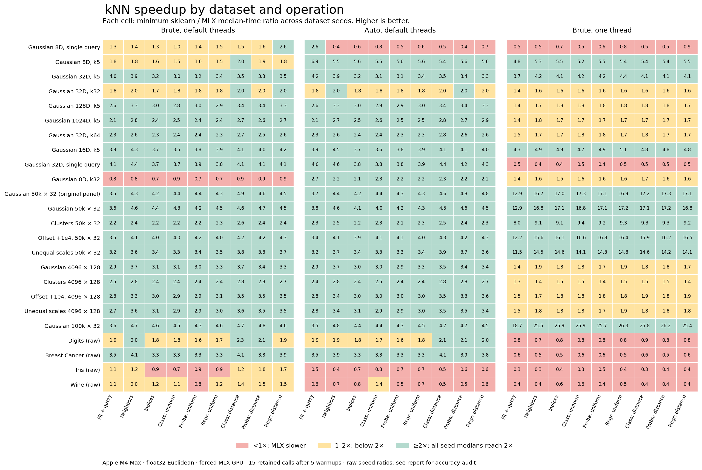

# Small-workload GPU optimization: full benchmark results

Completed `2026-10-30T18:00:06.727165+00:00`. This run covers **72 dataset instances in 24 families**, 9 search/inference operations, and **15 retained calls after 5 warmups** per dataset-operation-variant. Fit-only is recorded separately and excluded from the headline 2× counts. Production source and fixture identities are recorded in the raw results.

| sklearn baseline | Medians ≥2× | Individual paired calls ≥2× | All medians ≥2×? | Every pair ≥2×? |
| --- | --- | --- | --- | --- |
| Brute, default threads | 526/648 (81.2%) | 7,810/9,720 (80.3%) | False | False |
| Auto, default threads | 551/648 (85.0%) | 8,117/9,720 (83.5%) | False | False |
| Brute, one thread | 252/648 (38.9%) | 4,200/9,720 (43.2%) | False | False |

Against the fastest median among the three measured sklearn configurations in each dataset-operation cell, **240/648 (37.0%)** reach 2×. This is a best-of-measured-configurations comparison, not one fixed sklearn setting. The panel weights each dataset-operation cell equally; percentages do not estimate real-world workload frequencies. Raw timing counts retain every baseline accuracy failure.

**8/24 families** reach 2× in every seed-operation median against all three baselines; **7/24** also reach 2× in every retained paired call. A family passes only when all its constituent cases and operations pass, without averaging away misses.

## Timing and dataset scope

Hardware: Apple M4 Max, 128 GiB memory; platform `macOS-26.6.2-arm64-arm-64bit-Mach-O`. Python `3.13.3`, MLX `0.32.2`, NumPy `2.5.2`, sklearn `1.9.0`. Reported OpenMP thread counts: `{"sklearn_1": [1], "sklearn_auto": [16], "sklearn_default": [16]}`.

Persistent isolated public NumPy API workers. All GPU/CPU timed calls are serial. Cold first fit/query is separate; every operation gets the stated count of warmups per variant. Variant starting order rotates by dataset and operation, and each round reverses it. Each call is synchronized and audited outside timing. fit_query includes a fresh fit and all first-query preparation. No result caching. Inputs are the same float32 arrays for all variants, with no rescaling or jitter. Real data use raw features and stratified holdouts. Synthetic inputs and real-data split seeds are preserved per fixture.

The current path explicitly forces the MLX GPU backend and brute search. These results do not evaluate automatic mlxlearn CPU/GPU dispatch. The 'cold' sample is first fit/query for a fixture in a persistent worker, not process/compiler startup. Timed work includes public validation, NumPy boundaries and GPU synchronization; IPC and numerical audits are outside timing. Auto's actual fitted algorithm is recorded per call. Distinct auto/brute workers may differ from timing variation even when both select brute.

Speedup = sklearn median milliseconds / current median milliseconds. Below 1× means current is slower. Family ranges span seed-specific ratios, not ratios of independently selected timing endpoints. The paired-call count uses corresponding retained rounds. These are descriptive results, not confidence intervals.

Fixtures cover the previous eleven Gaussian shapes; Gaussian, clusters, +1e4 offsets and unequal scales at 50k × 32 and 4096 × 128; 100k × 32 Gaussian; and bundled raw Digits, Breast Cancer, Iris and Wine. All inputs are float32 Euclidean data with no rescaling or jitter. Real data use stratified holdouts. Class labels reused numerically for real-data regression provide timing fixtures, not regression-quality evidence. Large real datasets, sparse input, other metrics, float64 and other hardware are outside this run.

## All query workloads

Ranges span seeds. The final column counts all search/inference operation medians reaching 2×, in the order default brute / auto / single-thread brute.

| Family | Train × features; queries; k | Current query ms | vs default brute | vs auto | vs one thread | Medians ≥2× |
| --- | --- | --- | --- | --- | --- | --- |
| Gaussian 8D, single query | 8,192 × 8; 1; 5 | 0.513–0.521 | 1.42–1.65× | 0.41–0.41× | 0.48–0.49× | 7 / 3 / 0 (each /27) |
| Gaussian 8D, k5 | 8,192 × 8; 256; 5 | 0.714–0.778 | 1.83–2.21× | 5.48–6.33× | 5.31–5.73× | 15 / 27 / 27 (each /27) |
| Gaussian 32D, k5 | 8,192 × 32; 256; 5 | 1.003–1.040 | 3.88–5.01× | 3.88–4.74× | 4.18–4.36× | 27 / 27 / 27 (each /27) |
| Gaussian 32D, k32 | 8,192 × 32; 128; 32 | 1.852–1.913 | 1.99–2.40× | 2.01–2.54× | 1.56–1.63× | 15 / 14 / 0 (each /27) |
| Gaussian 128D, k5 | 4,096 × 128; 128; 5 | 0.862–0.977 | 3.32–3.78× | 3.35–3.71× | 1.73–1.96× | 27 / 27 / 1 (each /27) |
| Gaussian 1024D, k5 | 2,048 × 1024; 32; 5 | 1.198–1.284 | 2.80–3.03× | 2.71–2.95× | 1.75–1.90× | 27 / 27 / 1 (each /27) |
| Gaussian 32D, k64 | 4,096 × 32; 128; 64 | 1.487–1.510 | 2.60–2.72× | 2.60–2.76× | 1.70–1.75× | 27 / 27 / 0 (each /27) |
| Gaussian 16D, k5 | 8,192 × 16; 256; 5 | 0.781–0.847 | 4.27–4.67× | 4.49–4.65× | 4.86–5.27× | 27 / 27 / 27 (each /27) |
| Gaussian 32D, single query | 8,192 × 32; 1; 5 | 0.604–0.615 | 4.42–4.87× | 4.55–4.83× | 0.45–0.47× | 27 / 27 / 0 (each /27) |
| Gaussian 8D, k32 | 8,192 × 8; 128; 32 | 1.807–1.830 | 0.85–0.87× | 2.22–2.30× | 1.56–1.58× | 0 / 27 / 0 (each /27) |
| Gaussian 50k × 32 (original panel) | 50,000 × 32; 256; 5 | 1.460–1.494 | 4.33–4.67× | 4.37–4.65× | 16.69–17.05× | 27 / 27 / 27 (each /27) |
| Gaussian 50k × 32 | 50,000 × 32; 256; 5 | 1.352–1.482 | 4.60–5.22× | 4.59–5.10× | 16.81–18.45× | 27 / 27 / 27 (each /27) |
| Clusters 50k × 32 | 50,000 × 32; 256; 5 | 2.728–2.782 | 2.39–2.53× | 2.46–2.53× | 9.08–9.19× | 27 / 27 / 27 (each /27) |
| Offset +1e4, 50k × 32 | 50,000 × 32; 256; 5 | 1.449–1.628 | 4.15–4.57× | 4.08–4.83× | 15.62–17.40× | 27 / 27 / 27 (each /27) |
| Unequal scales 50k × 32 | 50,000 × 32; 256; 5 | 1.749–1.858 | 3.63–3.96× | 3.73–3.95× | 14.49–14.92× | 27 / 27 / 27 (each /27) |
| Gaussian 4096 × 128 | 4,096 × 128; 128; 5 | 0.874–0.931 | 3.72–4.45× | 3.73–4.32× | 1.87–1.95× | 27 / 27 / 3 (each /27) |
| Clusters 4096 × 128 | 4,096 × 128; 128; 5 | 1.176–1.197 | 2.84–2.90× | 2.83–2.84× | 1.42–1.50× | 27 / 27 / 0 (each /27) |
| Offset +1e4, 4096 × 128 | 4,096 × 128; 128; 5 | 0.967–1.044 | 3.27–3.61× | 3.43–3.54× | 1.73–1.81× | 27 / 27 / 3 (each /27) |
| Unequal scales 4096 × 128 | 4,096 × 128; 128; 5 | 0.891–0.967 | 3.59–3.89× | 3.44–3.81× | 1.79–1.97× | 27 / 27 / 1 (each /27) |
| Gaussian 100k × 32 | 100,000 × 32; 256; 5 | 2.086–2.133 | 4.74–5.03× | 4.77–4.84× | 25.49–26.20× | 27 / 27 / 27 (each /27) |
| Digits (raw) | 1,541 × 64; 256; 5 | 1.250–1.506 | 2.05–2.47× | 1.86–2.47× | 0.74–0.91× | 21 / 21 / 0 (each /27) |
| Breast Cancer (raw) | 455 × 30; 114; 5 | 0.538–0.548 | 4.14–4.41× | 3.89–4.12× | 0.51–0.56× | 27 / 27 / 0 (each /27) |
| Iris (raw) | 120 × 4; 30; 5 | 0.302–0.559 | 1.15–2.07× | 0.42–0.71× | 0.26–0.48× | 3 / 0 / 0 (each /27) |
| Wine (raw) | 142 × 13; 36; 5 | 0.268–0.341 | 1.99–2.45× | 0.66–0.84× | 0.44–0.56× | 6 / 0 / 0 (each /27) |

## Fresh fit + query

| Family | Current fresh ms | vs default brute | vs auto | vs one thread |
| --- | --- | --- | --- | --- |
| Gaussian 8D, single query | 0.619–0.643 | 1.31–1.64× | 2.57–2.79× | 0.55–0.56× |
| Gaussian 8D, k5 | 0.826–0.884 | 1.82–2.14× | 6.86–6.95× | 4.77–5.08× |
| Gaussian 32D, k5 | 1.088–1.216 | 3.99–4.62× | 4.24–4.53× | 3.71–4.09× |
| Gaussian 32D, k32 | 2.157–2.176 | 1.81–2.11× | 1.84–2.20× | 1.44–1.45× |
| Gaussian 128D, k5 | 1.145–1.302 | 2.59–2.99× | 2.60–3.02× | 1.41–1.62× |
| Gaussian 1024D, k5 | 1.782–1.903 | 2.08–2.22× | 2.06–2.25× | 1.36–1.47× |
| Gaussian 32D, k64 | 1.718–1.810 | 2.27–2.45× | 2.28–2.46× | 1.49–1.56× |
| Gaussian 16D, k5 | 0.944–0.980 | 3.86–3.88× | 3.86–3.91× | 4.34–4.46× |
| Gaussian 32D, single query | 0.515–0.736 | 4.09–5.67× | 4.00–5.63× | 0.52–0.78× |
| Gaussian 8D, k32 | 2.002–2.099 | 0.77–0.83× | 2.68–2.82× | 1.41–1.49× |
| Gaussian 50k × 32 (original panel) | 1.795–1.962 | 3.51–4.23× | 3.66–4.09× | 12.90–14.10× |
| Gaussian 50k × 32 | 1.933–1.952 | 3.64–3.92× | 3.77–3.82× | 12.94–13.07× |
| Clusters 50k × 32 | 2.969–3.162 | 2.22–2.59× | 2.26–2.46× | 8.05–8.52× |
| Offset +1e4, 50k × 32 | 2.020–2.160 | 3.46–3.51× | 3.41–3.63× | 12.20–12.77× |
| Unequal scales 50k × 32 | 2.236–2.306 | 3.21–3.26× | 3.21–3.29× | 11.45–12.15× |
| Gaussian 4096 × 128 | 1.216–1.306 | 2.91–3.23× | 2.92–3.38× | 1.45–1.55× |
| Clusters 4096 × 128 | 1.336–1.401 | 2.50–2.74× | 2.44–2.72× | 1.32–1.43× |
| Offset +1e4, 4096 × 128 | 1.189–1.296 | 2.82–2.98× | 2.78–3.02× | 1.48–1.63× |
| Unequal scales 4096 × 128 | 1.216–1.302 | 2.74–2.93× | 2.77–2.90× | 1.47–1.56× |
| Gaussian 100k × 32 | 2.849–2.920 | 3.56–3.63× | 3.52–3.67× | 18.67–19.37× |
| Digits (raw) | 1.417–1.620 | 1.94–2.28× | 1.93–2.25× | 0.77–0.90× |
| Breast Cancer (raw) | 0.630–0.672 | 3.54–3.73× | 3.47–3.74× | 0.57–0.59× |
| Iris (raw) | 0.474–0.631 | 1.07–1.64× | 0.51–0.80× | 0.33–0.52× |
| Wine (raw) | 0.589–0.616 | 1.15–1.35× | 0.55–0.59× | 0.37–0.39× |

## Every operation and paired call

Operation cells report median counts, then individual paired-call counts. Fit-only excludes first-query preparation and is not a substitute for fresh fit + query.

| Operation | Brute, default threads | Auto, default threads | Brute, one thread |
| --- | --- | --- | --- |
| `fit` (excluded from headline) | 0/72; 2/1,080 | 9/72; 135/1,080 | 0/72; 1/1,080 |
| `fit_query` | 56/72; 840/1,080 | 63/72; 930/1,080 | 27/72; 416/1,080 |
| `kneighbors` | 61/72; 906/1,080 | 62/72; 918/1,080 | 27/72; 464/1,080 |
| `indices` | 55/72; 818/1,080 | 60/72; 882/1,080 | 28/72; 452/1,080 |
| `predict_uniform` | 56/72; 820/1,080 | 60/72; 878/1,080 | 29/72; 477/1,080 |
| `proba_uniform` | 55/72; 827/1,080 | 59/72; 862/1,080 | 28/72; 483/1,080 |
| `regress_uniform` | 55/72; 828/1,080 | 60/72; 877/1,080 | 30/72; 482/1,080 |
| `predict_distance` | 65/72; 940/1,080 | 62/72; 925/1,080 | 28/72; 484/1,080 |
| `proba_distance` | 62/72; 919/1,080 | 63/72; 929/1,080 | 28/72; 476/1,080 |
| `regress_distance` | 61/72; 912/1,080 | 62/72; 916/1,080 | 27/72; 466/1,080 |

Family-level paired-call counts retain every individual threshold miss:

| Family | Brute, default threads | Auto, default threads | Brute, one thread |
| --- | --- | --- | --- |
| Gaussian 8D, single query | 151/405 | 45/405 | 0/405 |
| Gaussian 8D, k5 | 212/405 | 405/405 | 405/405 |
| Gaussian 32D, k5 | 405/405 | 405/405 | 405/405 |
| Gaussian 32D, k32 | 189/405 | 211/405 | 8/405 |
| Gaussian 128D, k5 | 405/405 | 404/405 | 84/405 |
| Gaussian 1024D, k5 | 384/405 | 383/405 | 72/405 |
| Gaussian 32D, k64 | 384/405 | 381/405 | 54/405 |
| Gaussian 16D, k5 | 405/405 | 405/405 | 405/405 |
| Gaussian 32D, single query | 405/405 | 405/405 | 0/405 |
| Gaussian 8D, k32 | 0/405 | 382/405 | 5/405 |
| Gaussian 50k × 32 (original panel) | 405/405 | 405/405 | 405/405 |
| Gaussian 50k × 32 | 405/405 | 405/405 | 405/405 |
| Clusters 50k × 32 | 398/405 | 394/405 | 405/405 |
| Offset +1e4, 50k × 32 | 405/405 | 405/405 | 405/405 |
| Unequal scales 50k × 32 | 405/405 | 405/405 | 405/405 |
| Gaussian 4096 × 128 | 403/405 | 403/405 | 111/405 |
| Clusters 4096 × 128 | 397/405 | 404/405 | 16/405 |
| Offset +1e4, 4096 × 128 | 402/405 | 400/405 | 107/405 |
| Unequal scales 4096 × 128 | 403/405 | 403/405 | 98/405 |
| Gaussian 100k × 32 | 405/405 | 405/405 | 405/405 |
| Digits (raw) | 271/405 | 256/405 | 0/405 |
| Breast Cancer (raw) | 405/405 | 405/405 | 0/405 |
| Iris (raw) | 60/405 | 1/405 | 0/405 |
| Wine (raw) | 106/405 | 0/405 | 0/405 |

## Accuracy and integrity

Exhaustive direct float64 differences on actual float32 coordinates; canonical distance/index order. Strict index and prediction mismatches remain failures. A separate query audit recognizes exact-distance-valid alternative tie choices; it never changes strict pass. Prediction mismatches on tied fixtures are marked ambiguous, not automatically accepted. Distance atol/rtol1e-6; existing prediction tolerance retained.

| Variant | Strict audit passes | Failure-kind counts | Maximum absolute errors |
| --- | --- | --- | --- |
| current | 14,472/14,472 | {} | {"distance_max_abs": 2.295977981248143e-05, "distance_max_abs_from_returned_points": 2.295977981248143e-05, "max_abs": 3.902618989082285e-08} |
| sklearn_default | 13,114/14,472 | {"canonical_prediction_mismatch": 160, "reported_distance_error": 793, "valid_exact_tie_alternative": 405} | {"distance_max_abs": 0.007307924795895815, "distance_max_abs_from_returned_points": 0.007307924795895815, "max_abs": 0.0033060949847009136} |
| sklearn_1 | 13,034/14,472 | {"canonical_prediction_mismatch": 160, "canonical_prediction_mismatch_on_boundary_ties": 80, "reported_distance_error": 793, "valid_exact_tie_alternative": 405} | {"distance_max_abs": 0.007307924795895815, "distance_max_abs_from_returned_points": 0.007307924795895815, "max_abs": 0.5999999999999996} |
| sklearn_auto | 13,114/14,472 | {"canonical_prediction_mismatch": 160, "reported_distance_error": 793, "valid_exact_tie_alternative": 405} | {"distance_max_abs": 0.007307924795895815, "distance_max_abs_from_returned_points": 0.007307924795895815, "max_abs": 0.0033060949847009136} |

Audit counts include cold, warmup and retained calls, and fit-only's untimed query audit. They count repeated audit requests rather than distinct datasets. Exact-distance-valid alternative ties are valid sklearn neighbor outputs; their canonical-index differences are kept separate from incorrect membership, ordering and distance-tolerance failures. Prediction differences on boundary ties are flagged as ambiguous and not automatically validated. The summary contains per-phase counts and all failing case/operation evidence pointers. Accuracy qualifications never remove timings from speed denominators.

Integrity checks: `{"fixture_integrity_pass": true, "harness_integrity_pass": true, "initial_worker_source_integrity_pass": true, "source_integrity_pass": true, "worker_source_integrity_pass": true}`. Current accuracy plus integrity acceptance: **True**.

## Artifacts

[Raw measurements and every audit](../benchmarks/evidence/knn-evidence-2026-10-31.md#artifact-06668b55761f291264b0)

[Validated derived summary](../benchmarks/evidence/knn-evidence-2026-10-31.md#artifact-78621ee72619d7369c59)

[Vector figure](assets/knn-small-final-2026-10-30.svg)

Production manifest: `benchmarks/reference/knn-small-final-2026-10-30.manifest.json`. Snapshot: `{"path": "benchmarks/reference/knn-small-final-2026-10-30.zip", "sha256": "7583c2d37412294d9e1c94c8bf405c91bb76affece769b3d83879540e5e44759"}`. The raw report records source, loaded-worker, harness and fixture hashes before and after timing.

Generated from recorded measurements. No source optimization or performance claim is inferred from a separate historical run.
