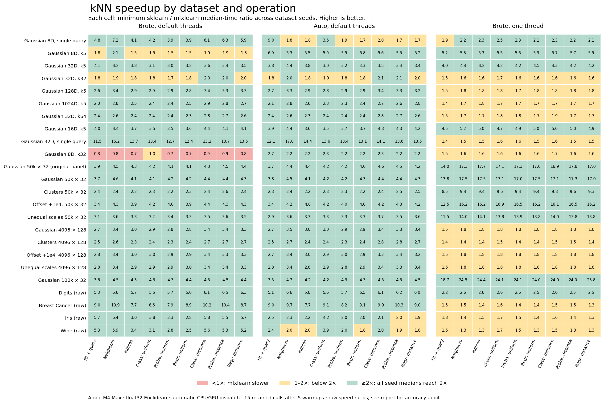

# KNN startup, first-query and GPU-control revision — October 30, 2026

This revision combines the native CPU improvements in the
[intermediate follow-up](knn-followup-fix-2026-10-30.md) with a startup-focused
estimator adapter. The user explicitly authorized dropping genuine inheritance
from stock sklearn neighbor classes. Direct estimators retain the sklearn
estimator interface but are no longer instances of those stock classes.

## Results

Total startup through the first returned result is now faster on all 18 target
fixtures than every sklearn configuration: approximately **15–18% lower process
latency**. In initialized processes, repeated fresh-model first queries and
combined fit-plus-first-query also win on all 18 fixtures against all three
sklearn configurations and the preceding automatic build. The full broad panel
passes **14,472/14,472 current numerical audits**. All six final timed panels
pass their accuracy and integrity gates.

The broad results cover 648 search/inference or fresh-fit case/operation medians:

| sklearn configuration | Current faster | At least 2× faster | Minimum speedup |
| --- | ---: | ---: | ---: |
| Default-thread brute force | 626/648 | 583/648 | 0.703× |
| Single-thread brute force | 648/648 | 302/648 | 1.270× |
| Default-thread automatic algorithm | 648/648 | 600/648 | 1.676× |

All **162 small/single-query cells** win against every comparator, with minimum
speedups of 2.508×, 1.270× and 1.676× respectively. All **108 clustered/offset
cells** also win, with minima 2.151×, 1.367× and 2.237×. The 22 slower cells versus
default-thread brute force all belong to the eight-feature batch workload with
`k=32`; its worst cell is 0.703×. This remains neither a universal speed win nor
a universal 2× improvement.

The [full broad tables](knn-startup-benchmarks-2026-10-30.md) include every
operation, separate fit-only costs, all seeds, paired observations and misses.
The figure shows the minimum median-time ratio across seeds, not an average.
Labels are rounded; colors use unrounded ratios.

### Startup and first query

The [450-launch fresh-process panel](knn-startup-cold-context-2026-10-30.md)
includes interpreter startup, input loading, estimator imports, fit and first
query. Its minimum–maximum speedups across the 18 fixture medians are:

| Comparator | Process start through first result | Fixtures faster |
| --- | ---: | ---: |
| Default-thread brute | 1.175–1.210× | 18/18 |
| Single-thread brute | 1.185–1.221× | 18/18 |
| sklearn auto | 1.176–1.212× | 18/18 |
| Preceding automatic build | 1.181–1.213× | 18/18 |

Current process-to-result medians are 676–701 ms versus 804–838 ms for preceding
automatic. Matched fixture medians save **124–146 ms**, or 15.4–17.6% elapsed
time. Estimator import/setup alone saves 125–144 ms. These are matched fixture
differences, not differences between unrelated range endpoints.

Measured import telemetry confirms `sklearn.neighbors` was absent before fit in
all 90 current-process launches. Its removal is therefore observed in the
measured API path. Native module initialization remains charged to ordinary
setup; it is not hidden by a prewarm.

The [fresh-model panel](knn-startup-first-query-2026-10-30.md) retains 30 new
models per fixture and implementation, including every first model. All 18
fixture medians win for both first query and fit-plus-first-query:

| Comparator | First-query speedup | Fit-plus-first-query speedup |
| --- | ---: | ---: |
| Default-thread brute | 5.908–39.760× | 5.397–19.758× |
| Single-thread brute | 1.327–3.227× | 1.510–2.288× |
| sklearn auto | 2.570–22.905× | 3.050–13.313× |
| Preceding automatic build | 1.019–1.234× | 1.152–1.574× |

The two protocols must not be conflated. In fresh processes, first-query-only
medians beat the preceding automatic build on 14/18 fixtures, and combined
fit/query wins on 17/18; all 18 total-startup medians still win. These retained
subphase misses prevent a claim that every individual first use improved.
The largest cold-query loss versus preceding automatic is 4.57%, or 26.8 µs;
the single cold fit/query loss is 3.15%, or 11.46 µs. All observations remain in
their respective panels.

### Isolated controls and remaining differences

The [full balanced control](knn-startup-control-2026-10-30.md) covers 222 cells.
All 162 targeted paired medians, including all 27 Digits cells, beat both the
same-source forced-GPU worker and the historical GPU build. Digits' minimum
paired speedups are 1.038× and 1.058× respectively. Across the 60 preservation
cells, the median paired speedup is 1.023× versus preceding automatic and
1.018× versus historical GPU. None is more than 5% slower than either historical
baseline in both current replicas under both ratio statistics.

Two such greater-than-5% flags remain in the balanced run: Digits seed 151,
distance-weighted regression versus preceding automatic; and 128-feature
Gaussian seed 552, query versus same-source forced GPU. Both flags and every
smaller miss remain in the record.

The [original-order nine-fixture repeat](knn-startup-legacy-control-2026-10-30.md)
does not reproduce a greater-than-5% slowdown in both replicas under both
statistics. All 27 Digits cells beat preceding automatic and same-source GPU;
26/27 beat historical GPU. Digits seed 252 distance-weighted regression is
0.979× by median paired ratio (**2.1% slower**) and 0.964× by ratio of medians
(**3.7% slower**): current 0.42025 ms versus historical GPU 0.40521 ms. The second
current replica measures 0.41171 ms, about 1.6% slower. These observations are
not removed from the result.

The additional [Gaussian/cluster repeat](knn-startup-preservation-repeat-2026-10-30.md)
also has no greater-than-5% flag confirmed by both replicas and both statistics.
Individual medians still vary: its primary paired ratios versus preceding
automatic span 0.936–1.187×. These controls support preservation of the broad
gains, but do not establish zero overhead on every isolated call. Different
orders and warmup durations are reported separately; the better result is not
substituted for a slower observation.

## Implementation

The [shared estimator adapter](../src/mlxlearn/neighbors/_base.py) now uses
public `BaseEstimator`, `ClassifierMixin` and `RegressorMixin` machinery with
explicit constructors matching the stock neighbor signatures. Normal direct
owned fit/query does not import `sklearn.neighbors`. This avoids loading an
unused implementation dependency; it does not move its work into a later owned
query. NumPy, sklearn's public base/validation helpers, SciPy and the native CPU
search dependency remain part of measured setup. No background loader or
workload prewarm is introduced.

Parameter validation has a narrow fast path: every whitelisted form satisfies
the stock constraints for the supported sklearn versions. It accepts a subset
of valid values rather than weakening the constraints. The fast path also
requires the instance and its class hierarchy to select the exact original
constraint descriptor. Custom instance or subclass constraints always use the
full validator, including overrides installed after construction; this decision
is checked on each call rather than cached. All other values use
`BaseEstimator`'s validator with the original sklearn neighbor constraints,
resolved lazily through a descriptor. Unusual valid options therefore still
reach capability handling, while invalid values retain stock error types and
messages. Array finiteness, shape, feature-name and target validation remain
separate and unchanged.

The [patched twins](../src/mlxlearn/patching/_estimators.py) use multiple
inheritance from the owned estimator and its captured original stock class.
Original classes are retained before public names are rebound, preventing a
fallback from recursively calling another patched estimator. The direct classes
retain cloning, parameter access, metadata routing and public mixin scoring.
Their graph methods use owned neighbor results; optional radius operations
delegate using the same validated float32 compatibility state as before.
Passing a direct model to sklearn's standalone graph helper is outside the new
identity contract; patched models remain accepted, as detailed below.

Permitted capability fallback fits an original stock delegate and mirrors its
fitted state. Parameter updates are synchronized at inference while the fitted
backend remains fixed. Saved models omit the duplicate delegate and GPU caches;
fallback reconstruction uses mirrored state without refitting. This also reads
older saved models that never contained a delegate. Ordinary owned pickle
round-trips do not import stock neighbor classes.

The native runtime is unchanged from the intermediate follow-up. Its
[integer-selection and concentrated-cutoff proof](knn-followup-fix-2026-10-30.md#implementation-and-precision)
still applies: all input/buffer checks, exact dyadic comparisons, training-index
tie order, conservative rejection bounds and portable fallbacks remain intact.
The preceding GPU kernels and original-coordinate precision contract are
unchanged by this adapter.

## Correctness and packaging validation

The relevant suite passes **1,408 tests on each of sklearn 1.7.2, 1.8.0 and
1.9.0**. Five unrelated LogisticRegression/SVC cases are deselected per run:
[1.7.2 log](../benchmarks/results/knn-startup-final2-sk172-tests-2026-10-30.log),
[1.8.0 log](../benchmarks/results/knn-startup-final2-sk180-tests-2026-10-30.log),
and [1.9.0 log](../benchmarks/results/knn-startup-final2-sk190-tests-2026-10-30.log).
The [65 harness checks](../benchmarks/results/knn-startup-harness-tests-final-2026-10-30.log)
also pass. That is **1,473 distinct checks** in the current environment; the
older sklearn runs are compatibility reruns, not additional unique tests.

The [standalone compatibility tests](../tests/unit/test_neighbors_standalone.py)
cover constructor signatures and defaults, parameter errors, tags, cloning,
pipelines, grid search, metadata routing, scoring, neighbor/radius graphs,
self queries, named subclasses, dynamic class/instance constraint overrides,
patch/unpatch, pickle and joblib serialization.
Fresh interpreters assert that all three direct owned paths, including inference
and pickle round-trips, leave `sklearn.neighbors` unimported. Legacy models are
created from the immutable preceding source and restored under the new adapter.
Patched captured-class identity and public sklearn graph helpers are tested
separately from the authorized direct-class identity change.

The existing numerical suites retain exact ordering and boundary ties,
float32 extremes/subnormals, distance weighting, ownership, tiling, concurrent
cache publication and portable execution coverage. Older sklearn releases have
an upstream string-label/float32 Manhattan prediction failure; dedicated tests
require the same stock output or the same exception rather than masking that
fallback limitation.

Ruff and source whitespace checks pass. The
[package validation](../benchmarks/results/knn-startup-final2-package-validation-2026-10-30.json)
matches wheel and source-distribution files to the frozen source and verifies
the packaged native binary. Native binaries still require a matching Python ABI
and architecture; the certified portable path remains available when the
optional extension is absent.

## Measurement protocol

The final comparison uses the same three sklearn configurations as the preceding
panels: default-thread brute force, single-thread brute force, and default-thread
`algorithm="auto"`. A win means comparator/current greater than one; a 2× result
requires a ratio of at least two. Fit-only, fresh fit plus query, first query,
warmed query and process startup are distinct measurements.

The full broad panel covers 72 fixture instances and nine search/inference or
fresh-fit operations, plus separate fit-only timing, with 15 retained repetitions
and five warmups. Its headline denominator is 648 case/operation medians; fit-only
adds 72 separately reported medians. Numerical audits retain the exact
original-coordinate distance and training-index tie contract. Accuracy failures
never remove observations or shrink speed denominators.

The preservation control uses 48 fixtures and 222 case/operation cells, five
isolated workers, 31 paired samples and 0.25-second warmups. A Williams order
balances worker positions and within-round predecessors over the first 30
samples; the 31st sample is retained. The original alternating/reverse order
also runs on all three seeds of Digits, Breast Cancer, 128-feature offset and
128-feature clustered data, plus all six 128-feature Gaussian seeds. This is
18 fixtures and 78 cells with 31 pairs and one-second warmups. The preservation
extension was [declared before this revision's preservation results](../benchmarks/results/knn-startup-final2-legacy-predeclaration-2026-10-30.json),
following isolated flags in the intermediate CPU revision's balanced control.
These are two separate nine-fixture runs, preserving the original
Digits/Breast Cancer/offset repeat's case selection and order; the supplementary
Gaussian/cluster run adds evidence without replacing it.
Both current replicas and both ratio-of-medians and median-paired-ratio
statistics remain visible. These descriptive ratios are not confidence intervals.

The fresh-model panel uses 18 fixtures, five workers and 30 rounds. Each request
constructs and fits a new estimator, then times its first and second queries
separately. All 2,700 models and 5,400 queries are retained, including each
worker's first model. Estimator imports are measured separately; previous
models can initialize process runtime caches.

The fresh-process panel launches 450 interpreters: 18 fixtures, five variants
and five retained repetitions. Each performs exactly one first fit/query with
no prewarm or harness native/GPU import before the result. Required imports,
input loading and setup remain included in process-to-result time. Numerical
audits and provenance capture follow the first-result marker. This is fresh
process latency, not a claim of cold operating-system or filesystem caches.

All timed panels run serially after correctness checks and source/runtime/harness
freezes. Baselines are the preceding automatic implementation
(`knn-latency-final-2026-10-30`) with its exact native binary and the historical
GPU implementation (`knn-small-final-2026-10-30`). The earlier frozen
`knn-followup-final` artifacts record an intermediate CPU-only revision; its
cold panel was interrupted when startup architecture was authorized and is not
counted as a completed result.
The first standalone snapshot's startup panel was also interrupted to add the
custom-constraint guard. Both partial runs are retained and excluded from the
completed-panel totals. Only `knn-startup-final2-2026-10-30` supplies the results
above.

## Compatibility change

For a direct `mlxlearn.neighbors.NearestNeighbors` instance,
`isinstance(model, StockNearestNeighbors)` is now false when
`StockNearestNeighbors` is the original sklearn class. Use sklearn's public
estimator interfaces and `is_classifier`/`is_regressor` for generic estimator
handling. The startup benefit applies to direct owned search. Patching already
loads stock estimator classes, and radius operations or permitted fallback still
need the stock implementation.

Sklearn's standalone graph helper functions also use concrete neighbor-mixin
identity checks. A direct estimator can call its own `kneighbors_graph` and
`radius_neighbors_graph` methods, but cannot be passed as the data argument to
those sklearn helper functions. This is a consequence of the authorized
identity change, not a numerical difference in the graph methods.

Patched KNN variants retain actual stock inheritance. Patching already loads
those classes, so it can preserve captured-class checks and the sklearn graph
helper inputs without imposing that import on direct users. Fallback delegates
are omitted from saved models; mirrored fitted state reconstructs them lazily,
including state produced by the preceding implementation. This also permits
pickling while the public sklearn names remain patched.

The rejected package-export and early-native-import experiments remain in the
[startup investigation](knn-startup-investigation-2026-10-30.md). Their 108 fresh
launches did not establish a reliable improvement and their changes were
reverted. The standalone architecture is a separate, explicitly authorized
change measured by the completed panels above.

## Reproduction and audit

The [execution record](../benchmarks/results/knn-startup-final2-2026-10-30-execution.json)
records exact timing commands, test commands, environment and artifact hashes.
The [independent full audit](../benchmarks/results/knn-startup-final2-2026-10-30-independent-audit.json)
checks the broad, balanced-control, fresh-process and fresh-model evidence.
Separate audit records accompany the two additional control reports.

Frozen artifacts are the [63-file source archive](../benchmarks/reference/knn-startup-final2-2026-10-30.zip),
[native runtime](../benchmarks/reference/knn-startup-final2-2026-10-30-runtime.zip),
and [146-file harness/test archive](../benchmarks/reference/knn-startup-final2-2026-10-30-harnesses.zip),
each with a matching manifest. The source SHA-256 is
`56418ec9e026afaff5c586a1de5202270453125421c6ccc05751838ae1f6bc1d`;
the measured native binary is
`69b80a68bc3fe5a0937b99ab2d030a37b33b5fdfd6b38d632e8c6611555ff2c3`.
The 21 GPU-device source files and the GPU distance wrapper match the preceding
automatic build. All timings are specific to the measured Apple M4 Max and
installed runtime; the portable CPU fallback is correctness-tested separately.
